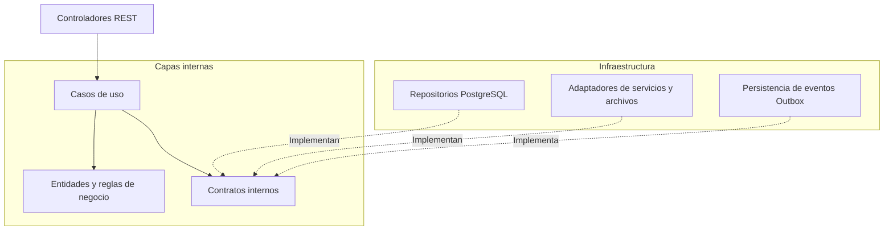

# Sistema Integral de Gestión del Proceso de Admisión – UNSCH

> **Curso:** Arquitectura de Software  
> **Entregable:** Entregable 01 – Propuesta Inicial del Proyecto  
> **Sprint:** 1  
> **Universidad:** Universidad Nacional de San Cristóbal de Huamanga  
> **Estado:** Propuesta y diseño arquitectónico inicial  
> **Año:** 2026

## 1. Información general

| Campo | Descripción |
|---|---|
| Proyecto | Sistema Integral de Gestión del Proceso de Admisión – UNSCH |
| Integrante | Diego Alejandro Coras Bendaño |
| Curso | Arquitectura de Software |
| Tipo de solución | Aplicación web responsiva |
| Arquitectura | Monolito Modular por Capas |
| Enfoque interno | Clean Architecture |
| Organización funcional | 12 módulos |
| Documentación arquitectónica | Modelo C4 |
| Alcance de la entrega | Análisis y diseño inicial |

## 2. Descripción del proyecto

El proyecto propone una solución web para centralizar la gestión del proceso de admisión de la UNSCH.

Permitirá registrar postulantes, validar su identidad, gestionar inscripciones Ordinaria y Exonerados, procesar pagos, evaluar expedientes, programar exámenes, asignar aulas y publicar resultados autorizados.

También incorporará un chatbot mediante OpenRouter API para brindar orientación y seguimiento autorizado, además de notificaciones por correo electrónico y avisos en el portal.

## 3. Caso de estudio

El caso de estudio corresponde al proceso de admisión de la Universidad Nacional de San Cristóbal de Huamanga.

**Portal de referencia:** [Admisión UNSCH](https://admision.unsch.edu.pe/)

La propuesta comprenderá:

- Registro y validación de identidad.
- Inscripciones Ordinaria y Exonerados.
- Selección de programas y consulta de vacantes.
- Pagos con tarjeta y Yape.
- Presentación y evaluación documental.
- Programación de exámenes y asignación de aulas.
- Consulta y publicación de resultados.
- Reportes, notificaciones y atención mediante chatbot.

**Naturaleza del proyecto:** propuesta académica de análisis y diseño arquitectónico basada en el proceso de admisión de la UNSCH.

## 4. Objetivo general

Diseñar una arquitectura de software para gestionar integralmente el proceso de admisión de la UNSCH mediante un Monolito Modular por Capas con Clean Architecture, que permita organizar sus funcionalidades de manera segura, mantenible y escalable.

## 5. Objetivos específicos

1. Identificar actores, historias de usuario y requisitos funcionales.
2. Definir nueve atributos de calidad y sus escenarios.
3. Identificar restricciones y drivers arquitectónicos.
4. Organizar la solución en 12 módulos funcionales.
5. Establecer las capas, responsabilidades y contratos internos.
6. Seleccionar las tecnologías e integraciones necesarias.
7. Representar la arquitectura mediante el modelo C4.
8. Definir patrones de diseño y principios SOLID.
9. Documentar las decisiones arquitectónicas que orientarán la implementación.

## 6. Alcance del Sprint 1

| Área | Actividades | Resultado esperado |
|---|---|---|
| Análisis | Identificar actores, historias de usuario, requisitos y restricciones. | Alcance funcional documentado. |
| Calidad | Priorizar atributos y definir escenarios verificables. | Objetivos de calidad establecidos. |
| Arquitectura inicial | Definir estilo, capas, módulos e integraciones. | Propuesta arquitectónica coherente. |
| Diseño interno | Proponer contratos, patrones y aplicación de SOLID. | Criterios para organizar el código. |
| Modelado C4 | Elaborar contexto, contenedores, componentes y ejemplos de código. | Vistas arquitectónicas relacionadas. |
| Decisiones | Justificar las elecciones técnicas. | Registro inicial de decisiones arquitectónicas. |

Los diagramas y contratos representan el diseño propuesto. Su implementación y validación se realizarán progresivamente en los siguientes sprints.

## 7. Actores del sistema

| Actor | Responsabilidad principal |
|---|---|
| Postulante | Inscribirse, pagar, presentar documentos y consultar su proceso. |
| Personal de Admisión | Gestionar convocatorias, postulantes e inscripciones. |
| Administrador | Administrar usuarios, permisos y configuración. |
| Evaluador Documental | Revisar expedientes y registrar observaciones o aprobaciones. |
| Responsable de Tesorería | Verificar y conciliar pagos. |
| Coordinador de Exámenes | Programar evaluaciones y asignar ambientes. |
| Responsable de Resultados | Gestionar calificaciones y publicar resultados autorizados. |
| Personal de Soporte | Atender consultas e incidencias. |

## 8. Arquitectura propuesta

La solución utilizará un **Monolito Modular por Capas**, con 12 módulos integrados en una misma aplicación backend.

Clean Architecture orientará las dependencias hacia las capas internas, manteniendo las reglas de negocio separadas de PostgreSQL, AWS y los proveedores externos.

### 8.1. Responsabilidades por capa

| Capa | Responsabilidad |
|---|---|
| Interfaces | Recibir solicitudes, validar entradas y devolver respuestas REST. |
| Aplicación | Coordinar casos de uso y operaciones transaccionales. |
| Dominio | Definir entidades, reglas de negocio y contratos propios del dominio. |
| Infraestructura | Implementar persistencia, archivos, mensajería e integraciones. |

Cada módulo comprenderá estas responsabilidades según sus necesidades. Los módulos se comunicarán mediante interfaces públicas y eventos.

### 8.2. Diagrama de dependencias

Las flechas continuas representan dependencias de uso y las discontinuas representan implementación de contratos.

### 8.3. Distribución tecnológica

Angular proporcionará la interfaz web y sus archivos estáticos se distribuirán mediante S3 y CloudFront.

Las solicitudes REST llegarán a API Gateway, que invocará el backend en AWS Lambda. La información se almacenará en PostgreSQL y los documentos en S3 privado.

El procesamiento asíncrono utilizará Outbox y SQS. Un procesador con un punto de entrada propio reutilizará el código modular para despachar eventos y ejecutar tareas, sin dividir los módulos en microservicios.

## 9. Módulos funcionales

La solución contempla **12 módulos funcionales**.

| Código | Módulo | Responsabilidad |
|---|---|---|
| M01 | Gestión de Convocatorias | Administrar convocatorias, cronogramas y condiciones del proceso. |
| M02 | Usuarios y Validación de Identidad | Gestionar datos de postulantes y usuarios y coordinar la consulta de identidad. |
| M03 | Inscripciones | Gestionar Ordinaria y Exonerados, sus requisitos, estados y fichas. |
| M04 | Gestión de Pagos | Administrar órdenes, confirmaciones y conciliaciones de pagos con tarjeta y Yape. |
| M05 | Gestión de Expedientes | Administrar documentos, evaluaciones, observaciones y subsanaciones. |
| M06 | Exámenes, Sedes y Aulas | Programar evaluaciones y asignar ambientes respetando horarios y capacidades. |
| M07 | Gestión de Resultados | Procesar calificaciones y gestionar resultados validados y autorizados. |
| M08 | Chatbot con Inteligencia Artificial | Brindar orientación, seguimiento autorizado y derivación a soporte. |
| M09 | Gestión de Notificaciones | Gestionar avisos en el portal y correos mediante Amazon SES. |
| M10 | Reportes y Estadísticas | Generar informes e indicadores del proceso. |
| M11 | Seguridad y Roles | Gestionar autenticación, autorización, permisos y consulta de auditoría. |
| M12 | Configuración e Integraciones | Administrar modalidades, programas, vacantes, parámetros e integraciones. |

## 10. Tecnologías seleccionadas

| Componente | Tecnología y función |
|---|---|
| Frontend | Angular para el portal responsivo y el panel administrativo. |
| Backend | Node.js, TypeScript y Express. |
| API | Endpoints REST mediante HTTPS. |
| Ejecución | AWS Lambda para la API y el procesamiento asíncrono. |
| Acceso a la API | Amazon API Gateway. |
| Base de datos | Amazon RDS PostgreSQL. |
| Frontend estático | Amazon S3 y CloudFront. |
| Caché pública | Caché HTTP mediante CloudFront. |
| Documentos | Amazon S3 privado con acceso autorizado. |
| Eventos transaccionales | Outbox dentro de PostgreSQL. |
| Mensajería | Amazon SQS. |
| Correo electrónico | Amazon SES. |
| Chatbot | OpenRouter API. |
| Control de versiones | Git y GitHub. |

Los parámetros de concurrencia, permisos, respaldos y activación de tareas se detallarán en el diseño de despliegue.

## 11. Integraciones externas

| Servicio | Función |
|---|---|
| Consulta de identidad vía apiperu | Verificar datos vinculados a RENIEC, conforme a las condiciones de acceso aplicables. |
| Izipay micuentaweb | Procesar pagos con tarjeta y verificar su estado. |
| Culqi | Procesar pagos con Yape y consultar su resultado. |
| OpenRouter API | Obtener respuestas para el chatbot. |
| Amazon SES | Enviar confirmaciones y notificaciones por correo electrónico. |

Las credenciales permanecerán en el backend. Los adaptadores normalizarán las respuestas y gestionarán errores de los proveedores.

## 12. Patrones y mecanismos de diseño

| Patrón o mecanismo | Aplicación |
|---|---|
| Adaptador | Aislar las integraciones de identidad, pagos, IA, correo y archivos. |
| Repositorio | Separar los casos de uso de la persistencia concreta. |
| Fábrica simple | Seleccionar y construir adaptadores según la configuración. |
| Inyección de dependencias | Proporcionar implementaciones mediante contratos internos. |
| Fachada | Exponer operaciones públicas de cada módulo. |
| Observer y publicación de eventos | Permitir que los consumidores reaccionen a cambios de negocio. |
| Transactional Outbox | Guardar eventos junto con la operación que los produce. |

El despacho de eventos se apoyará en SQS y consumidores idempotentes. Un fallo de notificación no revertirá una inscripción o un pago confirmado.

### Principios SOLID

| Principio | Aplicación propuesta |
|---|---|
| Responsabilidad Única | Mantener responsabilidades coherentes en controladores, casos de uso, entidades y adaptadores. |
| Abierto/Cerrado | Facilitar extensiones mediante contratos y adaptadores. |
| Sustitución de Liskov | Mantener el comportamiento esperado al sustituir implementaciones compatibles. |
| Segregación de Interfaces | Definir contratos según las necesidades del consumidor. |
| Inversión de Dependencias | Hacer que los casos de uso dependan de abstracciones. |

## 13. Atributos de calidad prioritarios

Se trabajará con **nueve atributos de calidad**.

| ID | Atributo | Objetivo principal |
|---|---|---|
| AC01 | Rendimiento | Lograr que al menos el 95 % de las solicitudes habituales responda en un máximo de 3 segundos bajo carga normal, excluyendo demoras externas. |
| AC02 | Disponibilidad | Alcanzar una disponibilidad objetivo del 99.9 % durante los periodos críticos. |
| AC03 | Escalabilidad | Ampliar la capacidad de atención manteniendo los objetivos de rendimiento y controlando las conexiones a PostgreSQL. |
| AC04 | Seguridad | Proteger datos y operaciones mediante autenticación, autorización, HTTPS y protección de credenciales. |
| AC05 | Mantenibilidad | Modificar funcionalidades respetando los límites de los módulos y las dependencias internas. |
| AC06 | Integridad | Evitar registros duplicados e inconsistencias mediante restricciones, transacciones e idempotencia. |
| AC07 | Usabilidad | Permitir que al menos el 90 % de los participantes de una prueba complete las tareas principales sin asistencia. |
| AC08 | Interoperabilidad | Intercambiar información con proveedores y gestionar resultados o errores controlados. |
| AC09 | Confiabilidad | Conservar operaciones confirmadas y admitir reintentos sin duplicar transacciones. |

Estos objetivos se validarán mediante pruebas de carga, integración, seguridad, usabilidad y escenarios de falla.

## 14. Reglas principales del diseño

1. La identidad se validará antes de habilitar el pago.
2. La inscripción comprenderá Ordinaria y Exonerados con sus reglas particulares.
3. La cuenta del postulante será opcional; las consultas personales requerirán verificación de acceso.
4. Los importes y las confirmaciones de pago se comprobarán en el backend.
5. Los pagos con resultado incierto permanecerán pendientes de verificación.
6. La habilitación exigirá cumplir los requisitos de pago y documentación correspondientes.
7. Los resultados se publicarán después de su validación y autorización.
8. Los módulos accederán a otros mediante interfaces públicas o eventos.
9. Las respuestas con información personal no se almacenarán en cachés públicas.
10. El chatbot consultará únicamente información autorizada y enviará datos mínimos al proveedor.

## 15. Documentación arquitectónica

| Documento | Contenido |
|---|---|
| Actores e historias de usuario | Personas, responsabilidades y necesidades. |
| Requisitos funcionales | Comportamientos esperados del sistema. |
| Atributos y escenarios de calidad | Nueve atributos y criterios de validación. |
| Restricciones y drivers | Condiciones que orientan el diseño. |
| Decisiones arquitectónicas | Elecciones técnicas y justificaciones. |
| Arquitectura inicial | Estilo, capas, tecnologías e integraciones. |
| Diseño interno | Responsabilidades y contratos de los 12 módulos. |
| Patrones y SOLID | Criterios de organización y dependencias. |
| C4 nivel 1 | Usuarios y sistemas externos. |
| C4 nivel 2 | Aplicaciones, almacenes de datos y comunicaciones. |
| C4 nivel 3 | Componentes funcionales del backend. |
| C4 nivel 4 | Clases e interfaces propuestas para Inscripciones y Pagos. |

## 16. Resultados esperados del Sprint 1

1. Alcance y actores identificados.
2. Historias de usuario y requisitos documentados.
3. Nueve atributos de calidad priorizados.
4. Doce módulos con responsabilidades definidas.
5. Arquitectura inicial y decisiones justificadas.
6. Diagramas C4 coherentes entre sí.
7. Contratos, patrones y principios de diseño establecidos.
8. Base técnica para orientar los siguientes sprints.

## 17. Autor

**Diego Alejandro Coras Bendaño**  
Universidad Nacional de San Cristóbal de Huamanga  
Curso: Arquitectura de Software  
Entregable 01 – Propuesta Inicial del Proyecto  
Año: 2026