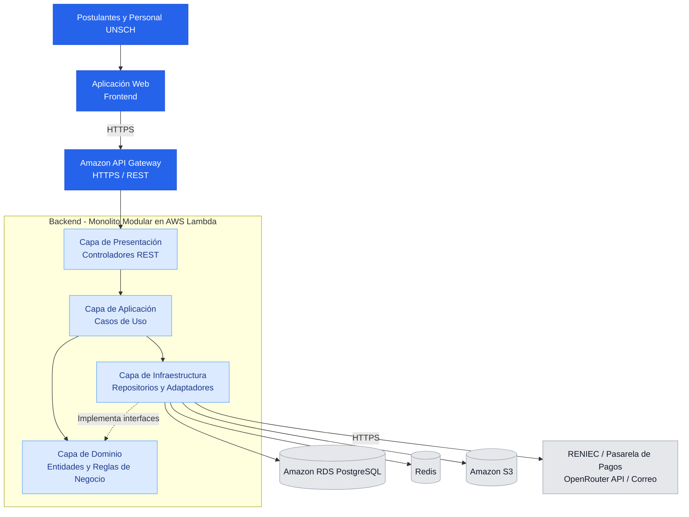

# Sistema Integral de Gestión del Proceso de Admisión – UNSCH

> **Curso:** Arquitectura de Software  
> **Entregable:** ENTREGABLE-01 – PROPUESTA INICIAL DEL PROYECTO  
> **Universidad:** Universidad Nacional de San Cristóbal de Huamanga (UNSCH)  
> **Versión:** 1.0  
> **Estado:** Propuesta y diseño arquitectónico

---

## 1. Información General

| Campo | Descripción |
|---|---|
| **Proyecto** | Sistema Integral de Gestión del Proceso de Admisión – UNSCH |
| **Integrante** | Diego Alejandro Coras Bendaño |
| **Universidad** | Universidad Nacional de San Cristóbal de Huamanga |
| **Curso** | Arquitectura de Software |
| **Entregable** | Entregable 01 – Propuesta Inicial del Proyecto |
| **Caso de estudio** | Gestión del proceso de admisión universitaria |
| **Tipo de solución** | Aplicación web |
| **Arquitectura propuesta** | Monolito Modular por Capas |
| **Enfoque interno** | Clean Architecture |
| **Modelo de documentación** | C4 Model |
| **Estado del proyecto** | En fase de análisis y diseño |

---

## 2. Descripción del Proyecto

El proyecto **Sistema Integral de Gestión del Proceso de Admisión – UNSCH** propone el diseño de una solución de software orientada a optimizar y centralizar las actividades relacionadas con el proceso de admisión universitaria.

La solución permitirá gestionar el registro de postulantes, las inscripciones en diferentes modalidades, la validación de identidad, los pagos, los expedientes documentales, la programación de exámenes y la publicación de resultados.

Asimismo, se contempla la incorporación de un chatbot basado en inteligencia artificial para brindar orientación sobre los procesos de admisión.

El diseño prioriza la seguridad, mantenibilidad, escalabilidad, disponibilidad e integridad de la información.

---

## 3. Caso de Estudio

El caso de estudio corresponde al proceso de admisión de la **Universidad Nacional de San Cristóbal de Huamanga (UNSCH)**, tomando como referencia funcional su portal institucional.

**Portal de referencia:**  
https://admision.unsch.edu.pe/

Se analizarán las funcionalidades relacionadas con:

- Registro de postulantes.
- Validación de datos personales.
- Selección de modalidad de admisión.
- Selección de escuela profesional.
- Inscripción ordinaria y de exonerados.
- Gestión de pagos.
- Presentación y revisión de documentos.
- Programación de exámenes.
- Asignación de sedes y aulas.
- Consulta y publicación de resultados.
- Generación de reportes.
- Atención de consultas mediante inteligencia artificial.

> **Nota:** Este proyecto constituye una propuesta académica de arquitectura de software basada en el caso de estudio de la UNSCH. No representa una implementación oficial de la universidad.

---

## 4. Objetivo General

Diseñar una propuesta de arquitectura de software para un Sistema Integral de Gestión del Proceso de Admisión de la UNSCH, mediante un enfoque de **Monolito Modular por Capas y Clean Architecture**, que permita organizar los procesos de admisión de manera segura, eficiente, mantenible y escalable.

---

## 5. Objetivos Específicos

1. Identificar los actores que participan en el proceso de admisión universitaria.
2. Definir las historias de usuario y los requisitos funcionales del sistema.
3. Identificar los atributos de calidad, restricciones y drivers arquitectónicos.
4. Establecer los módulos funcionales principales de la solución.
5. Proponer una arquitectura de software basada en un Monolito Modular por Capas.
6. Aplicar Clean Architecture para organizar las responsabilidades internas del backend.
7. Documentar la solución mediante los cuatro niveles del modelo C4.
8. Identificar los patrones de diseño y principios SOLID aplicables.
9. Proponer tecnologías de infraestructura e integración con servicios externos.

---

## 6. Etapas del Proyecto

### Etapa 1: Análisis del Sistema

En esta etapa se identifican y documentan las necesidades funcionales y no funcionales del sistema.

**Actividades principales:**

- Identificación de actores.
- Elaboración de historias de usuario.
- Definición de requisitos funcionales.
- Identificación de atributos de calidad.
- Análisis de restricciones.
- Identificación de drivers arquitectónicos.
- Definición de escenarios de calidad.

**Resultado esperado:**

Documentación de los requisitos y necesidades que orientarán las decisiones arquitectónicas.

### Etapa 2: Diseño Arquitectónico Inicial

Se desarrolla la propuesta de organización del sistema, estableciendo el estilo arquitectónico, sus capas, módulos y relaciones.

**Actividades principales:**

- Selección del estilo arquitectónico.
- Definición de la arquitectura por capas.
- Identificación de los módulos funcionales.
- Definición de responsabilidades.
- Identificación de dependencias.
- Identificación de sistemas externos.
- Elaboración del diagrama de arquitectura inicial.

**Arquitectura seleccionada:**

**Monolito Modular por Capas**, con enfoque interno de **Clean Architecture**.

### Etapa 3: Diseño Detallado de Software

Se documenta la estructura interna del sistema y las decisiones técnicas necesarias para orientar su implementación.

**Actividades principales:**

- Diseño interno de módulos.
- Aplicación de patrones de diseño.
- Aplicación de principios SOLID.
- Definición de interfaces y contratos.
- Elaboración de diagramas de clases.
- Elaboración de diagramas de secuencia.
- Documentación de decisiones arquitectónicas.

### Etapa 4: Modelado Arquitectónico C4

Se representa la arquitectura utilizando los cuatro niveles del modelo C4.

| Nivel | Diagrama | Descripción |
|---|---|---|
| **Nivel 1** | Contexto del Sistema | Identifica usuarios y sistemas externos. |
| **Nivel 2** | Contenedores | Representa aplicaciones, backend y almacenes de datos. |
| **Nivel 3** | Componentes | Describe los módulos internos del backend. |
| **Nivel 4** | Código | Representa clases, interfaces y relaciones internas. |

---

## 7. Arquitectura de Software Propuesta

El sistema utilizará una arquitectura de **Monolito Modular por Capas**, organizada internamente mediante **Clean Architecture**.

Esta propuesta permitirá mantener las funcionalidades dentro de una única aplicación backend, separando sus responsabilidades en módulos independientes desde el punto de vista lógico.

### 7.1. Capas de la Arquitectura

| Capa | Responsabilidad |
|---|---|
| **Presentación** | Gestionar las solicitudes HTTP y las respuestas REST. |
| **Aplicación** | Coordinar los casos de uso del sistema. |
| **Dominio** | Contener las entidades y reglas de negocio. |
| **Infraestructura** | Implementar repositorios, adaptadores e integraciones externas. |

### 7.2. Diagrama General

> Las flechas del diagrama representan el flujo funcional. Las dependencias del código respetarán las reglas de Clean Architecture.

---

## 8. Módulos Funcionales

La solución contempla **14 módulos funcionales**.

| Código | Módulo | Responsabilidad |
|---|---|---|
| M01 | Gestión de Convocatorias | Administrar convocatorias, cronogramas y vacantes. |
| M02 | Usuarios y Validación de Identidad | Gestionar postulantes y verificar datos personales. |
| M03 | Inscripción Ordinaria | Registrar postulaciones ordinarias. |
| M04 | Inscripción de Exonerados | Gestionar modalidades especiales de admisión. |
| M05 | Gestión de Pagos | Administrar órdenes y confirmaciones de pago. |
| M06 | Gestión de Expedientes | Gestionar documentos y evaluaciones documentales. |
| M07 | Programación de Exámenes | Organizar las evaluaciones de admisión. |
| M08 | Gestión de Sedes y Aulas | Administrar ambientes y asignaciones. |
| M09 | Gestión de Resultados | Procesar y publicar resultados autorizados. |
| M10 | Chatbot con Inteligencia Artificial | Atender consultas mediante IA. |
| M11 | Gestión de Notificaciones | Enviar confirmaciones y avisos. |
| M12 | Reportes y Estadísticas | Generar información administrativa. |
| M13 | Seguridad y Roles | Gestionar autenticación, permisos y auditoría. |
| M14 | Configuración e Integraciones | Administrar parámetros y servicios externos. |

---

## 9. Tecnologías Propuestas

| Componente | Tecnología |
|---|---|
| Frontend | Aplicación web SPA (framework por definir) |
| Backend | Node.js + TypeScript + Express |
| Arquitectura | Monolito Modular por Capas |
| Enfoque | Clean Architecture |
| API | REST mediante HTTPS |
| Ejecución del backend | AWS Lambda |
| Entrada de solicitudes | Amazon API Gateway |
| Base de datos | Amazon RDS PostgreSQL |
| Gestión de conexiones | Amazon RDS Proxy |
| Caché | Redis mediante Amazon ElastiCache |
| Almacenamiento de archivos | Amazon S3 |
| Mensajería | Amazon SQS |
| Distribución web | Amazon CloudFront |
| Gestión de secretos | AWS Secrets Manager |
| Monitoreo | Amazon CloudWatch |
| DNS | Amazon Route 53 |
| Certificados | AWS Certificate Manager |
| Inteligencia artificial | OpenRouter API |
| Control de versiones | Git y GitHub |

> Estas tecnologías forman parte del diseño propuesto y están sujetas a validación durante las siguientes etapas del proyecto.

---

## 10. Sistemas Externos

| Sistema | Función |
|---|---|
| **RENIEC** | Validación de identidad de postulantes mediante acceso autorizado. |
| **Pasarela de Pagos** | Procesamiento y confirmación de pagos de inscripción. |
| **OpenRouter API** | Integración del chatbot con modelos de inteligencia artificial. |
| **Servicio de Correo** | Envío de notificaciones y confirmaciones. |
| **Servicio SMS** | Envío opcional de avisos y recordatorios. |

---

## 11. Patrones y Principios de Diseño

### Patrones de Diseño

Se consideran los siguientes patrones:

- **Adaptador:** integración con servicios externos.
- **Repositorio:** separación entre reglas de negocio y persistencia.
- **Decorador:** incorporación de caché mediante Redis.
- **Inyección de Dependencias:** desacoplamiento entre interfaces e implementaciones.
- **Fachada:** comunicación controlada entre módulos.

También se contempla evaluar los patrones Observer, Factory y Strategy según las necesidades de implementación.

### Principios SOLID

| Principio | Aplicación |
|---|---|
| **S - Responsabilidad Única** | Cada clase cumple una responsabilidad definida. |
| **O - Abierto/Cerrado** | Se incorporan nuevas implementaciones mediante extensiones. |
| **L - Sustitución de Liskov** | Los adaptadores respetan los contratos establecidos. |
| **I - Segregación de Interfaces** | Cada módulo utiliza interfaces específicas. |
| **D - Inversión de Dependencias** | Los casos de uso dependen de abstracciones. |

---

## 12. Atributos de Calidad

La propuesta considera los siguientes atributos:

- Rendimiento.
- Disponibilidad.
- Escalabilidad.
- Seguridad.
- Mantenibilidad.
- Integridad.
- Usabilidad.
- Interoperabilidad.
- Confiabilidad.
- Auditabilidad.
- Privacidad.
- Recuperabilidad.
- Accesibilidad.
- Observabilidad.
- Modularidad.

Estos atributos servirán para establecer escenarios de calidad y evaluar las decisiones arquitectónicas.

---

## 13. Documentación Arquitectónica

La documentación del proyecto contempla los siguientes apartados:

| Documento | Contenido |
|---|---|
| Análisis del Sistema | Actores, historias de usuario y requisitos. |
| Atributos de Calidad | Características de calidad y escenarios. |
| Drivers Arquitectónicos | Factores que condicionan el diseño. |
| Decisiones Arquitectónicas | Registro y justificación de decisiones (ADR). |
| Diseño Interno de Módulos | Organización de clases, interfaces y capas. |
| Patrones de Diseño | Patrones aplicados en el backend. |
| Principios SOLID | Aplicación de principios de diseño. |
| C4 - Nivel 1 | Diagrama de contexto del sistema. |
| C4 - Nivel 2 | Diagrama de contenedores. |
| C4 - Nivel 3 | Diagrama de componentes. |
| C4 - Nivel 4 | Diagrama de código. |

---

## 14. Resultados Esperados

Al finalizar las etapas de análisis y diseño arquitectónico, se espera contar con:

1. Una definición clara del alcance del sistema.
2. Requisitos funcionales y atributos de calidad documentados.
3. Identificación de los actores y sus responsabilidades.
4. Una propuesta de arquitectura coherente con las necesidades del sistema.
5. Una estructura modular para organizar el backend.
6. Diagramas arquitectónicos elaborados mediante el modelo C4.
7. Patrones de diseño y principios SOLID documentados.
8. Decisiones arquitectónicas justificadas.
9. Una base técnica para orientar una futura implementación.

---

## 15. Conclusión

El proyecto **Sistema Integral de Gestión del Proceso de Admisión – UNSCH** propone una solución tecnológica orientada a centralizar y mejorar la gestión de los procesos de admisión universitaria.

La arquitectura seleccionada, basada en un **Monolito Modular por Capas** y **Clean Architecture**, busca garantizar una organización clara de responsabilidades, reducir el acoplamiento y facilitar el mantenimiento y evolución del sistema.

Asimismo, la utilización del modelo **C4**, los patrones de diseño y los principios **SOLID** permitirá documentar la solución de manera estructurada y proporcionar una referencia técnica para su posterior desarrollo.

---

## 16. Autor

**Diego Alejandro Coras Bendaño**

**Universidad Nacional de San Cristóbal de Huamanga – UNSCH**

**Curso:** Arquitectura de Software

**Entregable:** ENTREGABLE-01 – PROPUESTA INICIAL DEL PROYECTO

**Año:** 2026

---

*Proyecto académico desarrollado con fines de análisis y diseño de arquitectura de software.*