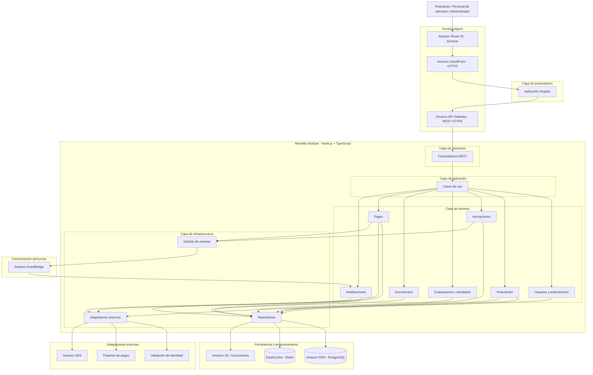

# 5. Diagrama de Arquitectura Inicial

## 5.1. Estilo arquitectónico

El Sistema Integral de Gestión del Proceso de Admisión UNSCH utilizará una arquitectura de **Monolito Modular por Capas**, donde las funcionalidades estarán organizadas en módulos independientes a nivel lógico, pero integrados dentro de una única aplicación backend.

Esta arquitectura permitirá separar las responsabilidades del sistema, facilitar su mantenimiento y simplificar el despliegue de la aplicación.

## 5.2. Diagrama de arquitectura inicial

## 5.3. Descripción de las capas

### Capa de presentación

Estará desarrollada con Angular y permitirá la interacción de los postulantes, personal de admisión y administradores con el sistema.

### Capa de interfaces

Estará compuesta por controladores REST encargados de recibir las solicitudes HTTP, validar los datos y comunicarse con la capa de aplicación.

### Capa de aplicación

Contendrá los casos de uso que coordinan los procesos de registro de postulantes, inscripciones, pagos, evaluaciones y consulta de resultados.

### Capa de dominio

Contendrá las reglas de negocio y estará organizada en siete módulos funcionales:

1. Usuarios y autenticación.
2. Postulantes.
3. Inscripciones.
4. Evaluaciones y resultados.
5. Documentos.
6. Pagos.
7. Notificaciones.

### Capa de infraestructura

Implementará los repositorios de datos, los adaptadores externos y la comunicación con los servicios AWS.

## 5.4. Tecnologías utilizadas

| Tecnología | Función |
|---|---|
| Angular | Interfaz web |
| Node.js y TypeScript | Backend modular |
| AWS Lambda | Ejecución del backend |
| Amazon API Gateway | API REST segura |
| Amazon RDS PostgreSQL | Base de datos |
| Amazon S3 | Almacenamiento de archivos |
| Amazon CloudFront | Distribución web |
| Amazon Route 53 | Dominio |
| Amazon ElastiCache Redis | Caché |
| Amazon EventBridge | Comunicación asíncrona |
| Amazon SES | Correos electrónicos |
| AWS Certificate Manager | Certificados HTTPS |

## 5.5. Justificación arquitectónica

Se seleccionó la arquitectura de Monolito Modular por Capas porque permite organizar el sistema en módulos funcionales claramente definidos, manteniendo una única aplicación backend.

Esta arquitectura facilita el desarrollo, las pruebas, el mantenimiento y el despliegue del sistema, evitando la complejidad de administrar múltiples microservicios.

Asimismo, permite integrar servicios de AWS para proporcionar almacenamiento, seguridad y procesamiento de solicitudes.

## 5.6. Consideraciones

El diagrama representa una vista lógica inicial de la arquitectura.

Los módulos compartirán una instancia de PostgreSQL, pero deberán mantener límites lógicos y acceder a los datos mediante repositorios e interfaces definidas.

El backend podrá desplegarse como una única función AWS Lambda conectada a Amazon API Gateway.

Amazon S3 podrá utilizarse tanto para almacenar documentos como para alojar los archivos estáticos del frontend, que serán distribuidos mediante CloudFront.

Las integraciones externas se implementarán mediante adaptadores.

El certificado HTTPS se administrará mediante AWS Certificate Manager.
