# 6. Componentes Arquitectónicos

## 6.1. Descripción general

El Sistema Integral de Gestión del Proceso de Admisión UNSCH estará desarrollado bajo una arquitectura de Monolito Modular por Capas, siguiendo principios de Clean Architecture.

El backend estará implementado con Node.js y TypeScript y podrá desplegarse como una única aplicación en AWS Lambda, expuesta mediante Amazon API Gateway.

Los componentes arquitectónicos estarán organizados en cuatro capas: presentación, interfaces, aplicación y dominio, además de los adaptadores de infraestructura que permitirán acceder a los servicios externos.

## 6.2. Diagrama de componentes arquitectónicos

```mermaid
flowchart TB
    FE["Aplicación Angular<br/>Interfaz web"]

    API["Amazon API Gateway<br/>API REST HTTPS"]

    subgraph BACKEND["Monolito Modular - Node.js + TypeScript"]
        direction TB

        subgraph INTERFACES["Capa de interfaces"]
            CTRL["Controladores REST"]
            AUTH["Middleware de autenticación y autorización"]
        end

        subgraph APLICACION["Capa de aplicación"]
            UC["Casos de uso<br/>Coordinación de procesos"]
        end

        subgraph DOMINIO["Capa de dominio - Módulos funcionales"]
            direction TB

            M01["Convocatorias"]
            M02["Usuarios"]
            M03["Inscripción Ordinaria"]
            M04["Inscripción Exonerados"]
            M05["Pagos"]
            M06["Expedientes"]
            M07["Exámenes"]
            M08["Sedes y Aulas"]
            M09["Resultados"]
            M10["Chatbot IA"]
            M11["Notificaciones"]
            M12["Reportes"]
            M13["Seguridad"]
            M14["Configuración"]
        end

        subgraph INFRA["Capa de infraestructura"]
            REP["Repositorios PostgreSQL"]
            CACHE["Adaptador de caché"]
            FILES["Adaptador de archivos"]
            QUEUE["Adaptador de mensajería"]
            INTEGRATIONS["Adaptadores de APIs externas"]
            OBS["Observabilidad y registros"]
        end

        CTRL --> AUTH
        AUTH --> UC

        UC --> M01
        UC --> M02
        UC --> M03
        UC --> M04
        UC --> M05
        UC --> M06
        UC --> M07
        UC --> M08
        UC --> M09
        UC --> M10
        UC --> M11
        UC --> M12
        UC --> M13
        UC --> M14

        M01 --> REP
        M02 --> REP
        M03 --> REP
        M04 --> REP
        M05 --> REP
        M06 --> REP
        M07 --> REP
        M08 --> REP
        M09 --> REP
        M10 --> INTEGRATIONS
        M11 --> INTEGRATIONS
        M12 --> REP
        M13 --> REP
        M14 --> REP

        UC --> CACHE
        UC --> FILES
        UC --> QUEUE
        UC --> OBS
    end

    subgraph DATOS["Persistencia y servicios AWS"]
        DB[("Amazon RDS PostgreSQL")]
        REDIS[("Amazon ElastiCache Redis")]
        S3["Amazon S3"]
        SQS["Amazon SQS"]
        CW["Amazon CloudWatch"]
    end

    subgraph EXTERNOS["Servicios externos"]
        RENIEC["RENIEC"]
        PAY["Pasarela de pagos"]
        AI["OpenRouter API"]
        EMAIL["Correo electrónico / SMS"]
    end

    FE --> API
    API --> CTRL

    REP --> DB
    CACHE --> REDIS
    FILES --> S3
    QUEUE --> SQS
    OBS --> CW

    INTEGRATIONS --> RENIEC
    INTEGRATIONS --> PAY
    INTEGRATIONS --> AI
    INTEGRATIONS --> EMAIL

    classDef frontend fill:#244478,color:#fff,stroke:#244478
    classDef layer fill:#3d6cba,color:#fff,stroke:#28539b
    classDef module fill:#d8e8fa,color:#102b50,stroke:#6a95cc
    classDef external fill:#e6e6e6,color:#222,stroke:#888

    class FE,API frontend
    class CTRL,AUTH,UC,REP,CACHE,FILES,QUEUE,INTEGRATIONS,OBS layer
    class M01,M02,M03,M04,M05,M06,M07,M08,M09,M10,M11,M12,M13,M14 module
    class DB,REDIS,S3,SQS,CW,RENIEC,PAY,AI,EMAIL external
```

## 6.3. Componentes principales

### Componente de presentación

La aplicación Angular permitirá que los postulantes, el personal de admisión y los administradores interactúen con el sistema mediante interfaces web.

### Componente de controladores REST

Recibirá las solicitudes HTTP provenientes de Amazon API Gateway, validará los datos y enviará las operaciones a los casos de uso correspondientes.

### Componente de autenticación y autorización

Verificará la identidad de los usuarios y controlará el acceso a las funcionalidades según los roles y permisos establecidos.

### Componente de casos de uso

Coordinará los procesos de negocio y permitirá ejecutar operaciones relacionadas con convocatorias, inscripciones, pagos, evaluaciones, resultados y otros procesos de admisión.

### Componentes del dominio

El sistema estará organizado en 14 módulos funcionales:

1. Convocatorias.
2. Usuarios.
3. Inscripción Ordinaria.
4. Inscripción Exonerados.
5. Pagos.
6. Expedientes.
7. Exámenes.
8. Sedes y Aulas.
9. Resultados.
10. Chatbot IA.
11. Notificaciones.
12. Reportes.
13. Seguridad.
14. Configuración.

Cada módulo tendrá responsabilidades específicas y mantendrá una separación lógica dentro del backend.

### Componente de persistencia

Permitirá almacenar y consultar información mediante repositorios conectados a Amazon RDS PostgreSQL.

### Componente de almacenamiento

Utilizará Amazon S3 para almacenar expedientes, fichas de inscripción y otros documentos digitales.

### Componente de integración

Permitirá establecer comunicación con RENIEC, la pasarela de pagos, OpenRouter API y los servicios de notificaciones.

### Componente de mensajería

Utilizará Amazon SQS para procesar tareas asíncronas, como notificaciones y otras operaciones que no requieran una respuesta inmediata.

### Componente de monitoreo

Utilizará Amazon CloudWatch para registrar eventos técnicos, supervisar el funcionamiento del backend e identificar posibles errores.

## 6.4. Relación entre componentes

La aplicación Angular enviará solicitudes HTTPS a Amazon API Gateway, que invocará el backend desplegado en AWS Lambda.

Los controladores REST recibirán las solicitudes y verificarán las condiciones de autenticación y autorización.

Posteriormente, los casos de uso ejecutarán los procesos correspondientes, aplicando las reglas de negocio definidas en los módulos funcionales.

Cuando sea necesario almacenar información o comunicarse con servicios externos, se utilizarán los adaptadores de infraestructura.

Finalmente, el backend devolverá la respuesta a la aplicación Angular.

## 6.5. Justificación

La organización de componentes propuesta permite mantener las funcionalidades del sistema dentro de un único backend, evitando la complejidad de administrar múltiples microservicios.

La separación por capas facilita el mantenimiento, las pruebas y la incorporación de nuevas funcionalidades.

Asimismo, el uso de interfaces y adaptadores permite reducir el acoplamiento entre la lógica de negocio y los servicios externos.

Esta organización resulta adecuada para el Sistema Integral de Gestión del Proceso de Admisión UNSCH porque permite desarrollar una solución modular, mantenible y preparada para futuras ampliaciones.
