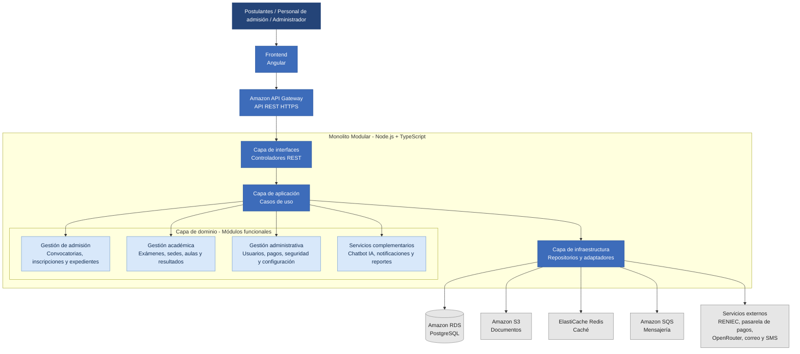

# 6. Componentes Arquitectónicos

## 6.1. Descripción general

El Sistema Integral de Gestión del Proceso de Admisión UNSCH utilizará una arquitectura de **Monolito Modular por Capas**.

El frontend estará desarrollado con Angular y el backend con Node.js y TypeScript, desplegado en AWS Lambda mediante Amazon API Gateway.

El sistema estará organizado en módulos funcionales dentro de una sola aplicación, facilitando su desarrollo, mantenimiento y administración.

## 6.2. Diagrama de componentes arquitectónicos

## 6.3. Componentes principales

### Capa de presentación

Desarrollada con Angular, permitirá que los postulantes, el personal de admisión y los administradores interactúen con el sistema.

### Capa de interfaces

Contendrá los controladores REST encargados de recibir las solicitudes y validar los datos enviados desde el frontend.

### Capa de aplicación

Contendrá los casos de uso que coordinan los procesos de inscripción, pagos, evaluaciones y consulta de resultados.

### Capa de dominio

Estará organizada en cuatro grupos de módulos funcionales:

1. **Gestión de admisión:** convocatorias, inscripción ordinaria, inscripción de exonerados y expedientes.

2. **Gestión académica:** exámenes, sedes, aulas y resultados.

3. **Gestión administrativa:** usuarios, pagos, seguridad y configuración.

4. **Servicios complementarios:** chatbot IA, notificaciones y reportes.

### Capa de infraestructura

Permitirá la conexión con Amazon RDS PostgreSQL, Amazon S3, ElastiCache Redis, Amazon SQS y los servicios externos.

## 6.4. Funcionamiento general

El usuario ingresará al sistema mediante la aplicación Angular, que enviará las solicitudes a Amazon API Gateway.

El backend recibirá las solicitudes mediante sus controladores REST y ejecutará los casos de uso correspondientes.

Los módulos funcionales aplicarán las reglas de negocio y, cuando sea necesario, utilizarán la infraestructura para almacenar información o comunicarse con servicios externos.

Finalmente, el sistema devolverá una respuesta al usuario.

## 6.5. Justificación

La arquitectura de Monolito Modular por Capas permite organizar las funcionalidades del sistema dentro de una sola aplicación backend.

Esta estructura facilita el desarrollo, mantenimiento y despliegue, manteniendo una separación clara de responsabilidades.

Además, permite integrar servicios AWS sin la complejidad de administrar múltiples microservicios.

Por estas razones, se considera adecuada para el Sistema Integral de Gestión del Proceso de Admisión UNSCH.
