# 6. Componentes Arquitectónicos

## 6.1. Descripción general

El Sistema Integral de Gestión del Proceso de Admisión UNSCH estará desarrollado bajo una arquitectura de **Monolito Modular por Capas**, aplicando principios de Clean Architecture.

El backend estará implementado con Node.js y TypeScript y podrá desplegarse como una única aplicación en AWS Lambda, expuesta mediante Amazon API Gateway.

La arquitectura estará organizada en cuatro capas: presentación, interfaces, aplicación y dominio. Adicionalmente, contará con una capa de infraestructura encargada de implementar los mecanismos de persistencia y las integraciones externas.

Los módulos funcionales formarán parte de un único backend desplegable, manteniendo responsabilidades definidas y una separación lógica entre sus componentes.

## 6.2. Diagrama de componentes arquitectónicos

```mermaid
flowchart TB
    FE["Aplicación Angular<br/>Interfaz web"]
    API["Amazon API Gateway<br/>API REST HTTPS"]

    subgraph BACKEND["Monolito Modular - Node.js y TypeScript"]
        direction TB

        subgraph INTERFACES["Capa de interfaces"]
            CTRL["Controladores REST"]
            AUTH["Autenticación y autorización"]
        end

        subgraph APLICACION["Capa de aplicación"]
            UC["Casos de uso<br/>Coordinación de procesos"]
            PORTS["Puertos e interfaces<br/>Contratos de infraestructura"]
        end

        subgraph DOMINIO["Módulos funcionales del dominio"]
            direction TB

            M01["Convocatorias"]
            M02["Usuarios"]
            M03["Inscripción Ordinaria"]
            M04["Inscripción Exonerados"]
            M05["Pagos"]
            M06["Expedientes"]
            M07["Exámenes"]
            M08["Sedes y Aulas"]
            M09["Resultados"]
            M10["Chatbot IA"]
            M11["Notificaciones"]
            M12["Reportes"]
            M13["Seguridad"]
            M14["Configuración"]
        end

        subgraph INFRA["Capa de infraestructura"]
            REP["Repositorios PostgreSQL"]
            CACHE["Adaptador de caché"]
            FILES["Adaptador de archivos"]
            QUEUE["Adaptador de mensajería"]
            INTEGRATIONS["Adaptadores de APIs externas"]
        end

        CTRL --> AUTH
        AUTH --> UC

        UC --> M01
        UC --> M02
        UC --> M03
        UC --> M04
        UC --> M05
        UC --> M06
        UC --> M07
        UC --> M08
        UC --> M09
        UC --> M10
        UC --> M11
        UC --> M12
        UC --> M13
        UC --> M14

        UC --> PORTS

        REP -.->|"Implementa"| PORTS
        CACHE -.->|"Implementa"| PORTS
        FILES -.->|"Implementa"| PORTS
        QUEUE -.->|"Implementa"| PORTS
        INTEGRATIONS -.->|"Implementa"| PORTS
    end

    subgraph DATOS["Persistencia y servicios AWS"]
        DB[("Amazon RDS PostgreSQL")]
        REDIS[("Amazon ElastiCache Redis")]
        S3["Amazon S3"]
        SQS["Amazon SQS"]
    end

    subgraph EXTERNOS["Servicios externos"]
        RENIEC["RENIEC - Validación de identidad"]
        PAY["Pasarela de pagos"]
        AI["OpenRouter API - Chatbot IA"]
        EMAIL["Servicio de correo electrónico / SMS"]
    end

    FE -->|"Solicitudes HTTPS"| API
    API -->|"Invoca AWS Lambda"| CTRL

    REP -->|"SQL"| DB
    CACHE -->|"Caché"| REDIS
    FILES -->|"Archivos"| S3
    QUEUE -->|"Mensajes"| SQS

    INTEGRATIONS -->|"HTTPS"| RENIEC
    INTEGRATIONS -->|"HTTPS"| PAY
    INTEGRATIONS -->|"HTTPS"| AI
    INTEGRATIONS -->|"HTTPS"| EMAIL

    classDef frontend fill:#244478,color:#ffffff,stroke:#244478
    classDef layer fill:#3d6cba,color:#ffffff,stroke:#28539b
    classDef module fill:#d8e8fa,color:#102b50,stroke:#6a95cc
    classDef external fill:#e6e6e6,color:#222222,stroke:#888888

    class FE,API frontend
    class CTRL,AUTH,UC,PORTS,REP,CACHE,FILES,QUEUE,INTEGRATIONS layer
    class M01,M02,M03,M04,M05,M06,M07,M08,M09,M10,M11,M12,M13,M14 module
    class DB,REDIS,S3,SQS,RENIEC,PAY,AI,EMAIL external

    style BACKEND fill:#ffffff,stroke:#777777,stroke-width:2px
    style DOMINIO fill:#f8fbff,stroke:#6a95cc
```

## 6.3. Componentes principales

### Componente de presentación

La aplicación Angular permitirá que los postulantes, el personal de admisión y los administradores interactúen con el sistema mediante interfaces web.

### Componente de controladores REST

Recibirá las solicitudes HTTP provenientes de Amazon API Gateway, validará los datos de entrada y enviará las operaciones a los casos de uso correspondientes.

### Componente de autenticación y autorización

Verificará la identidad de los usuarios y controlará el acceso a las funcionalidades del sistema según los roles y permisos establecidos.

### Componente de casos de uso

Coordinará los procesos de negocio relacionados con convocatorias, inscripciones, pagos, evaluaciones, resultados y otras funcionalidades del sistema.

### Componentes del dominio

El sistema estará organizado en 14 módulos funcionales:

1. Convocatorias.
2. Usuarios.
3. Inscripción Ordinaria.
4. Inscripción Exonerados.
5. Pagos.
6. Expedientes.
7. Exámenes.
8. Sedes y Aulas.
9. Resultados.
10. Chatbot IA.
11. Notificaciones.
12. Reportes.
13. Seguridad.
14. Configuración.

Cada módulo tendrá responsabilidades específicas y mantendrá una separación lógica dentro de la aplicación.

Los módulos de chatbot, notificaciones, reportes y configuración representan capacidades funcionales. Sus reglas y casos de uso se mantendrán separados de las implementaciones técnicas de los servicios externos.

### Componente de puertos e interfaces

Definirá los contratos necesarios para que los casos de uso puedan acceder a repositorios, servicios de almacenamiento, mensajería e integraciones externas sin depender directamente de sus implementaciones.

### Componente de persistencia

Permitirá almacenar y consultar información mediante repositorios conectados a Amazon RDS PostgreSQL.

### Componente de almacenamiento

Utilizará Amazon S3 para almacenar expedientes, fichas de inscripción y otros documentos digitales.

### Componente de caché

Podrá utilizar Amazon ElastiCache Redis para almacenar temporalmente información de consulta frecuente y reducir las solicitudes repetitivas a la base de datos.

### Componente de integración

Permitirá establecer comunicación con RENIEC, la pasarela de pagos, OpenRouter API y los servicios de correo electrónico y SMS mediante adaptadores.

### Componente de mensajería

Utilizará Amazon SQS para gestionar tareas asíncronas, como el procesamiento de notificaciones y otras operaciones que no requieran una respuesta inmediata.

## 6.4. Relación entre componentes

La aplicación Angular enviará solicitudes HTTPS a Amazon API Gateway, que invocará el backend desplegado en AWS Lambda.

Los controladores REST recibirán las solicitudes y aplicarán las validaciones de autenticación y autorización correspondientes.

Posteriormente, los casos de uso coordinarán las operaciones y aplicarán las reglas de negocio definidas en los módulos funcionales.

Cuando sea necesario almacenar información o comunicarse con servicios externos, los casos de uso utilizarán puertos e interfaces definidos en la aplicación.

Los adaptadores de infraestructura implementarán estos contratos para comunicarse con Amazon RDS PostgreSQL, Amazon S3, Amazon ElastiCache Redis, Amazon SQS y los servicios externos.

Finalmente, el backend devolverá la respuesta a Amazon API Gateway, que la enviará a la aplicación Angular para mostrar el resultado al usuario.

## 6.5. Justificación arquitectónica

La arquitectura de Monolito Modular por Capas permite mantener las funcionalidades del sistema dentro de una única aplicación backend, evitando la complejidad de administrar múltiples microservicios.

La separación por capas facilita el mantenimiento, las pruebas y la incorporación de nuevas funcionalidades.

Asimismo, la aplicación de principios de Clean Architecture permite reducir el acoplamiento entre la lógica de negocio y las tecnologías de infraestructura.

Los módulos funcionales podrán evolucionar de manera organizada sin requerir despliegues independientes.

Esta arquitectura resulta adecuada para el Sistema Integral de Gestión del Proceso de Admisión UNSCH porque permite desarrollar una solución modular, mantenible y preparada para futuras ampliaciones.

## 6.6. Consideraciones técnicas

El diagrama representa una vista lógica inicial de los componentes arquitectónicos.

Los 14 módulos funcionales formarán parte de un único backend desplegable en AWS Lambda.

La capa de dominio no dependerá directamente de los servicios AWS ni de las implementaciones de infraestructura.

Los repositorios y adaptadores implementarán los contratos definidos por las capas internas, siguiendo el principio de inversión de dependencias.

Los módulos compartirán una instancia de PostgreSQL, pero deberán mantener límites lógicos para evitar el acceso indiscriminado a los datos de otros módulos.

Amazon SQS requerirá un consumidor de mensajes, que podrá implementarse mediante un controlador de eventos dentro del mismo proyecto backend.

Los servicios de caché y mensajería podrán incorporarse progresivamente según las necesidades de rendimiento y procesamiento del sistema.
