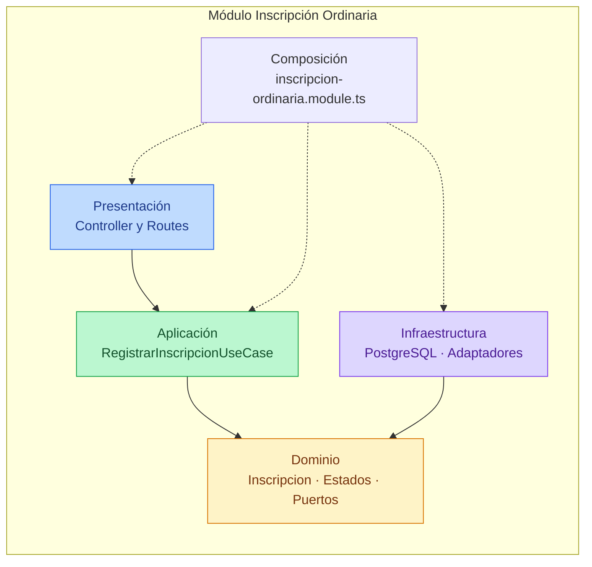
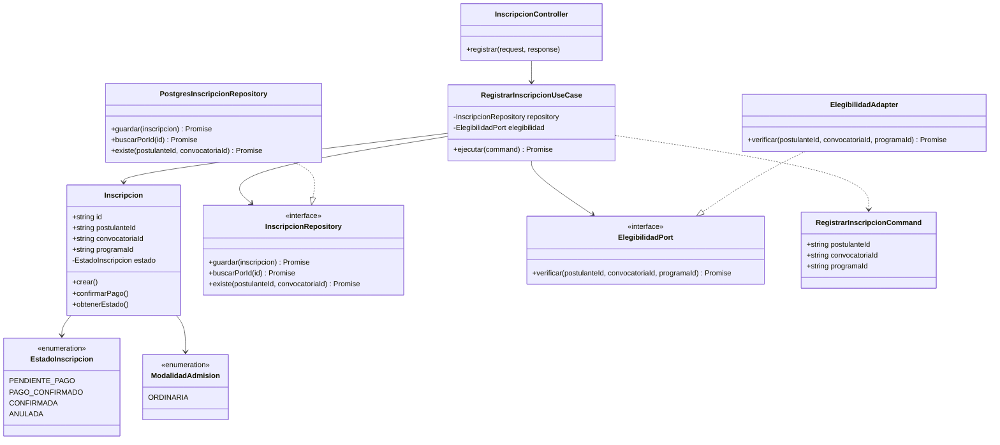
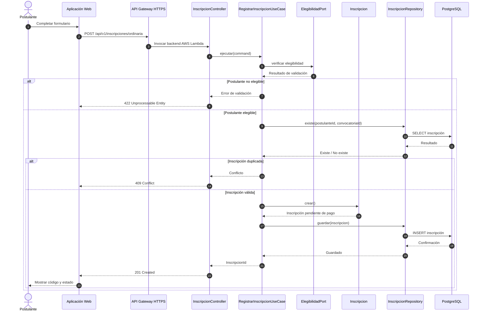
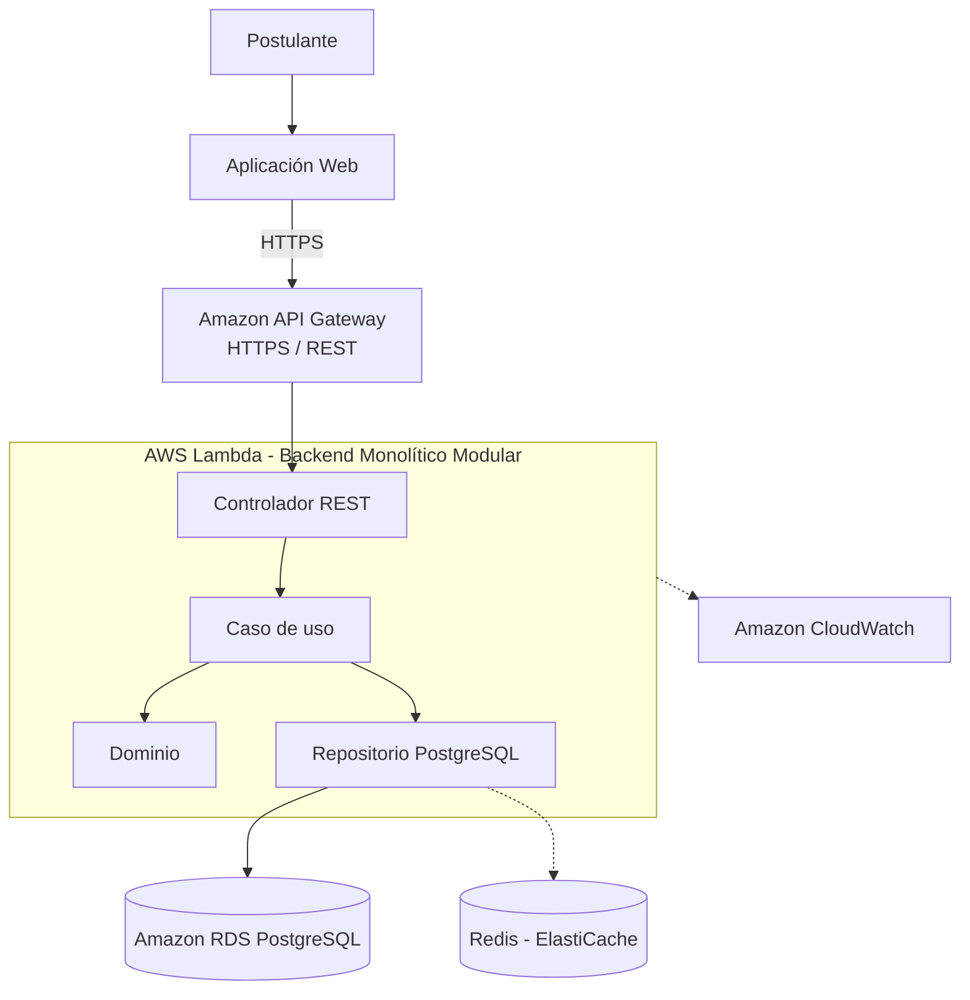

# Diseño Interno de Módulos

**Proyecto:** Sistema Integral de Gestión del Proceso de Admisión – UNSCH  
**Backend propuesto:** Node.js + TypeScript  
**Módulo de referencia:** Inscripción Ordinaria  
**Enfoque arquitectónico:** Clean Architecture dentro de un Monolito Modular por Capas  
**Despliegue:** AWS Lambda + API Gateway mediante HTTPS  
**Nivel C4:** 4 – Código  
**Versión:** 1.0

---

## 1. Propósito

Este documento describe cómo se organizará el código fuente de los módulos del Sistema Integral de Gestión del Proceso de Admisión de la Universidad Nacional de San Cristóbal de Huamanga (UNSCH).

Tiene tres objetivos principales:

1. Establecer una estructura uniforme para los 14 módulos funcionales.
2. Separar las reglas de negocio de los detalles tecnológicos mediante Clean Architecture.
3. Facilitar el desarrollo, mantenimiento, pruebas e integración del sistema.

Se utilizará como referencia el módulo **Inscripción Ordinaria**, encargado de registrar las postulaciones de los estudiantes a una convocatoria de admisión.

---

## 2. Estructura de carpetas

La aplicación estará organizada como un único backend modular, desplegado mediante AWS Lambda.

```text
src/
├── modules/
│   ├── convocatorias/
│   ├── usuarios/
│   ├── inscripcion-ordinaria/
│   │   ├── dominio/
│   │   │   ├── inscripcion.ts
│   │   │   ├── estado-inscripcion.ts
│   │   │   ├── modalidad-admision.ts
│   │   │   ├── inscripcion-repository.ts
│   │   │   └── elegibilidad-port.ts
│   │   ├── aplicacion/
│   │   │   ├── registrar-inscripcion.use-case.ts
│   │   │   └── registrar-inscripcion.command.ts
│   │   ├── infraestructura/
│   │   │   ├── postgres-inscripcion.repository.ts
│   │   │   └── elegibilidad.adapter.ts
│   │   ├── presentacion/
│   │   │   ├── inscripcion.controller.ts
│   │   │   └── inscripcion.routes.ts
│   │   ├── inscripcion-ordinaria.module.ts
│   │   └── index.ts
│   ├── inscripcion-exonerados/
│   ├── pagos/
│   ├── expedientes/
│   ├── examenes/
│   ├── sedes-aulas/
│   ├── resultados/
│   ├── chatbot-ia/
│   ├── notificaciones/
│   ├── reportes/
│   ├── seguridad/
│   └── configuracion/
├── shared/
│   ├── errores/
│   ├── middleware/
│   └── configuracion/
├── app.ts
└── lambda.ts
```

### Responsabilidad de los archivos del módulo

| Archivo | Capa | Responsabilidad | Importa de |
|---|---|---|---|
| `inscripcion.ts` | Dominio | Representar una inscripción y sus reglas de negocio. | Dominio |
| `estado-inscripcion.ts` | Dominio | Definir los estados de una inscripción. | Ninguna |
| `modalidad-admision.ts` | Dominio | Identificar la modalidad ordinaria. | Ninguna |
| `inscripcion-repository.ts` | Dominio | Declarar las operaciones de persistencia. | Dominio |
| `elegibilidad-port.ts` | Dominio | Definir el contrato para comprobar la elegibilidad del postulante. | Dominio |
| `registrar-inscripcion.use-case.ts` | Aplicación | Coordinar el registro de una inscripción. | Dominio |
| `registrar-inscripcion.command.ts` | Aplicación | Definir los datos de entrada del caso de uso. | Ninguna |
| `postgres-inscripcion.repository.ts` | Infraestructura | Guardar y consultar inscripciones en PostgreSQL. | Dominio y driver PostgreSQL |
| `elegibilidad.adapter.ts` | Infraestructura | Consultar las condiciones de inscripción mediante contratos de otros módulos. | Dominio y APIs internas |
| `inscripcion.controller.ts` | Presentación | Recibir solicitudes HTTP e invocar casos de uso. | Aplicación |
| `inscripcion.routes.ts` | Presentación | Registrar las rutas REST del módulo. | Presentación |
| `inscripcion-ordinaria.module.ts` | Composición | Crear e inyectar las dependencias del módulo. | Todas las capas |
| `index.ts` | API pública | Exponer las funcionalidades permitidas a otros módulos. | Composición y contratos públicos |

---

## 3. Capas del módulo y regla de dependencia

### Diagrama de paquetes del módulo Inscripción Ordinaria



### Reglas de dependencia

| Capa | Contiene | Responsabilidad | Puede depender de | No puede depender de |
|---|---|---|---|---|
| Dominio | Entidades, enumeraciones, objetos de valor y puertos | Implementar las reglas de negocio. | Código propio del dominio | Aplicación, infraestructura, presentación, Express, PostgreSQL |
| Aplicación | Casos de uso y comandos | Coordinar los procesos del sistema. | Dominio | Infraestructura, presentación, ORM |
| Infraestructura | Repositorios y adaptadores | Implementar persistencia e integraciones externas. | Dominio y librerías externas | Presentación y controladores |
| Presentación | Controladores y rutas REST | Procesar solicitudes HTTP y devolver respuestas. | Aplicación | Repositorios concretos y acceso directo a PostgreSQL |
| Composición | Configuración e inyección de dependencias | Conectar las implementaciones concretas. | Todas las capas | — |

**Regla principal:** las dependencias del código deben orientarse hacia el dominio. El dominio no debe conocer AWS Lambda, Express, PostgreSQL, Redis ni servicios externos.

---

## 4. Diagrama de clases

El siguiente diagrama representa las principales clases e interfaces del módulo Inscripción Ordinaria.



### 4.1. Notación UML utilizada

| Símbolo | Significado |
|---|---|
| Flecha continua | Asociación entre clases. |
| Flecha discontinua | Dependencia o uso temporal. |
| Triángulo hueco | Implementación de una interfaz. |
| `<<interface>>` | Contrato sin implementación concreta. |
| `<<enumeration>>` | Conjunto de valores definidos. |
| `+` | Miembro público. |
| `-` | Miembro privado. |

---

## 5. Flujo de ejecución: registrar inscripción ordinaria

### Diagrama de secuencia



### Descripción del flujo

| Paso | Origen → Destino | Acción | Capa |
|---|---|---|---|
| 1 | Postulante → Aplicación Web | Completa los datos de inscripción. | Presentación web |
| 2 | Aplicación Web → API Gateway | Envía solicitud mediante HTTPS. | Infraestructura AWS |
| 3 | API Gateway → Controlador | Invoca la aplicación en AWS Lambda. | Presentación |
| 4 | Controlador → Caso de uso | Solicita registrar la inscripción. | Presentación → Aplicación |
| 5 | Caso de uso → ElegibilidadPort | Comprueba identidad validada, convocatoria y programa. | Aplicación → Puerto |
| 6 | Caso de uso → Repositorio | Verifica que no exista una inscripción duplicada. | Aplicación → Dominio |
| 7 | Caso de uso → Entidad | Crea una inscripción pendiente de pago. | Aplicación → Dominio |
| 8 | Caso de uso → Repositorio | Solicita guardar la inscripción. | Aplicación → Dominio |
| 9 | Repositorio → PostgreSQL | Registra la inscripción en una transacción. | Infraestructura |
| 10 | Controlador → Aplicación Web | Devuelve HTTP 201 y el identificador. | Presentación |
| 11 | Flujo alternativo | Si el postulante no es elegible, devuelve HTTP 422. | Aplicación |
| 12 | Flujo alternativo | Si ya existe la inscripción, devuelve HTTP 409. | Aplicación |

La inscripción se registra inicialmente como **pendiente de pago**. La confirmación del pago y la habilitación de la inscripción se gestionarán mediante el módulo Pagos, después de recibir una confirmación válida de la pasarela.

---

## 6. Código de referencia

Los siguientes fragmentos representan una implementación inicial en TypeScript. Son ejemplos de diseño y requieren completar validaciones, manejo de errores y adaptadores para su ejecución en producción.

### 6.1. Dominio – Entidad Inscripción

Archivo: `dominio/inscripcion.ts`

```typescript
import { randomUUID } from "node:crypto";
import { EstadoInscripcion } from "./estado-inscripcion";

export class Inscripcion {
  private constructor(
    public readonly id: string,
    public readonly postulanteId: string,
    public readonly convocatoriaId: string,
    public readonly programaId: string,
    private estado: EstadoInscripcion
  ) {}

  static crear(
    postulanteId: string,
    convocatoriaId: string,
    programaId: string
  ): Inscripcion {
    if (!postulanteId || !convocatoriaId || !programaId) {
      throw new Error("Los datos de inscripción son obligatorios");
    }

    return new Inscripcion(
      randomUUID(),
      postulanteId,
      convocatoriaId,
      programaId,
      EstadoInscripcion.PENDIENTE_PAGO
    );
  }

  confirmarPago(): void {
    if (this.estado !== EstadoInscripcion.PENDIENTE_PAGO) {
      throw new Error("La inscripción no está pendiente de pago");
    }

    this.estado = EstadoInscripcion.PAGO_CONFIRMADO;
  }

  obtenerEstado(): EstadoInscripcion {
    return this.estado;
  }
}
```

Archivo: `dominio/estado-inscripcion.ts`

```typescript
export enum EstadoInscripcion {
  PENDIENTE_PAGO = "PENDIENTE_PAGO",
  PAGO_CONFIRMADO = "PAGO_CONFIRMADO",
  CONFIRMADA = "CONFIRMADA",
  ANULADA = "ANULADA"
}
```

### 6.2. Dominio – Interfaces

Archivo: `dominio/inscripcion-repository.ts`

```typescript
import { Inscripcion } from "./inscripcion";

export interface InscripcionRepository {
  guardar(inscripcion: Inscripcion): Promise<void>;

  buscarPorId(id: string): Promise<Inscripcion | null>;

  existe(
    postulanteId: string,
    convocatoriaId: string
  ): Promise<boolean>;
}
```

Archivo: `dominio/elegibilidad-port.ts`

```typescript
export interface ElegibilidadPort {
  verificar(
    postulanteId: string,
    convocatoriaId: string,
    programaId: string
  ): Promise<boolean>;
}
```

### 6.3. Aplicación – Caso de uso

Archivo: `aplicacion/registrar-inscripcion.command.ts`

```typescript
export interface RegistrarInscripcionCommand {
  postulanteId: string;
  convocatoriaId: string;
  programaId: string;
}
```

Archivo: `aplicacion/registrar-inscripcion.use-case.ts`

```typescript
import { Inscripcion } from "../dominio/inscripcion";
import { InscripcionRepository } from "../dominio/inscripcion-repository";
import { ElegibilidadPort } from "../dominio/elegibilidad-port";
import { RegistrarInscripcionCommand } from "./registrar-inscripcion.command";

export class RegistrarInscripcionUseCase {
  constructor(
    private readonly repository: InscripcionRepository,
    private readonly elegibilidad: ElegibilidadPort
  ) {}

  async ejecutar(
    command: RegistrarInscripcionCommand
  ): Promise<string> {
    const esElegible = await this.elegibilidad.verificar(
      command.postulanteId,
      command.convocatoriaId,
      command.programaId
    );

    if (!esElegible) {
      throw new Error("El postulante no cumple los requisitos");
    }

    const existe = await this.repository.existe(
      command.postulanteId,
      command.convocatoriaId
    );

    if (existe) {
      throw new Error("El postulante ya tiene una inscripción");
    }

    const inscripcion = Inscripcion.crear(
      command.postulanteId,
      command.convocatoriaId,
      command.programaId
    );

    await this.repository.guardar(inscripcion);

    return inscripcion.id;
  }
}
```

**Consideración:** La validación previa de duplicados no reemplaza una restricción única en PostgreSQL. El repositorio deberá garantizar la unicidad también ante solicitudes concurrentes.

### 6.4. Infraestructura – Repositorio PostgreSQL

Archivo: `infraestructura/postgres-inscripcion.repository.ts`

```typescript
import { Pool } from "pg";
import { Inscripcion } from "../dominio/inscripcion";
import { InscripcionRepository } from "../dominio/inscripcion-repository";

export class PostgresInscripcionRepository
  implements InscripcionRepository {

  constructor(private readonly db: Pool) {}

  async guardar(inscripcion: Inscripcion): Promise<void> {
    await this.db.query(
      `INSERT INTO inscripciones
       (id, postulante_id, convocatoria_id, programa_id, estado)
       VALUES ($1, $2, $3, $4, $5)`,
      [
        inscripcion.id,
        inscripcion.postulanteId,
        inscripcion.convocatoriaId,
        inscripcion.programaId,
        inscripcion.obtenerEstado()
      ]
    );
  }

  async existe(
    postulanteId: string,
    convocatoriaId: string
  ): Promise<boolean> {
    const resultado = await this.db.query(
      `SELECT 1 FROM inscripciones
       WHERE postulante_id = $1 AND convocatoria_id = $2
       LIMIT 1`,
      [postulanteId, convocatoriaId]
    );

    return (resultado.rowCount ?? 0) > 0;
  }

  async buscarPorId(id: string): Promise<Inscripcion | null> {
    // Implementar reconstitución de la entidad desde PostgreSQL.
    throw new Error("Método pendiente de implementación");
  }
}
```

### 6.5. Presentación – Controlador REST

Archivo: `presentacion/inscripcion.controller.ts`

```typescript
import { Request, Response } from "express";
import { RegistrarInscripcionUseCase } from "../aplicacion/registrar-inscripcion.use-case";

export class InscripcionController {
  constructor(
    private readonly registrarInscripcion: RegistrarInscripcionUseCase
  ) {}

  registrar = async (
    req: Request,
    res: Response
  ): Promise<void> => {
    const inscripcionId = await this.registrarInscripcion.ejecutar({
      postulanteId: req.user.id,
      convocatoriaId: req.body.convocatoriaId,
      programaId: req.body.programaId
    });

    res.status(201).json({
      mensaje: "Inscripción registrada correctamente",
      inscripcionId,
      estado: "PENDIENTE_PAGO"
    });
  };
}
```

El identificador del postulante debe obtenerse de una sesión autenticada y validada, no del cuerpo de la solicitud. La propiedad `req.user` requiere un middleware y una extensión de tipos de Express.

### 6.6. Raíz de composición

Archivo: `inscripcion-ordinaria.module.ts`

```typescript
import { Pool } from "pg";
import { PostgresInscripcionRepository } from "./infraestructura/postgres-inscripcion.repository";
import { ElegibilidadPort } from "./dominio/elegibilidad-port";
import { RegistrarInscripcionUseCase } from "./aplicacion/registrar-inscripcion.use-case";
import { InscripcionController } from "./presentacion/inscripcion.controller";

export function crearModuloInscripcionOrdinaria(
  db: Pool,
  elegibilidad: ElegibilidadPort
) {
  const repository = new PostgresInscripcionRepository(db);

  const registrarInscripcion = new RegistrarInscripcionUseCase(
    repository,
    elegibilidad
  );

  return {
    controller: new InscripcionController(registrarInscripcion)
  };
}
```

El adaptador concreto de elegibilidad se inyectará desde la composición principal de la aplicación, utilizando los contratos públicos de los módulos Usuarios, Convocatorias y Configuración.

---

## 7. Integración con AWS Lambda

El backend se desplegará como una aplicación monolítica modular mediante AWS Lambda, utilizando Amazon API Gateway para exponer los endpoints REST.



### Consideraciones técnicas

- **AWS Lambda:** ejecutará el backend como una única unidad desplegable.
- **API Gateway:** recibirá las solicitudes REST mediante HTTPS.
- **PostgreSQL:** almacenará la información institucional.
- **Redis:** permitirá optimizar consultas frecuentes cuando se configure el caché.
- **RDS Proxy:** podrá utilizarse para gestionar conexiones concurrentes a PostgreSQL.
- **CloudWatch:** registrará métricas, errores y eventos.
- **AWS Secrets Manager:** protegerá las credenciales de base de datos y las claves de servicios externos.

---

## 8. Aplicación de la estructura a los 14 módulos

| Código | Módulo | Responsabilidad principal |
|---|---|---|
| M01 | Convocatorias | Gestionar procesos, cronogramas y periodos de admisión. |
| M02 | Usuarios | Registrar postulantes y gestionar la validación de identidad. |
| M03 | Inscripción Ordinaria | Gestionar postulaciones de la modalidad ordinaria. |
| M04 | Inscripción Exonerados | Gestionar postulaciones de modalidades especiales. |
| M05 | Pagos | Gestionar órdenes, confirmaciones y conciliaciones. |
| M06 | Expedientes | Gestionar documentos, evaluaciones y observaciones. |
| M07 | Exámenes | Programar evaluaciones de admisión. |
| M08 | Sedes y Aulas | Administrar ambientes y asignar postulantes. |
| M09 | Resultados | Procesar calificaciones, méritos y resultados oficiales. |
| M10 | Chatbot IA | Proporcionar orientación y seguimiento mediante OpenRouter API. |
| M11 | Notificaciones | Enviar avisos mediante correo y otros canales habilitados. |
| M12 | Reportes | Generar estadísticas e informes administrativos. |
| M13 | Seguridad | Gestionar autenticación, autorización y roles. |
| M14 | Configuración | Administrar parámetros e integraciones del sistema. |

Todos los módulos deberán seguir la estructura:

```text
modulo/
├── dominio/
├── aplicacion/
├── infraestructura/
├── presentacion/
├── modulo.module.ts
└── index.ts
```

---

## 9. Resumen

| Aspecto | Decisión |
|---|---|
| Arquitectura | Monolito Modular por Capas |
| Enfoque | Clean Architecture |
| Organización | 14 módulos funcionales |
| Backend propuesto | Node.js + TypeScript |
| Despliegue | AWS Lambda |
| Comunicación | API REST + HTTPS |
| Persistencia | Amazon RDS PostgreSQL |
| Caché | Redis |
| Integraciones | RENIEC, pasarela de pagos y OpenRouter API |
| Referencia de diseño | Módulo Inscripción Ordinaria |
| Nivel C4 | Nivel 4 – Código |

## Conclusión

El diseño interno establece una organización uniforme para los módulos del Sistema Integral de Gestión del Proceso de Admisión – UNSCH.

La separación de responsabilidades permitirá mantener las reglas de negocio independientes de la infraestructura, facilitar las pruebas y conservar una única aplicación desplegable en AWS Lambda.

Los fragmentos de código presentados constituyen una referencia inicial de arquitectura y requieren completar las implementaciones necesarias antes de utilizarse en producción.