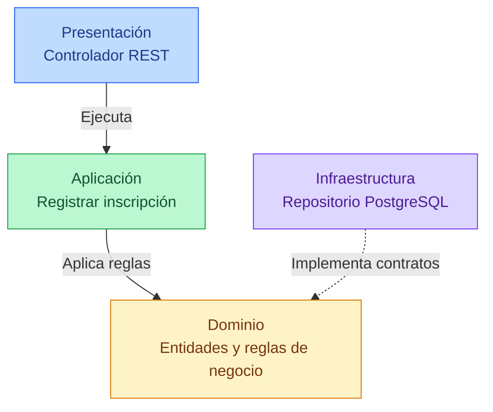

# 7. Diseño Interno de Módulos

## 7.1. Descripción general

El Sistema Integral de Gestión del Proceso de Admisión UNSCH estará desarrollado bajo una arquitectura de **Monolito Modular por Capas**, aplicando los principios de **Clean Architecture**.

Esta arquitectura permitirá organizar las funcionalidades del sistema en módulos independientes a nivel lógico, pero integrados dentro de una única aplicación backend desarrollada con Node.js y TypeScript.

El backend podrá desplegarse mediante AWS Lambda y comunicarse con la aplicación Angular a través de Amazon API Gateway.

El objetivo principal de este diseño es separar las responsabilidades de cada módulo, facilitar el mantenimiento del código y permitir la incorporación de nuevas funcionalidades sin afectar innecesariamente a los demás componentes.

## 7.2. Organización interna de los módulos

Cada módulo funcional seguirá una estructura de cuatro capas, con responsabilidades claramente definidas.

### Capa de presentación

Se encargará de recibir las solicitudes HTTP provenientes de la aplicación Angular.

Contendrá los controladores REST y las rutas necesarias para acceder a las funcionalidades del módulo. También permitirá validar los datos de entrada y devolver las respuestas correspondientes.

### Capa de aplicación

Contendrá los casos de uso encargados de coordinar los procesos del sistema.

Por ejemplo, en el módulo de Inscripción Ordinaria, esta capa ejecutará el proceso de registro, solicitará la validación de requisitos y coordinará el almacenamiento de la inscripción.

### Capa de dominio

Contendrá las entidades, reglas de negocio e interfaces necesarias para representar el funcionamiento del módulo.

Esta capa será independiente de tecnologías como PostgreSQL, AWS Lambda o frameworks de desarrollo, permitiendo que las reglas de negocio puedan mantenerse sin depender de la infraestructura.

### Capa de infraestructura

Implementará los repositorios y adaptadores necesarios para comunicarse con la base de datos y los servicios externos.

Por ejemplo, permitirá guardar inscripciones en Amazon RDS PostgreSQL y acceder a servicios como RENIEC o la pasarela de pagos cuando el proceso lo requiera.

## 7.3. Diagrama de diseño interno

Para representar la organización interna se utiliza como ejemplo el módulo de **Inscripción Ordinaria**.



**Interpretación del diagrama:**

La capa de presentación recibe las solicitudes del usuario y las envía a la capa de aplicación. Esta coordina el caso de uso y aplica las reglas definidas en el dominio.

La infraestructura implementa los contratos necesarios para almacenar y consultar información, evitando que el dominio dependa directamente de PostgreSQL.

## 7.4. Estructura de carpetas

Para mantener una organización uniforme, los módulos utilizarán la siguiente estructura de carpetas.

```text
src/
├── modules/
│   ├── convocatorias/
│   ├── usuarios/
│   ├── inscripcion-ordinaria/
│   │   ├── dominio/
│   │   │   ├── inscripcion.ts
│   │   │   └── inscripcion-repository.ts
│   │   ├── aplicacion/
│   │   │   └── registrar-inscripcion.use-case.ts
│   │   ├── infraestructura/
│   │   │   └── postgres-inscripcion.repository.ts
│   │   ├── presentacion/
│   │   │   ├── inscripcion.controller.ts
│   │   │   └── inscripcion.routes.ts
│   │   └── inscripcion-ordinaria.module.ts
│   ├── inscripcion-exonerados/
│   ├── pagos/
│   ├── expedientes/
│   ├── examenes/
│   ├── sedes-aulas/
│   ├── resultados/
│   ├── chatbot-ia/
│   ├── notificaciones/
│   ├── reportes/
│   ├── seguridad/
│   └── configuracion/
├── shared/
├── app.ts
└── lambda.ts
```

Cada módulo contará con sus propios componentes internos. La carpeta `shared` almacenará únicamente elementos comunes que puedan reutilizarse sin generar dependencias innecesarias entre módulos.

Esta estructura es una propuesta de organización y podrá adaptarse a las necesidades de implementación del proyecto.

## 7.5. Funcionamiento del módulo Inscripción Ordinaria

El módulo de Inscripción Ordinaria permitirá registrar la postulación de un estudiante a una convocatoria de admisión.

El proceso seguirá la siguiente secuencia:

1. **Registro de información:** el postulante completará el formulario de inscripción desde la aplicación Angular.

2. **Recepción de solicitud:** Amazon API Gateway enviará la solicitud al backend, donde será procesada por el controlador REST.

3. **Validación de requisitos:** el caso de uso verificará que el postulante cumpla las condiciones establecidas para la convocatoria.

4. **Verificación de duplicados:** el sistema comprobará que no exista una inscripción previa para el mismo postulante y convocatoria.

5. **Aplicación de reglas de negocio:** el dominio creará la inscripción con el estado inicial correspondiente.

6. **Almacenamiento:** el repositorio guardará la información en Amazon RDS PostgreSQL.

7. **Respuesta al usuario:** el sistema devolverá el código de inscripción y su estado actual.

Inicialmente, la inscripción tendrá el estado **PENDIENTE_PAGO**. Una vez confirmada la operación por la pasarela de pagos, el módulo correspondiente permitirá actualizar su estado según las reglas del proceso de admisión.

## 7.6. Módulos funcionales del sistema

El sistema estará compuesto por 14 módulos funcionales, organizados dentro de una única aplicación backend.

| Código | Módulo | Responsabilidad principal |
|---|---|---|
| M01 | Convocatorias | Gestionar periodos, cronogramas y procesos de admisión. |
| M02 | Usuarios | Registrar usuarios y gestionar sus datos. |
| M03 | Inscripción Ordinaria | Administrar postulaciones de la modalidad ordinaria. |
| M04 | Inscripción Exonerados | Gestionar postulaciones de modalidades especiales. |
| M05 | Pagos | Registrar y verificar los pagos de inscripción. |
| M06 | Expedientes | Administrar documentos y observaciones. |
| M07 | Exámenes | Programar las evaluaciones de admisión. |
| M08 | Sedes y Aulas | Gestionar ambientes y asignaciones. |
| M09 | Resultados | Procesar y publicar resultados de admisión. |
| M10 | Chatbot IA | Orientar a los postulantes mediante OpenRouter API. |
| M11 | Notificaciones | Enviar avisos y correos electrónicos. |
| M12 | Reportes | Generar estadísticas e informes. |
| M13 | Seguridad | Administrar autenticación, roles y permisos. |
| M14 | Configuración | Gestionar parámetros generales del sistema. |

Cada módulo tendrá responsabilidades específicas y se comunicará con los demás mediante interfaces definidas, evitando dependencias directas innecesarias.

## 7.7. Integración con la infraestructura AWS

El sistema utilizará diferentes servicios tecnológicos para ejecutar sus funcionalidades.

| Tecnología | Función |
|---|---|
| Angular | Desarrollo de la interfaz web. |
| Node.js y TypeScript | Implementación del backend modular. |
| Amazon API Gateway | Recepción de solicitudes REST mediante HTTPS. |
| AWS Lambda | Ejecución del backend. |
| Amazon RDS PostgreSQL | Almacenamiento de información. |
| Amazon S3 | Almacenamiento de documentos y fichas PDF. |
| Amazon ElastiCache Redis | Almacenamiento temporal en caché. |
| Amazon SQS | Procesamiento de tareas asíncronas. |
| RENIEC | Validación de identidad. |
| Pasarela de pagos | Procesamiento y confirmación de pagos. |
| OpenRouter API | Integración del chatbot de inteligencia artificial. |
| Amazon SES | Envío de correos electrónicos. |

La comunicación con estos servicios se realizará mediante adaptadores implementados en la capa de infraestructura.

Los servicios de caché y mensajería podrán incorporarse progresivamente de acuerdo con las necesidades del sistema.

## 7.8. Reglas de diseño

Para mantener una estructura organizada se establecerán las siguientes reglas:

1. Cada módulo tendrá responsabilidades claramente definidas.
2. La lógica de negocio permanecerá separada de la infraestructura.
3. Los controladores REST no accederán directamente a la base de datos.
4. Los casos de uso coordinarán los procesos del sistema.
5. Los repositorios implementarán las interfaces definidas en las capas internas.
6. Los módulos evitarán dependencias circulares.
7. Todas las funcionalidades se integrarán en un único backend desplegable.

Estas reglas permitirán aplicar los principios de Clean Architecture dentro del Monolito Modular por Capas.

## 7.9. Conclusión

El diseño interno de módulos permitirá desarrollar el Sistema Integral de Gestión del Proceso de Admisión UNSCH de manera organizada, modular y mantenible.

La aplicación de Clean Architecture facilitará la separación entre las reglas de negocio y los detalles tecnológicos, mientras que el Monolito Modular por Capas permitirá integrar las funcionalidades dentro de una sola aplicación backend.

Esta propuesta simplificará el desarrollo, las pruebas y el despliegue del sistema, además de facilitar futuras mejoras y ampliaciones.
