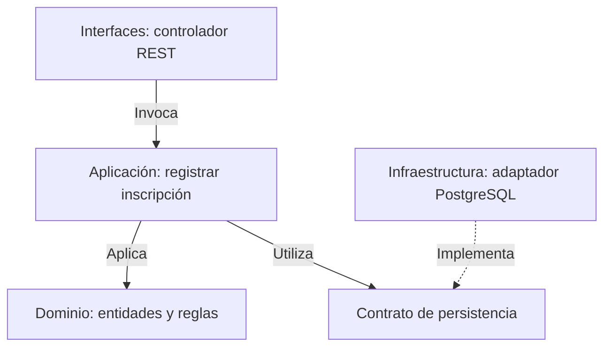

# 7. Diseño Interno de Módulos

## 7.1. Descripción general

El Sistema de Gestión del Proceso de Admisión UNSCH se desarrollará mediante una arquitectura de **Monolito Modular por Capas**, aplicando los principios de **Clean Architecture**.

El sistema estará organizado en **12 módulos funcionales**, integrados en una única aplicación backend desarrollada con Node.js y TypeScript. La interfaz web utilizará Angular y se comunicará con el backend mediante una API REST sobre HTTPS.

El backend se ejecutará mediante AWS Lambda, con Amazon API Gateway como punto de acceso a sus endpoints.

Este diseño corresponde a la propuesta arquitectónica inicial del Sprint 1 y establece la organización de responsabilidades, las dependencias entre capas y las integraciones tecnológicas.

## 7.2. Organización interna de los módulos

Cada módulo seguirá una estructura de cuatro capas.

### Capa de interfaces

Recibirá las solicitudes HTTP mediante controladores REST y rutas.

Sus responsabilidades serán validar el formato de los datos de entrada, aplicar los controles de autenticación y autorización correspondientes, invocar los casos de uso y devolver las respuestas.

Esta capa no accederá directamente a la base de datos ni contendrá las reglas de negocio.

### Capa de aplicación

Contendrá los casos de uso que coordinarán los procesos del módulo.

Por ejemplo, el caso de uso Registrar Inscripción verificará la convocatoria, solicitará las validaciones correspondientes, aplicará las reglas del dominio y coordinará la persistencia mediante interfaces.

También establecerá los límites transaccionales necesarios para las operaciones críticas.

### Capa de dominio

Contendrá las entidades, reglas de negocio y contratos internos del módulo.

En Inscripciones, incluirá las condiciones de registro, las diferencias entre Ordinaria y Exonerados y las transiciones válidas de estado.

El dominio no dependerá de Angular, PostgreSQL, AWS Lambda ni de proveedores externos.

### Capa de infraestructura

Implementará los contratos de persistencia y los adaptadores para servicios externos.

Permitirá almacenar información en PostgreSQL, gestionar documentos en Amazon S3, procesar eventos mediante Outbox y Amazon SQS e integrar los proveedores de identidad, pagos, inteligencia artificial y correo.

Las implementaciones de infraestructura dependerán de las interfaces internas, respetando la dirección de dependencias de Clean Architecture.

## 7.3. Diagrama de diseño interno

Se utiliza como ejemplo el módulo de **Inscripciones**, que comprenderá las modalidades Ordinaria y Exonerados.

Las flechas representan dependencias de código. El caso de uso utilizará un contrato interno y recibirá su implementación mediante inyección de dependencias. De esta manera, no necesitará conocer los detalles de PostgreSQL.

## 7.4. Estructura de carpetas propuesta

Los módulos se organizarán en las siguientes carpetas:

| Código | Módulo | Carpeta |
|---|---|---|
| M01 | Convocatorias | `modules/convocatorias/` |
| M02 | Usuarios | `modules/usuarios/` |
| M03 | Inscripciones | `modules/inscripciones/` |
| M04 | Pagos | `modules/pagos/` |
| M05 | Expedientes | `modules/expedientes/` |
| M06 | Exámenes, Sedes y Aulas | `modules/examenes/` |
| M07 | Resultados | `modules/resultados/` |
| M08 | Chatbot IA | `modules/asistente/` |
| M09 | Notificaciones | `modules/notificaciones/` |
| M10 | Reportes | `modules/reportes/` |
| M11 | Seguridad | `modules/seguridad/` |
| M12 | Configuración | `modules/configuracion/` |

Cada módulo utilizará la siguiente organización interna:

| Ruta interna | Contenido |
|---|---|
| `presentation/` | Controladores REST, rutas y validación de entrada. |
| `application/` | Casos de uso, coordinación de procesos y contratos de aplicación. |
| `domain/` | Entidades, reglas de negocio y contratos del dominio. |
| `infrastructure/` | Implementaciones de persistencia y adaptadores externos. |
| `index.ts` | Interfaz pública y composición del módulo. |

Los contratos se ubicarán en la capa interna que los necesite. La carpeta `shared/` contendrá únicamente componentes técnicos comunes, evitando trasladar allí reglas que pertenezcan a un módulo específico.

## 7.5. Funcionamiento del módulo Inscripciones

El módulo Inscripciones gestionará las postulaciones de las modalidades **Ordinaria y Exonerados**, manteniendo sus reglas particulares dentro de un mismo módulo.

El proceso general será el siguiente:

1. **Recepción de datos:** el postulante completará el formulario desde Angular y seleccionará la modalidad correspondiente.

2. **Ingreso de la solicitud:** Amazon API Gateway enviará la solicitud al backend ejecutado en AWS Lambda.

3. **Validación de entrada:** el controlador REST verificará el formato de los datos y ejecutará el caso de uso.

4. **Validación del proceso:** el caso de uso comprobará la convocatoria, los plazos, el programa seleccionado y los requisitos de la modalidad. La identidad deberá validarse antes de habilitar el pago.

5. **Control de duplicidad:** se verificará que no exista una inscripción incompatible con las reglas de unicidad establecidas para el proceso.

6. **Aplicación de reglas:** el dominio determinará las condiciones y el estado inicial de la inscripción.

7. **Persistencia transaccional:** se guardarán la inscripción y el evento correspondiente en la bandeja Outbox de PostgreSQL dentro de una misma transacción.

8. **Respuesta al postulante:** se devolverán el identificador de seguimiento, el estado y las acciones pendientes.

9. **Continuación del proceso:** la confirmación del pago y, cuando corresponda, la aprobación documental permitirán actualizar la inscripción según las reglas de la modalidad.

El módulo Pagos comunicará las confirmaciones verificadas mediante eventos internos. El módulo Inscripciones procesará estos eventos de forma idempotente para evitar actualizaciones duplicadas.

La inscripción solo quedará habilitada cuando cumpla todos los requisitos de pago y validación que correspondan.

## 7.6. Módulos funcionales del sistema

| Código | Módulo | Responsabilidad principal |
|---|---|---|
| M01 | Convocatorias | Gestionar procesos de admisión, periodos, cronogramas y condiciones de apertura y cierre. |
| M02 | Usuarios | Gestionar datos de postulantes, cuentas opcionales y usuarios del personal. |
| M03 | Inscripciones | Registrar y gestionar postulaciones de las modalidades Ordinaria y Exonerados, sus estados y fichas. |
| M04 | Pagos | Generar órdenes de pago, verificar confirmaciones y facilitar la conciliación de transacciones. |
| M05 | Expedientes | Gestionar documentos, revisión, observaciones y subsanaciones. |
| M06 | Exámenes, Sedes y Aulas | Programar evaluaciones, administrar ambientes y distribuir postulantes respetando capacidades y horarios. |
| M07 | Resultados | Registrar calificaciones, calcular puntajes y gestionar la validación y publicación de resultados. |
| M08 | Chatbot IA | Brindar orientación y seguimiento autorizado mediante OpenRouter API y derivar consultas a soporte. |
| M09 | Notificaciones | Gestionar avisos del sistema y enviar comunicaciones por correo electrónico. |
| M10 | Reportes | Generar estadísticas e informes operativos y administrativos. |
| M11 | Seguridad | Gestionar autenticación, roles, permisos y registro de operaciones críticas para auditoría. |
| M12 | Configuración | Administrar modalidades, programas, parámetros e integraciones del sistema. |

Inscripción Ordinaria e Inscripción Exonerados se integrarán en **M03 Inscripciones**.

Exámenes y Sedes y Aulas se integrarán en **M06 Exámenes, Sedes y Aulas**.

Cada módulo expondrá una interfaz pública para colaborar con los demás sin acceder directamente a sus componentes internos.

## 7.7. Tecnologías e integraciones

| Tecnología o servicio | Función |
|---|---|
| Angular | Interfaz web responsiva para postulantes y personal. |
| Node.js y TypeScript | Desarrollo de la aplicación backend modular. |
| Amazon API Gateway | Exposición de endpoints REST mediante HTTPS. |
| AWS Lambda | Ejecución del backend modular. |
| Amazon RDS PostgreSQL | Persistencia de datos, restricciones y transacciones. |
| Amazon S3 para frontend | Almacenamiento de los archivos estáticos de Angular. |
| Amazon CloudFront | Distribución del frontend y caché HTTP de consultas públicas autorizadas. |
| Amazon S3 privado | Almacenamiento protegido de expedientes y documentos PDF. |
| Outbox en PostgreSQL | Registro transaccional de eventos pendientes de procesamiento. |
| Amazon SQS | Transporte de mensajes para tareas asíncronas. |
| RENIEC vía apiperu | Consulta de identidad, sujeta a las condiciones y autorizaciones del proveedor. |
| Izipay micuentaweb | Procesamiento de pagos con tarjeta. |
| Culqi | Procesamiento de pagos con Yape. |
| OpenRouter API | Procesamiento de consultas del chatbot. |
| Amazon SES | Envío de correos electrónicos. |

Los archivos del frontend y los documentos privados tendrán permisos y mecanismos de acceso diferenciados.

Las consultas con información personal no se almacenarán en una caché pública.

## 7.8. Comunicación entre módulos

La colaboración entre módulos utilizará dos mecanismos:

| Mecanismo | Aplicación |
|---|---|
| Interfaces internas | Operaciones que requieran una respuesta inmediata de otro módulo. |
| Eventos internos | Comunicación de hechos de negocio y ejecución de tareas complementarias. |

Por ejemplo, Inscripciones podrá consultar las condiciones de una convocatoria mediante una interfaz pública. Cuando se confirme un pago, Pagos emitirá un evento para que los módulos interesados actualicen sus procesos.

La bandeja Outbox permitirá guardar el evento junto con la operación de negocio en PostgreSQL. Posteriormente, el mecanismo de despacho enviará los mensajes a Amazon SQS para su procesamiento.

Los consumidores deberán admitir entregas repetidas mediante idempotencia y reintentos controlados. El uso de mensajería no implicará dividir los módulos en microservicios.

## 7.9. Reglas de diseño

1. Cada módulo tendrá responsabilidades y contratos públicos definidos.
2. Las dependencias de código se orientarán hacia las capas internas.
3. El dominio permanecerá independiente de tecnologías y proveedores externos.
4. Los controladores REST no accederán directamente a la base de datos.
5. Los casos de uso utilizarán interfaces para solicitar persistencia e integraciones.
6. La infraestructura implementará los contratos definidos en las capas internas.
7. Los módulos no accederán directamente a las tablas ni a los componentes privados de otros módulos.
8. Se evitarán dependencias circulares.
9. Las operaciones críticas utilizarán transacciones, restricciones e idempotencia.
10. Las credenciales de las integraciones permanecerán en el backend.
11. El chatbot accederá únicamente a información autorizada y enviará al proveedor los datos necesarios.
12. Los 12 módulos formarán parte de una misma aplicación backend modular.

## 7.10. Relación con los atributos de calidad

| Atributo | Decisiones de diseño relacionadas |
|---|---|
| Rendimiento | Consultas optimizadas, índices, caché HTTP pública y tareas asíncronas. |
| Disponibilidad | Servicios administrados y manejo controlado de fallas. |
| Escalabilidad | Ejecución en AWS Lambda y control de concurrencia y conexiones a PostgreSQL. |
| Seguridad | Autenticación, autorización por roles, HTTPS y protección de credenciales. |
| Mantenibilidad | Separación por capas, contratos internos y límites entre módulos. |
| Integridad | Transacciones, restricciones de unicidad y validaciones de negocio. |
| Usabilidad | Interfaz responsiva, formularios comprensibles y mensajes de validación. |
| Interoperabilidad | Adaptadores para identidad, pagos, chatbot y correo. |
| Confiabilidad | Outbox, reintentos controlados, verificación de pagos e idempotencia. |

Este diseño establece la estructura inicial del sistema para el Sprint 1. Su cumplimiento se verificará durante los siguientes sprints mediante revisiones de código y pruebas.