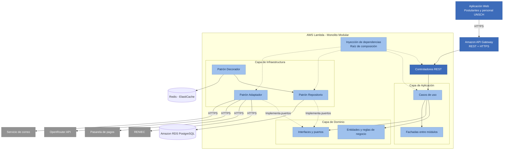

# 11. Patrones de Diseño

## Sistema Integral de Gestión del Proceso de Admisión – UNSCH

## 1. Objetivo

Documentar los patrones de diseño aplicados en el backend del Sistema Integral de Gestión del Proceso de Admisión – UNSCH, indicando dónde se utilizan, qué problemas resuelven y con qué tecnologías se implementan, para garantizar un desarrollo organizado, mantenible y uniforme.

## 2. Contexto

- **Estilo arquitectónico:** Monolito Modular por Capas.
- **Enfoque interno:** Clean Architecture.
- **Backend:** Node.js + TypeScript + Express.
- **Despliegue:** AWS Lambda.
- **Comunicación:** API REST mediante HTTPS.
- **Base de datos:** Amazon RDS PostgreSQL.
- **Caché:** Redis mediante Amazon ElastiCache.
- **Almacenamiento:** Amazon S3.
- **Inteligencia artificial:** OpenRouter API.
- **Base arquitectónica:** Diagrama de componentes C4 – Nivel 3.
- **Organización:** 14 módulos funcionales.

## 3. Patrones aplicados

| Patrón | Dónde se usa | Problema que resuelve | Se implementa con | Archivos en el código |
|---|---|---|---|---|
| Adaptador | Usuarios → RENIEC | El servicio de validación de identidad utiliza una interfaz externa. | API REST mediante HTTPS. | `identity-port.ts`, `reniec.adapter.ts` |
| Adaptador | Pagos → Pasarela de pagos | La pasarela tiene sus propios métodos de procesamiento y confirmación de pagos. | SDK o API REST mediante HTTPS. | `payment-port.ts`, `payment-gateway.adapter.ts` |
| Adaptador | Chatbot IA → OpenRouter API | La API de inteligencia artificial utiliza solicitudes y respuestas específicas. | API REST de OpenRouter mediante HTTPS. | `ai-port.ts`, `openrouter.adapter.ts` |
| Adaptador | Notificaciones → Servicio de correo | El proveedor de correo utiliza una interfaz propia para enviar mensajes. | Amazon SES o API de correo. | `notification-port.ts`, `email.adapter.ts` |
| Repositorio | Módulos de negocio → PostgreSQL | Evitar que las reglas de negocio dependan directamente de consultas SQL. | PostgreSQL mediante `pg` u ORM. | `inscripcion-repository.ts`, `postgres-inscripcion.repository.ts` |
| Decorador | Convocatorias y Configuración → Redis | Reducir las consultas repetitivas a la base de datos. | Redis mediante Amazon ElastiCache. | `cached-convocatoria.repository.ts` |
| Inyección de dependencias | Todos los módulos | Evitar el acoplamiento entre casos de uso e implementaciones concretas. | Interfaces de TypeScript y composición de objetos. | `inscripcion-ordinaria.module.ts`, `pagos.module.ts` |
| Fachada | Comunicación entre módulos | Proporcionar una interfaz controlada para utilizar funcionalidades de otros módulos. | Servicios y contratos públicos internos. | `usuarios.facade.ts`, `convocatorias.facade.ts` |

## 4. Cómo funciona cada patrón

| Patrón | En pocas palabras |
|---|---|
| Adaptador | El sistema solicita `validarDNI(dni)` y el adaptador transforma la operación en una petición HTTPS compatible con RENIEC. |
| Adaptador | El módulo Pagos solicita `crearPago(monto)` y el adaptador realiza la operación correspondiente en la pasarela de pagos. |
| Adaptador | El chatbot solicita `generarRespuesta(mensaje)` y el adaptador se comunica con OpenRouter API. |
| Repositorio | El caso de uso solicita `guardar(inscripcion)` y el repositorio ejecuta la operación en PostgreSQL. |
| Decorador | Primero consulta Redis; si no encuentra la información, consulta PostgreSQL y almacena temporalmente el resultado en caché. |
| Inyección de dependencias | El caso de uso recibe interfaces mediante su constructor, sin crear directamente conexiones o servicios externos. |
| Fachada | Un módulo utiliza una interfaz pública para consultar funcionalidades de otro módulo sin acceder directamente a sus componentes internos. |

## 5. Diagrama de patrones de diseño

**Nota:** Las flechas continuas representan principalmente el flujo de utilización. Las flechas discontinuas representan implementación de contratos o composición de dependencias. Las reglas de dependencia del código se mantienen conforme a Clean Architecture.

## 6. Beneficios de los patrones

- **Adaptador:** permite cambiar RENIEC, la pasarela de pagos, OpenRouter API o el servicio de correo sin modificar las reglas de negocio.
- **Repositorio:** mantiene el acceso a PostgreSQL separado del dominio.
- **Decorador:** permite utilizar Redis para mejorar el rendimiento sin modificar la lógica principal.
- **Inyección de dependencias:** facilita las pruebas unitarias mediante implementaciones simuladas.
- **Fachada:** reduce el acoplamiento entre los 14 módulos funcionales.

## 7. Patrones previstos para las siguientes iteraciones

| Patrón | Dónde se aplicaría | Cuándo |
|---|---|---|
| Observador | Inscripciones y Pagos → Notificaciones | Cuando se implementen eventos de confirmación de inscripción y pago. |
| Fábrica | Inscripción Ordinaria y Exonerados | Cuando la creación de inscripciones requiera reglas específicas según la modalidad. |
| Estrategia | Evaluación de expedientes | Cuando existan diferentes criterios de evaluación según la modalidad de admisión. |
| Estado | Inscripciones y Expedientes | Cuando aumente la complejidad de las transiciones entre estados. |
| Fachada | Comunicación entre módulos | Cuando sea necesario ampliar las interfaces públicas internas. |

## 8. Relación con las decisiones arquitectónicas

| Patrón | Decisión arquitectónica relacionada |
|---|---|
| Adaptador | ADR-007 - Integración mediante interfaces y adaptadores |
| Repositorio | ADR-002 - Clean Architecture y ADR-004 - PostgreSQL |
| Decorador | ADR-005 - Estrategia de caché mediante Redis |
| Inyección de dependencias | ADR-001 - Monolito Modular y ADR-002 - Clean Architecture |
| Fachada | ADR-001 - Monolito Modular por Capas |
| Observador | ADR-009 - Comunicación asíncrona mediante eventos |

## 9. Resumen

| Aspecto | Descripción |
|---|---|
| Arquitectura | Monolito Modular por Capas |
| Enfoque | Clean Architecture |
| Patrones principales | Adaptador, Repositorio, Decorador, Inyección de dependencias y Fachada |
| Patrones previstos | Observador, Fábrica, Estrategia y Estado |
| Backend | Node.js + TypeScript + Express |
| Despliegue | AWS Lambda |
| Comunicación | API REST mediante HTTPS |
| Base de datos | Amazon RDS PostgreSQL |
| Caché | Redis |
| Integraciones | RENIEC, pasarela de pagos, OpenRouter API y correo |

## 10. Conclusión

La aplicación de patrones de diseño permitirá mantener una estructura uniforme, reducir el acoplamiento entre componentes y facilitar el mantenimiento del Sistema Integral de Gestión del Proceso de Admisión – UNSCH.

Los patrones Adaptador, Repositorio, Decorador, Inyección de dependencias y Fachada se consideran parte del diseño propuesto. Su implementación concreta deberá verificarse durante el desarrollo.

El sistema conservará una arquitectura de Monolito Modular por Capas, utilizando Clean Architecture para organizar las responsabilidades internas y AWS Lambda para su despliegue.