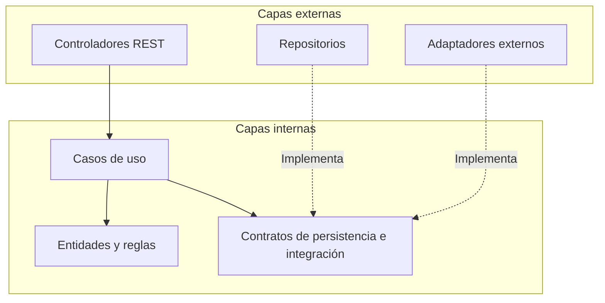

# 8. Patrones de Diseño

## Sistema de Gestión del Proceso de Admisión – UNSCH

## 8.1. Objetivo

Definir los patrones de diseño que se utilizarán en el sistema para organizar las responsabilidades, reducir el acoplamiento y facilitar las pruebas y el mantenimiento.

Esta propuesta corresponde al diseño arquitectónico inicial del Sprint 1.

## 8.2. Contexto arquitectónico

| Aspecto | Definición |
|---|---|
| Estilo arquitectónico | Monolito Modular por Capas. |
| Enfoque interno | Clean Architecture. |
| Organización funcional | 12 módulos integrados en una aplicación backend. |
| Frontend | Angular. |
| Backend | Node.js, TypeScript y Express. |
| Acceso al backend | Amazon API Gateway y AWS Lambda. |
| Comunicación | API REST mediante HTTPS. |
| Persistencia | Amazon RDS PostgreSQL. |
| Almacenamiento de documentos | Amazon S3 privado. |
| Procesamiento asíncrono | Outbox en PostgreSQL y Amazon SQS. |
| Integraciones | RENIEC vía apiperu, Izipay micuentaweb, Culqi, OpenRouter API y Amazon SES. |

## 8.3. Patrones seleccionados

| Patrón o mecanismo | Dónde se utilizará | Problema que resolverá |
|---|---|---|
| Adaptador | Integraciones de identidad, pagos, chatbot, correo y almacenamiento. | Evitar que los casos de uso dependan de los protocolos y SDK de cada proveedor. |
| Repositorio | Persistencia de los módulos que gestionen información. | Separar las operaciones de negocio de las consultas y detalles de PostgreSQL. |
| Fábrica simple | Creación y selección de adaptadores. | Centralizar la elección de proveedores reales o simulados según la configuración. |
| Inyección de dependencias | Composición de los módulos y casos de uso. | Proporcionar las dependencias mediante contratos sin crearlas dentro de la lógica de negocio. |
| Fachada | Acceso público a las funcionalidades de cada módulo. | Permitir la colaboración entre módulos sin exponer sus componentes internos. |
| Publicación y suscripción | Comunicación de eventos entre módulos. | Permitir que varios módulos reaccionen a un hecho sin acoplarlos directamente al productor. |
| Transactional Outbox | Operaciones que deban guardar datos y emitir eventos. | Evitar que se confirme un cambio de negocio sin conservar el evento que debe comunicarse. |

La inyección de dependencias es un mecanismo de diseño. Publicación y suscripción y Transactional Outbox son patrones de comunicación y persistencia que complementarán los patrones de diseño del sistema.

## 8.4. Aplicación de los patrones

### Adaptador

Se definirán interfaces internas para representar los servicios que necesita el sistema. Los adaptadores de infraestructura convertirán estas operaciones en solicitudes compatibles con cada proveedor.

| Interfaz propuesta | Adaptador | Módulo relacionado |
|---|---|---|
| `IdentityProvider` | Consulta de identidad mediante apiperu. | Usuarios. |
| `PaymentGateway` | Izipay micuentaweb para tarjetas. | Pagos. |
| `YapeGateway` | Culqi para Yape. | Pagos. |
| `LlmProvider` | OpenRouter API. | Chatbot IA. |
| `EmailSender` | Amazon SES. | Notificaciones. |
| `FileStorage` | Amazon S3 privado. | Expedientes e Inscripciones. |

Los casos de uso utilizarán estas interfaces. Las credenciales y los detalles de comunicación permanecerán en la infraestructura del backend.

### Repositorio

Los módulos utilizarán contratos de repositorio para consultar y almacenar información sin depender directamente de PostgreSQL.

Por ejemplo, Inscripciones podrá utilizar una interfaz `InscripcionesRepository` con operaciones como:

- Buscar una inscripción por postulante y convocatoria.
- Registrar una inscripción.
- Consultar su estado.
- Guardar una transición de estado válida.

La infraestructura implementará estas operaciones. Los procesos que requieran modificar varios registros y guardar eventos compartirán una misma transacción.

### Fábrica simple

Las fábricas permitirán construir los adaptadores correspondientes a la configuración del entorno.

Por ejemplo, una fábrica podrá proporcionar un proveedor de identidad simulado durante las pruebas y el adaptador de apiperu cuando se utilice el servicio externo.

La selección se realizará en la composición de la aplicación, sin introducir condiciones sobre proveedores dentro de las reglas de negocio.

### Inyección de dependencias

Los casos de uso recibirán sus colaboradores mediante parámetros o constructores.

Por ejemplo, Registrar Inscripción recibirá los contratos necesarios para consultar convocatorias, verificar identidad y guardar la inscripción.

Este mecanismo permitirá sustituir las implementaciones externas por versiones controladas durante las pruebas.

### Fachada

Cada módulo expondrá una interfaz pública con las operaciones que otros módulos podrán utilizar.

Por ejemplo, Convocatorias ofrecerá consultas sobre la convocatoria vigente y sus condiciones. Inscripciones utilizará esas consultas sin importar clases internas ni acceder directamente a sus tablas.

El archivo `index.ts` podrá exportar esta interfaz pública y participar en la composición del módulo. La fachada estará constituida por el contrato de operaciones expuesto.

### Publicación y suscripción

Los módulos comunicarán hechos relevantes mediante eventos.

| Evento propuesto | Productor | Consumidores principales |
|---|---|---|
| `InscripcionRegistrada` | Inscripciones. | Notificaciones. |
| `PagoConfirmado` | Pagos. | Inscripciones y Notificaciones. |
| `ExpedienteEvaluado` | Expedientes. | Inscripciones y Notificaciones. |
| `AulaAsignada` | Exámenes, Sedes y Aulas. | Notificaciones. |
| `ResultadosPublicados` | Resultados. | Notificaciones. |

Cada consumidor ejecutará su propia responsabilidad. Por ejemplo, ante `PagoConfirmado`, Inscripciones verificará si corresponde actualizar la habilitación del postulante y Notificaciones enviará la comunicación pertinente.

El pago confirmado no sustituirá los requisitos documentales que correspondan a la modalidad.

### Transactional Outbox

Los eventos se guardarán en una tabla Outbox de PostgreSQL dentro de la misma transacción que la operación de negocio.

Un mecanismo de despacho enviará posteriormente los eventos a Amazon SQS para su procesamiento asíncrono.

La entrega podrá repetirse, por lo que los consumidores deberán aplicar idempotencia. También se establecerán reintentos controlados y seguimiento de errores.

Amazon SQS transportará los mensajes; la lógica para distribuirlos a los consumidores correspondientes se definirá en la aplicación. Una cola por sí sola no realiza difusión a todos los suscriptores.

## 8.5. Diagrama de dependencias

Las flechas continuas representan dependencias de uso y las discontinuas representan implementación de contratos.

La infraestructura dependerá de los contratos internos. Los casos de uso no dependerán de implementaciones concretas de PostgreSQL ni de proveedores externos.

## 8.6. Ejemplo: confirmación de un pago

1. El adaptador recibirá o consultará la confirmación de la pasarela.
2. El módulo Pagos verificará la autenticidad de la respuesta y los datos de la transacción.
3. Se comprobará si el pago ya fue procesado para evitar duplicidades.
4. En una misma transacción se guardarán la confirmación y el evento `PagoConfirmado` en Outbox.
5. El mecanismo de despacho enviará el evento a Amazon SQS.
6. Los consumidores procesarán el evento de forma idempotente.
7. Inscripciones verificará los requisitos de habilitación y actualizará el estado cuando corresponda.
8. Notificaciones gestionará el envío del correo mediante Amazon SES.

## 8.7. Relación con los 12 módulos

| Código | Módulo | Patrones o mecanismos principales |
|---|---|---|
| M01 | Convocatorias | Repositorio, Fachada e Inyección de dependencias. |
| M02 | Usuarios | Adaptador de identidad, Repositorio e Inyección de dependencias. |
| M03 | Inscripciones | Repositorio, Fachada, Publicación y suscripción y Outbox. |
| M04 | Pagos | Adaptador, Fábrica simple, Repositorio y Outbox. |
| M05 | Expedientes | Repositorio, Adaptador de almacenamiento y Outbox. |
| M06 | Exámenes, Sedes y Aulas | Repositorio, Fachada y Outbox. |
| M07 | Resultados | Repositorio, Fachada y Outbox. |
| M08 | Chatbot IA | Adaptador, Fábrica simple e Inyección de dependencias. |
| M09 | Notificaciones | Adaptador de correo, Publicación y suscripción e Inyección de dependencias. |
| M10 | Reportes | Fachada e Inyección de dependencias para consultas autorizadas. |
| M11 | Seguridad | Fachada, Repositorio e Inyección de dependencias. |
| M12 | Configuración | Repositorio, Fachada e Inyección de dependencias. |

Los patrones se aplicarán cuando exista una necesidad concreta. No se requerirá crear las mismas clases en todos los módulos.

## 8.8. Reglas de aplicación

1. Los controladores delegarán las operaciones en los casos de uso.
2. Los contratos pertenecerán a las capas internas que los necesiten.
3. Los repositorios y adaptadores se implementarán en infraestructura.
4. Las fábricas y la composición se mantendrán fuera del dominio.
5. Los módulos colaborarán mediante sus interfaces públicas o eventos.
6. Ningún módulo modificará directamente las tablas de otro.
7. Las operaciones de negocio y sus eventos se guardarán de forma atómica cuando corresponda.
8. Los consumidores admitirán mensajes repetidos sin duplicar efectos.
9. Las credenciales externas permanecerán en el backend.
10. Las pruebas verificarán reglas de negocio, contratos y escenarios de falla.

## 8.9. Relación con los atributos de calidad

| Atributo | Contribución del diseño |
|---|---|
| Rendimiento | Las tareas complementarias podrán ejecutarse de forma asíncrona. |
| Disponibilidad | Los eventos persistidos permitirán continuar tareas cuando se recuperen los servicios. |
| Escalabilidad | SQS permitirá regular el procesamiento de tareas, respetando la capacidad de PostgreSQL. |
| Seguridad | Los adaptadores centralizarán las credenciales y la comunicación con proveedores. |
| Mantenibilidad | Adaptador, Repositorio y Fachada reducirán el acoplamiento. |
| Integridad | Las transacciones y Outbox mantendrán consistencia entre cambios y eventos. |
| Usabilidad | Los errores controlados permitirán comunicar estados comprensibles al usuario. |
| Interoperabilidad | Los adaptadores normalizarán el intercambio con servicios externos. |
| Confiabilidad | La idempotencia, los reintentos y la persistencia de eventos reducirán pérdidas y duplicidades. |

## 8.10. Alcance del Sprint 1

En el Sprint 1 se definirán los patrones seleccionados, sus responsabilidades y los contratos principales.

Su implementación y validación se realizarán progresivamente en los siguientes sprints, manteniendo los 12 módulos dentro de la arquitectura de Monolito Modular por Capas.