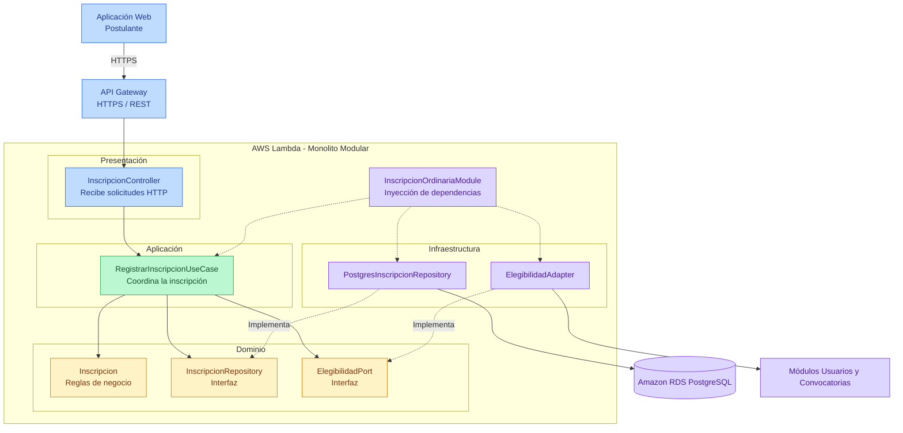

# 12. Principios de Diseño (SOLID)

## Sistema Integral de Gestión del Proceso de Admisión – UNSCH

## 1. Objetivo

Documentar cómo se aplican los principios SOLID en el backend del Sistema Integral de Gestión del Proceso de Admisión – UNSCH, organizado mediante Clean Architecture, para garantizar que los módulos se desarrollen de manera uniforme, mantenible y desacoplada de las tecnologías externas.

## 2. Contexto

- **Estilo arquitectónico:** Monolito Modular por Capas.
- **Enfoque interno:** Clean Architecture.
- **Capas:** Presentación, Aplicación, Dominio e Infraestructura.
- **Backend:** Node.js + TypeScript + Express.
- **Despliegue:** AWS Lambda.
- **Comunicación:** API REST mediante HTTPS.
- **Base de datos:** Amazon RDS PostgreSQL.
- **Caché:** Redis mediante Amazon ElastiCache.
- **Módulo de referencia:** Inscripción Ordinaria, porque integra validación de postulantes, convocatorias, registro de inscripciones y persistencia en PostgreSQL.

## 3. SOLID en el módulo Inscripción Ordinaria

### Diagrama de aplicación de SOLID

### Aplicación de los cinco principios SOLID

| Principio | Dónde se aplica (capa) | Cómo se cumple en el sistema UNSCH | Archivos |
|---|---|---|---|
| **S - Responsabilidad Única (SRP)** | Todas las capas | Cada clase tiene una responsabilidad específica: el controlador recibe solicitudes HTTP, el caso de uso coordina la inscripción, la entidad aplica las reglas de negocio y el repositorio guarda la información en PostgreSQL. | `inscripcion.controller.ts`, `registrar-inscripcion.use-case.ts`, `inscripcion.ts`, `postgres-inscripcion.repository.ts` |
| **O - Abierto/Cerrado (OCP)** | Aplicación e Infraestructura | Para incorporar otra implementación de persistencia o validación de elegibilidad, se crea un nuevo adaptador sin modificar el caso de uso, siempre que se mantenga el contrato establecido. | `inscripcion-repository.ts`, `postgres-inscripcion.repository.ts`, `elegibilidad-port.ts`, `elegibilidad.adapter.ts` |
| **L - Sustitución de Liskov (LSP)** | Dominio e Infraestructura | Las implementaciones de `InscripcionRepository` y `ElegibilidadPort` deben respetar sus contratos, permitiendo sustituirlas por implementaciones de prueba o alternativas sin alterar el comportamiento esperado. | `inscripcion-repository.ts`, `postgres-inscripcion.repository.ts`, `elegibilidad-port.ts`, `elegibilidad.adapter.ts` |
| **I - Segregación de Interfaces (ISP)** | Dominio | Cada interfaz contiene únicamente las operaciones necesarias: `InscripcionRepository` permite guardar y consultar inscripciones, mientras que `ElegibilidadPort` verifica las condiciones de inscripción. | `inscripcion-repository.ts`, `elegibilidad-port.ts` |
| **D - Inversión de Dependencias (DIP)** | Aplicación e Infraestructura | El caso de uso depende de interfaces y no conoce directamente PostgreSQL ni los módulos externos. Las implementaciones concretas se conectan mediante inyección de dependencias. | `registrar-inscripcion.use-case.ts`, `inscripcion-ordinaria.module.ts` |

## 4. Cómo funciona cada principio

| Principio | Explicación |
|---|---|
| **Responsabilidad Única (S)** | Cada clase realiza una tarea específica y tiene una razón principal para cambiar. |
| **Abierto/Cerrado (O)** | Se pueden incorporar nuevas implementaciones mediante extensiones sin modificar innecesariamente el código existente. |
| **Sustitución de Liskov (L)** | Una implementación puede reemplazar a otra si mantiene las condiciones y comportamientos definidos por su interfaz. |
| **Segregación de Interfaces (I)** | Los componentes dependen únicamente de las operaciones que realmente necesitan. |
| **Inversión de Dependencias (D)** | Los casos de uso dependen de abstracciones, mientras que los detalles tecnológicos implementan dichas abstracciones. |

## 5. Qué pasaría sin SOLID en el sistema UNSCH

| Situación real | Sin SOLID | Con SOLID |
|---|---|---|
| Se modifica la integración con RENIEC. | Se deben modificar directamente los casos de uso que validan identidades. | Se modifica o reemplaza `reniec.adapter.ts`. |
| Se cambia la pasarela de pagos. | El módulo Pagos depende directamente del proveedor anterior. | Se crea un nuevo adaptador que implementa `PaymentPort`. |
| Se cambia la implementación de persistencia. | Las reglas de negocio contienen consultas SQL y deben modificarse. | Se modifica la implementación del repositorio manteniendo su interfaz. |
| Se necesita probar una inscripción. | Se requiere conectar PostgreSQL y utilizar servicios externos reales. | Se utilizan repositorios y adaptadores simulados. |
| Cambian las reglas de inscripción ordinaria. | Las validaciones están distribuidas entre controladores y consultas SQL. | Las reglas se mantienen en el dominio y se coordinan desde los casos de uso. |
| Se modifica el proveedor de inteligencia artificial. | El módulo Chatbot depende directamente de OpenRouter API. | Se reemplaza el adaptador que implementa `AiPort`. |
| Se agrega una nueva modalidad de admisión. | Se modifican múltiples componentes sin una estructura definida. | Se incorporan reglas y componentes específicos respetando los contratos existentes. |

## 6. Relación con Clean Architecture y los patrones de diseño

| Principio | Cómo se aplica en el proyecto |
|---|---|
| **Responsabilidad Única** | Separación de responsabilidades entre Presentación, Aplicación, Dominio e Infraestructura. |
| **Abierto/Cerrado** | Patrón Adaptador para RENIEC, pasarela de pagos y OpenRouter API. |
| **Sustitución de Liskov** | Implementaciones intercambiables de repositorios y adaptadores que respetan los contratos. |
| **Segregación de Interfaces** | Interfaces específicas como `InscripcionRepository`, `ElegibilidadPort`, `PaymentPort` y `AiPort`. |
| **Inversión de Dependencias** | Patrón Repositorio, interfaces del dominio e inyección de dependencias mediante las raíces de composición. |

## 7. Aplicación de SOLID en los módulos del sistema

| Módulo | Aplicación principal de SOLID |
|---|---|
| M01 - Convocatorias | Separar la gestión de convocatorias de su persistencia. |
| M02 - Usuarios | Desacoplar la validación de identidad del servicio RENIEC. |
| M03 - Inscripción Ordinaria | Separar reglas de inscripción, casos de uso y repositorios. |
| M04 - Inscripción Exonerados | Encapsular reglas específicas de las modalidades especiales. |
| M05 - Pagos | Utilizar interfaces y adaptadores para las pasarelas de pago. |
| M06 - Expedientes | Separar la evaluación documental del almacenamiento de archivos. |
| M07 - Exámenes | Encapsular las reglas de programación de evaluaciones. |
| M08 - Sedes y Aulas | Separar las reglas de asignación y capacidad de aulas. |
| M09 - Resultados | Mantener independientes el cálculo, validación y publicación de resultados. |
| M10 - Chatbot IA | Desacoplar los casos de uso del proveedor OpenRouter API. |
| M11 - Notificaciones | Permitir sustituir proveedores de correo o SMS mediante adaptadores. |
| M12 - Reportes | Separar la generación de reportes de las consultas y formatos de exportación. |
| M13 - Seguridad | Separar autenticación, autorización y gestión de roles. |
| M14 - Configuración | Centralizar la configuración mediante interfaces controladas. |

## 8. Beneficios de aplicar SOLID

- **Mantenibilidad:** facilita modificar funcionalidades sin afectar innecesariamente otros módulos.
- **Escalabilidad del desarrollo:** permite que diferentes integrantes del equipo trabajen en módulos separados.
- **Flexibilidad:** facilita cambiar proveedores externos y tecnologías de infraestructura.
- **Pruebas:** permite utilizar implementaciones simuladas sin depender de servicios reales.
- **Modularidad:** mantiene responsabilidades y contratos claramente definidos.
- **Reutilización:** permite compartir contratos y componentes cuando exista una necesidad justificada.
- **Seguridad:** facilita concentrar las validaciones y controles en los componentes correspondientes.

## 9. Relación con las decisiones arquitectónicas

| Principio SOLID | Decisión arquitectónica relacionada |
|---|---|
| Responsabilidad Única | ADR-001 - Monolito Modular por Capas |
| Responsabilidad Única | ADR-002 - Clean Architecture |
| Abierto/Cerrado | ADR-007 - Integración mediante interfaces y adaptadores |
| Sustitución de Liskov | ADR-007 - Integración mediante interfaces y adaptadores |
| Segregación de Interfaces | ADR-002 - Clean Architecture |
| Inversión de Dependencias | ADR-002 - Clean Architecture |
| Inversión de Dependencias | ADR-004 - Persistencia mediante PostgreSQL |
| Inversión de Dependencias | ADR-011 - Chatbot inteligente mediante OpenRouter API |

## 10. Resumen

| Aspecto | Descripción |
|---|---|
| Proyecto | Sistema Integral de Gestión del Proceso de Admisión – UNSCH |
| Arquitectura | Monolito Modular por Capas |
| Enfoque | Clean Architecture |
| Principios | SRP, OCP, LSP, ISP y DIP |
| Módulo de referencia | Inscripción Ordinaria |
| Backend | Node.js + TypeScript + Express |
| Despliegue | AWS Lambda |
| Comunicación | API REST mediante HTTPS |
| Persistencia | Amazon RDS PostgreSQL |
| Integraciones | RENIEC, pasarela de pagos y OpenRouter API |
| Patrones relacionados | Adaptador, Repositorio e Inyección de Dependencias |

## 11. Conclusión

La aplicación de los principios SOLID en el Sistema Integral de Gestión del Proceso de Admisión – UNSCH permitirá desarrollar un backend organizado, mantenible y desacoplado de las tecnologías externas.

El módulo Inscripción Ordinaria constituye una referencia para aplicar estos principios en los demás módulos funcionales.

La combinación de **SOLID, Clean Architecture y Monolito Modular por Capas** facilitará la evolución del sistema sin comprometer las reglas de negocio, manteniendo un único backend desplegable mediante AWS Lambda y comunicación segura mediante HTTPS.

**Nota:** Este documento establece los principios y convenciones de diseño propuestos. Su cumplimiento deberá verificarse durante la implementación mediante revisiones de código, pruebas y análisis de dependencias.