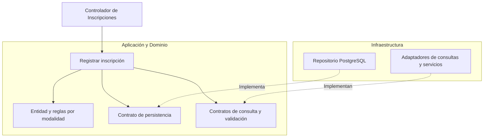

# 9. Principios de Diseño SOLID

## Sistema de Gestión del Proceso de Admisión – UNSCH

## 9.1. Objetivo

Definir cómo se aplicarán los principios SOLID en el diseño del backend para mantener responsabilidades claras, facilitar las pruebas y reducir la dependencia de tecnologías y proveedores externos.

Este documento corresponde a la propuesta de diseño inicial del Sprint 1.

## 9.2. Contexto arquitectónico

| Aspecto | Definición |
|---|---|
| Estilo arquitectónico | Monolito Modular por Capas. |
| Enfoque interno | Clean Architecture. |
| Organización | 12 módulos funcionales dentro de una aplicación backend. |
| Capas internas | Interfaces, Aplicación, Dominio e Infraestructura. |
| Frontend | Angular. |
| Backend | Node.js, TypeScript y Express. |
| Acceso y ejecución | Amazon API Gateway y AWS Lambda. |
| Comunicación | API REST mediante HTTPS. |
| Persistencia | Amazon RDS PostgreSQL. |
| Documentos | Amazon S3 privado. |
| Eventos | Outbox en PostgreSQL y Amazon SQS. |
| Integraciones | RENIEC vía apiperu, Izipay micuentaweb, Culqi, OpenRouter API y Amazon SES. |
| Módulo de referencia | M03 Inscripciones: Ordinaria y Exonerados. |

## 9.3. Aplicación de los cinco principios

| Principio | Criterio de diseño | Aplicación en el sistema |
|---|---|---|
| S — Responsabilidad Única | Cada componente tendrá una responsabilidad coherente y una razón principal para cambiar. | El controlador gestionará HTTP; el caso de uso coordinará la operación; el dominio aplicará reglas; el repositorio resolverá la persistencia. |
| O — Abierto/Cerrado | Los componentes permitirán extender comportamientos mediante contratos estables, limitando los cambios en la lógica existente. | Se podrán incorporar adaptadores de identidad, pagos o correo sin introducir detalles del proveedor en los casos de uso. |
| L — Sustitución de Liskov | Las implementaciones de un contrato deberán conservar sus condiciones y comportamientos esperados. | Un repositorio simulado podrá sustituir al de PostgreSQL en las pruebas que correspondan, respetando resultados, errores y reglas del contrato. |
| I — Segregación de Interfaces | Los componentes dependerán únicamente de las operaciones que necesiten. | Un caso de uso de consulta no dependerá de operaciones para registrar, anular o modificar inscripciones. |
| D — Inversión de Dependencias | Las reglas y los casos de uso dependerán de abstracciones; los detalles tecnológicos implementarán esas abstracciones. | Los casos de uso utilizarán interfaces de persistencia e integración, suministradas mediante inyección de dependencias. |

## 9.4. Aplicación en el módulo Inscripciones

El módulo M03 gestionará las modalidades Ordinaria y Exonerados. Compartirá las operaciones comunes y mantendrá separadas las reglas particulares de cada modalidad.

### Responsabilidad Única

El registro de una inscripción se distribuirá entre componentes con funciones definidas:

| Componente propuesto | Responsabilidad |
|---|---|
| `InscripcionesController` | Recibir solicitudes, validar su formato y devolver respuestas HTTP. |
| `RegistrarInscripcionUseCase` | Coordinar el registro y las validaciones necesarias. |
| `Inscripcion` | Representar la inscripción y proteger sus reglas y transiciones de estado. |
| Reglas por modalidad | Evaluar las condiciones particulares de Ordinaria y Exonerados. |
| `PostgresInscripcionesRepository` | Ejecutar las operaciones de persistencia. |
| Adaptadores de integración | Comunicarse con los servicios externos requeridos. |

La separación se realizará según las responsabilidades y necesidades del proceso, evitando crear clases sin una finalidad concreta.

### Abierto/Cerrado

Los casos de uso utilizarán contratos que permitan incorporar implementaciones alternativas.

Por ejemplo, un cambio en el proveedor de consulta de identidad se resolverá mediante un adaptador que respete `IdentityProvider`. Los detalles de autenticación y respuesta del proveedor permanecerán fuera de las reglas de inscripción.

Los cambios reales en las reglas de negocio podrán requerir modificar el dominio. Este principio no implica que el código existente nunca deba cambiar.

### Sustitución de Liskov

Las implementaciones de un mismo contrato deberán comportarse de forma compatible.

Por ejemplo, los repositorios de PostgreSQL y de prueba deberán respetar:

- El significado de los resultados devueltos.
- La representación de una inscripción inexistente.
- Los errores previstos para duplicidades.
- Las condiciones de las operaciones de registro y actualización.

Cumplir una interfaz de TypeScript no será suficiente: también se verificará el comportamiento mediante pruebas de contrato.

### Segregación de Interfaces

Los contratos se definirán según las necesidades de sus consumidores.

| Contrato propuesto | Operaciones necesarias |
|---|---|
| `InscripcionesConsulta` | Buscar inscripciones y consultar estados. |
| `InscripcionesRegistro` | Registrar una inscripción y verificar duplicidades. |
| `ConvocatoriasConsulta` | Consultar vigencia y condiciones de la convocatoria. |
| `IdentityProvider` | Consultar los datos de identidad necesarios. |

La separación se aplicará cuando evite dependencias innecesarias, sin fragmentar artificialmente todas las interfaces.

### Inversión de Dependencias

Registrar Inscripción dependerá de contratos internos y no de clientes concretos de PostgreSQL o de servicios externos.

La composición de la aplicación conectará el caso de uso con los repositorios y adaptadores elegidos.

Esto permitirá probar la coordinación del proceso mediante implementaciones controladas, sin requerir servicios externos reales en cada prueba.

## 9.5. Diagrama de dependencias

Las flechas continuas representan dependencias de uso y las discontinuas representan implementación de contratos.

Las implementaciones concretas se proporcionarán desde la composición de la aplicación. El dominio no dependerá de PostgreSQL, AWS ni de proveedores externos.

## 9.6. Ejemplos de cambios y respuesta del diseño

| Cambio | Respuesta prevista |
|---|---|
| Cambia la API de consulta de identidad. | Actualizar el adaptador de apiperu y comprobar que mantiene el contrato interno. |
| Se incorpora otro proveedor de pagos con capacidades compatibles. | Agregar un adaptador y ajustar su selección en la composición. |
| Una forma de pago requiere operaciones diferentes. | Definir un contrato específico sin obligar a otros adaptadores a implementar funciones que no admiten. |
| Cambian los requisitos de Exonerados. | Actualizar las reglas de esa modalidad y sus pruebas dentro de Inscripciones y Expedientes, según corresponda. |
| Cambia el almacenamiento de documentos. | Incorporar otra implementación de `FileStorage`. |
| Se necesita probar una inscripción sin servicios reales. | Inyectar repositorios y proveedores de prueba que respeten los contratos. |
| Cambia el proveedor del chatbot. | Sustituir el adaptador de `LlmProvider` y validar sus capacidades, respuestas y errores. |

Izipay para tarjetas y Culqi para Yape podrán utilizar contratos distintos cuando sus capacidades lo requieran. No se asumirán intercambiables únicamente por ser proveedores de pagos.

## 9.7. Aplicación en los 12 módulos

| Código | Módulo | Aplicación principal de SOLID |
|---|---|---|
| M01 | Convocatorias | Separar las reglas de vigencia y cronogramas de la persistencia. |
| M02 | Usuarios | Separar la gestión de datos y cuentas de la consulta externa de identidad. |
| M03 | Inscripciones | Distinguir coordinación, reglas por modalidad y persistencia. |
| M04 | Pagos | Utilizar contratos específicos para tarjetas y Yape, separando la verificación del proveedor de las reglas del pago. |
| M05 | Expedientes | Separar evaluación documental, observaciones y almacenamiento de archivos. |
| M06 | Exámenes, Sedes y Aulas | Mantener responsabilidades diferenciadas para programación, capacidad y asignación dentro del mismo módulo. |
| M07 | Resultados | Separar cálculo de puntajes, validación, autorización y publicación. |
| M08 | Chatbot IA | Separar consultas autorizadas, coordinación del asistente y comunicación con OpenRouter. |
| M09 | Notificaciones | Separar la preparación de mensajes, el procesamiento de eventos y el envío mediante SES. |
| M10 | Reportes | Separar consultas autorizadas, elaboración de informes y formatos de salida. |
| M11 | Seguridad | Diferenciar autenticación, autorización, permisos y registro de auditoría. |
| M12 | Configuración | Exponer operaciones específicas para administrar parámetros e integraciones. |

La agrupación en un mismo módulo no implicará concentrar todas sus funciones en una sola clase.

## 9.8. Relación con Clean Architecture y los patrones

| Principio | Relación con el diseño |
|---|---|
| Responsabilidad Única | Separación de funciones entre capas, casos de uso, entidades y adaptadores. |
| Abierto/Cerrado | Extensión mediante Adaptador y selección de implementaciones mediante Fábrica simple. |
| Sustitución de Liskov | Contratos de comportamiento verificables para repositorios y adaptadores. |
| Segregación de Interfaces | Puertos y fachadas definidos según las necesidades de cada consumidor. |
| Inversión de Dependencias | Repositorios y adaptadores que implementan contratos internos, conectados mediante inyección de dependencias. |

La publicación de eventos y Outbox complementarán este diseño para comunicar módulos y conservar eventos de forma transaccional. Su uso no demostrará por sí solo el cumplimiento de SOLID.

## 9.9. Criterios de verificación

| Principio | Cómo se verificará |
|---|---|
| SRP | Revisar que los controladores, casos de uso y adaptadores mantengan responsabilidades coherentes. |
| OCP | Comprobar que una implementación alternativa pueda incorporarse sin introducir detalles del proveedor en el dominio. |
| LSP | Ejecutar pruebas de contrato sobre implementaciones intercambiables. |
| ISP | Revisar que los consumidores no dependan de operaciones que no utilizan. |
| DIP | Analizar las dependencias y comprobar que las capas internas no importen implementaciones de infraestructura. |

Las pruebas de integración verificarán adicionalmente las transacciones, restricciones y comunicaciones reales que no puedan reproducirse fielmente con simulaciones.

## 9.10. Alcance del Sprint 1

En el Sprint 1 se definirán las responsabilidades por capa, los contratos principales y las reglas de dependencia de los 12 módulos.

La aplicación de SOLID se verificará durante los siguientes sprints mediante revisiones de código, pruebas y análisis de dependencias, manteniendo la arquitectura de Monolito Modular por Capas con Clean Architecture.