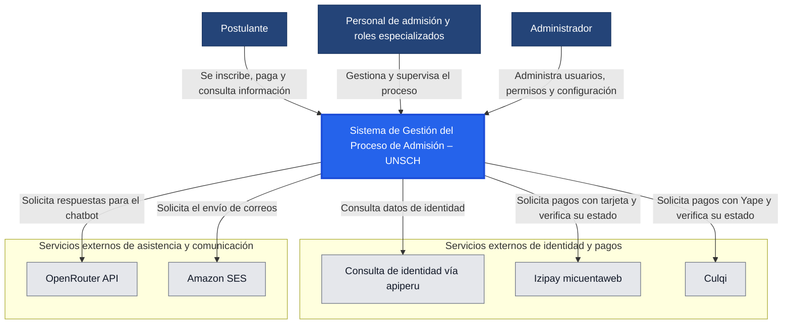

# Nivel 1 · Diagrama de Contexto del Sistema

**Proyecto:** Sistema de Gestión del Proceso de Admisión – UNSCH  
**Modelo:** C4 · Nivel 1  
**Entrega:** Sprint 1 · Diseño inicial

## 1. Objetivo

Representar el Sistema de Gestión del Proceso de Admisión UNSCH como una unidad, identificando las personas que lo utilizarán y los sistemas externos con los que se integrará.

Esta vista permitirá comprender el alcance del proyecto y sus relaciones con el entorno.

| Aspecto | Descripción |
|---|---|
| Pregunta principal | ¿Quién utiliza el sistema y con qué servicios externos se relaciona? |
| Audiencia | Personal de admisión, autoridades, docente y equipo de desarrollo. |
| Sistema en alcance | Plataforma de gestión del proceso de admisión UNSCH. |
| Alcance funcional | Inscripciones Ordinaria y Exonerados, pagos, expedientes, exámenes, resultados y atención al postulante. |
| Detalles internos | Los 12 módulos, las capas y la infraestructura se desarrollarán en las vistas posteriores. |

## 2. Diagrama de contexto

Para facilitar la lectura, el personal de admisión y los roles especializados se agrupan en una sola categoría visual. Sus responsabilidades se detallan en la sección 3.

Las relaciones expresan el propósito de la interacción. Las solicitudes, respuestas y confirmaciones técnicas se detallarán en los niveles posteriores.

## 3. Personas que utilizarán el sistema

| Persona | Responsabilidad | Interacción principal |
|---|---|---|
| Postulante | Participar en el proceso de admisión. | Registrar datos, seleccionar modalidad y programa, presentar documentos, pagar y consultar inscripción, aula y resultados. |
| Personal de Admisión | Gestionar el proceso de admisión. | Administrar convocatorias, postulantes e inscripciones y consultar reportes. |
| Administrador | Administrar el acceso y la configuración. | Gestionar usuarios, roles, permisos y parámetros generales. |
| Evaluador Documental | Revisar los documentos presentados. | Aprobar, observar o rechazar expedientes y revisar subsanaciones. |
| Responsable de Tesorería | Supervisar los pagos de inscripción. | Verificar transacciones, conciliar pagos y consultar recaudación. |
| Coordinador de Exámenes | Organizar las evaluaciones. | Programar exámenes, gestionar sedes y aulas y distribuir postulantes. |
| Responsable de Resultados | Gestionar calificaciones y resultados. | Registrar, validar y publicar resultados según los permisos y aprobaciones establecidos. |
| Personal de Soporte | Atender consultas e incidencias. | Resolver solicitudes y atender casos derivados del chatbot. |

Los roles especializados se representan como personas con responsabilidades diferentes, aunque utilicen la misma plataforma.

## 4. Sistema en alcance

| Sistema | Responsabilidad |
|---|---|
| Sistema de Gestión del Proceso de Admisión – UNSCH | Centralizar la gestión de convocatorias, usuarios, inscripciones, pagos, expedientes, exámenes, sedes, aulas, resultados, orientación, notificaciones, reportes, seguridad y configuración. |

Su organización interna comprenderá 12 módulos funcionales:

| Código | Módulo |
|---|---|
| M01 | Convocatorias |
| M02 | Usuarios |
| M03 | Inscripciones: Ordinaria y Exonerados |
| M04 | Pagos |
| M05 | Expedientes |
| M06 | Exámenes, Sedes y Aulas |
| M07 | Resultados |
| M08 | Chatbot IA |
| M09 | Notificaciones |
| M10 | Reportes |
| M11 | Seguridad |
| M12 | Configuración |

Los módulos se enumeran para mantener la trazabilidad del alcance. En el diagrama de contexto permanecen contenidos dentro de una sola representación del sistema.

## 5. Sistemas externos

| Sistema externo | Responsabilidad | Relación con el sistema UNSCH |
|---|---|---|
| Consulta de identidad vía apiperu | Proporcionar consultas de datos de identidad vinculados a RENIEC, conforme a las condiciones y autorizaciones aplicables. | Permitir verificar la identidad del postulante antes de habilitar el pago. |
| Izipay micuentaweb | Procesar pagos con tarjeta y comunicar su estado. | Permitir pagar la inscripción y verificar la confirmación de la transacción. |
| Culqi | Proporcionar el procesamiento de pagos con Yape. | Permitir pagar mediante Yape y verificar el resultado de la operación. |
| OpenRouter API | Proporcionar acceso a modelos de inteligencia artificial. | Generar respuestas del chatbot a partir de consultas y datos autorizados. |
| Amazon SES | Proporcionar el servicio de envío de correo electrónico. | Enviar confirmaciones y avisos relacionados con el proceso de admisión. |

La relación de identidad se representa mediante apiperu porque será el punto de integración seleccionado. No se representa una conexión directa del sistema con RENIEC.

## 6. Relaciones principales

| Origen | Destino | Propósito |
|---|---|---|
| Postulante | Sistema UNSCH | Registrar su postulación, efectuar pagos y consultar su proceso. |
| Personal de Admisión | Sistema UNSCH | Gestionar convocatorias, postulantes e inscripciones. |
| Administrador | Sistema UNSCH | Administrar usuarios, permisos y configuración. |
| Evaluador Documental | Sistema UNSCH | Revisar expedientes y registrar observaciones o aprobaciones. |
| Responsable de Tesorería | Sistema UNSCH | Verificar y conciliar pagos. |
| Coordinador de Exámenes | Sistema UNSCH | Programar evaluaciones y asignar ambientes. |
| Responsable de Resultados | Sistema UNSCH | Gestionar calificaciones y publicar resultados autorizados. |
| Personal de Soporte | Sistema UNSCH | Atender consultas e incidencias. |
| Sistema UNSCH | Consulta de identidad vía apiperu | Verificar datos de identidad del postulante. |
| Sistema UNSCH | Izipay micuentaweb | Solicitar y verificar pagos con tarjeta. |
| Sistema UNSCH | Culqi | Solicitar y verificar pagos con Yape. |
| Sistema UNSCH | OpenRouter API | Solicitar respuestas para la orientación y el seguimiento autorizado. |
| Sistema UNSCH | Amazon SES | Solicitar el envío de correos electrónicos. |

## 7. Decisiones y supuestos iniciales

| N.º | Decisión o supuesto | Justificación |
|---|---|---|
| 1 | Ordinaria y Exonerados se gestionarán en una misma plataforma. | Centralizar el proceso conservando las reglas de cada modalidad. |
| 2 | Los postulantes accederán mediante una aplicación web responsiva. | Facilitar el uso desde computadoras y dispositivos móviles. |
| 3 | La inscripción no exigirá crear una cuenta; el acceso a información personal requerirá mecanismos de verificación. | Facilitar el registro y proteger las consultas de seguimiento. |
| 4 | La consulta de identidad se realizará mediante apiperu, sujeta a las condiciones de acceso del proveedor. | Verificar los datos del postulante antes del pago. |
| 5 | Se utilizarán Izipay micuentaweb para tarjetas y Culqi para Yape. | Ofrecer los métodos de pago seleccionados. |
| 6 | Las confirmaciones de pago se verificarán en el backend. | Evitar habilitar inscripciones a partir de respuestas no verificadas del navegador. |
| 7 | El chatbot utilizará OpenRouter API. | Brindar orientación y seguimiento con acceso controlado a información. |
| 8 | Las notificaciones externas se enviarán mediante Amazon SES. | Comunicar estados y acontecimientos relevantes por correo electrónico. |
| 9 | El personal utilizará permisos según sus responsabilidades. | Restringir las operaciones administrativas y el acceso a datos. |
| 10 | Los resultados se publicarán después de su validación y autorización. | Proteger la integridad del proceso de admisión. |
| 11 | Los servicios externos serán administrados por sus proveedores. | Delimitar las responsabilidades del proyecto. |

## 8. Aspectos por validar

| Tema | Validación necesaria |
|---|---|
| Consulta de identidad | Condiciones de uso, autorización, cobertura y credenciales del proveedor. |
| Pagos | Condiciones comerciales, credenciales y procedimientos de confirmación y conciliación. |
| Correo electrónico | Remitente autorizado y condiciones de envío. |
| Chatbot | Modelo, límites de consumo y criterios de derivación al personal de soporte. |
| Protección de datos | Información que podrá consultarse, almacenarse y enviarse a proveedores externos. |
| Roles y permisos | Responsabilidades aprobadas por el área de admisión. |
| Reglas de admisión | Requisitos, modalidades, cronogramas, vacantes y condiciones oficiales. |
| Resultados | Responsables de validación, autorización y publicación. |

## 9. Alcance del Sprint 1

Esta vista establece las personas, los límites del sistema y las integraciones seleccionadas para la propuesta inicial.

El nivel 2 del modelo C4 describirá la aplicación web, el backend, la base de datos y los servicios de almacenamiento y mensajería. El nivel 3 detallará los componentes internos del backend modular.

## 7. Pendientes por definir

| **Tema** | **Detalle** | **Resolución (02/11/2026)** |
|---|---|---|
| **Acceso a RENIEC** | Confirmar los requisitos institucionales, credenciales y servicios disponibles para validar el DNI de los postulantes. | ✅ apiperu.dev con token; simulador para desarrollo |
| **Proveedor de pagos** | Seleccionar la pasarela de pagos y definir los métodos de pago, confirmaciones y conciliación. | ✅ Izipay micuentaweb para tarjeta (ADR-016) y Culqi para Yape (ADR-019); conciliación en Tesorería. Faltan las claves de producción |
| **Servicio de correo** | Definir el proveedor encargado de enviar confirmaciones y notificaciones. | ✅ Amazon SES |
| **Servicio SMS** | Determinar si se implementarán notificaciones mediante mensajes de texto. | No se implementa por ahora (opcional, RC16) |
| **Modelo de IA** | Seleccionar el modelo disponible mediante OpenRouter API y establecer sus límites de uso. | ✅ Modelo configurable (`OPENROUTER_MODEL`), presupuesto diario y modo básico sin clave (ADR-017) |
| **Política de privacidad** | Definir qué información puede enviarse al chatbot y a los servicios externos. | ✅ Datos mínimos con pase firmado; consentimiento en la inscripción y anonimización por retención |
| **Roles y permisos** | Validar con el área de admisión las responsabilidades de cada usuario administrativo. | ✅ 8 roles definidos en el panel (ADR-018); pendiente la validación formal con la Dirección de Admisión |
| **Reglas de admisión** | Confirmar los requisitos, modalidades, vacantes y procedimientos oficiales de cada convocatoria. | ✅ Configurables como datos en el panel (catálogo del concurso) |
| **Publicación de resultados** | Definir los responsables y procedimientos de aprobación de resultados oficiales. | ✅ Aprobación de otra persona y publicación a la hora autorizada |
