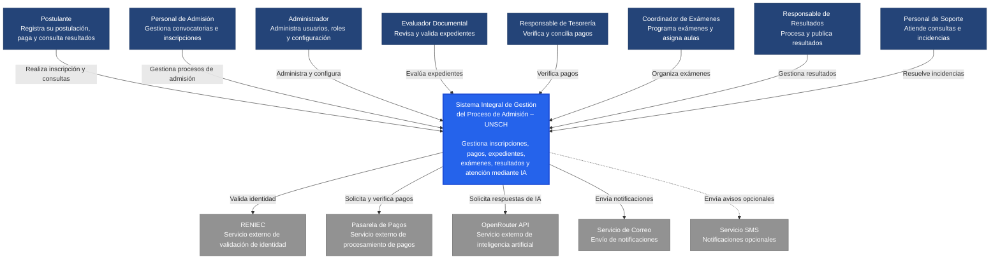

# Nivel 1 · Diagrama de Contexto del Sistema

> **Proyecto:** Sistema Integral de Gestión del Proceso de Admisión – UNSCH  
> **Modelo:** C4 · Nivel 1 de 4 · **Versión:** 1.0

---

## 1. Objetivo

Mostrar el **Sistema Integral de Gestión del Proceso de Admisión – UNSCH como una sola caja**, identificando a los usuarios que interactúan con él y los sistemas externos con los que se comunica.

Este diagrama representa la vista general del sistema, sin mostrar su arquitectura interna, componentes tecnológicos ni infraestructura.

| **Aspecto** | **Descripción** |
|---|---|
| Pregunta que responde | ¿Qué es el sistema de admisión, quiénes lo utilizan y con qué sistemas externos se integra? |
| Audiencia | Personal de admisión, autoridades universitarias, docentes, equipo de desarrollo y responsables de operaciones. |
| Qué **no** muestra | Tecnologías, servidores, bases de datos, AWS Lambda, módulos internos ni detalles de implementación. |
| Siguiente nivel | `Nivel2-Diagrama-de-Contenedores.md` |

---

## 2. Diagrama

### Diagrama de contexto del Sistema Integral de Gestión del Proceso de Admisión – UNSCH

**Descripción:** El Sistema Integral de Gestión del Proceso de Admisión – UNSCH centraliza los procesos de admisión universitaria y permite la interacción de postulantes y personal autorizado con servicios externos de validación de identidad, pagos, inteligencia artificial y notificaciones.

---

## 3. Personas (usuarios)

| **Persona** | **Descripción** | **Qué hace en el sistema** |
|---|---|---|
| **Postulante** | Persona que desea ingresar a la Universidad Nacional de San Cristóbal de Huamanga. | Registra sus datos, selecciona modalidad y programa de estudios, adjunta documentos, realiza pagos, consulta su inscripción, ubicación de examen y resultados. |
| **Personal de Admisión** | Responsable de administrar los procesos de admisión universitaria. | Gestiona convocatorias, postulantes, inscripciones y seguimiento de los procesos. |
| **Administrador** | Responsable de la administración y configuración del sistema. | Gestiona usuarios, roles, permisos, modalidades, programas, vacantes y parámetros del sistema. |
| **Evaluador Documental** | Personal encargado de revisar los documentos presentados por los postulantes. | Evalúa expedientes, aprueba documentos y registra observaciones. |
| **Responsable de Tesorería** | Personal encargado de supervisar los pagos de inscripción. | Consulta, verifica y concilia los pagos realizados por los postulantes. |
| **Coordinador de Exámenes** | Responsable de organizar las evaluaciones de admisión. | Programa exámenes, administra sedes y aulas, y asigna ambientes a los postulantes. |
| **Responsable de Resultados** | Personal autorizado para gestionar las calificaciones. | Registra, valida y publica los resultados oficiales de admisión. |
| **Personal de Soporte** | Personal encargado de brindar asistencia a los usuarios. | Atiende consultas, incidencias y solicitudes derivadas del chatbot inteligente. |

---

## 4. Sistemas

| **Sistema** | **Tipo** | **Responsabilidad** | **Quién lo construye o administra** |
|---|---|---|---|
| **Sistema Integral de Gestión del Proceso de Admisión – UNSCH** | Sistema en alcance | Gestionar convocatorias, postulantes, inscripciones ordinarias y de exonerados, pagos, expedientes, exámenes, resultados, reportes y atención mediante chatbot inteligente. | Equipo de desarrollo del proyecto. |
| **RENIEC** | Sistema externo | Validar los datos de identidad de los postulantes mediante servicios autorizados. | Registro Nacional de Identificación y Estado Civil. |
| **Pasarela de Pagos** | Sistema externo | Procesar pagos de inscripción y proporcionar información sobre su estado. | Proveedor de servicios de pago por definir. |
| **OpenRouter API** | Sistema externo | Proporcionar acceso a modelos de inteligencia artificial para responder consultas del chatbot. | OpenRouter. |
| **Servicio de Correo Electrónico** | Sistema externo | Enviar confirmaciones, observaciones y notificaciones a los postulantes. | Proveedor de correo por definir. |
| **Servicio SMS** | Sistema externo opcional | Enviar avisos y recordatorios mediante mensajes de texto. | Proveedor SMS por definir. |

---

## 5. Relaciones

| **Origen** | **Destino** | **Descripción** | **Protocolo** |
|---|---|---|---|
| Postulante | Sistema de Admisión UNSCH | Registra datos, realiza inscripciones, consulta pagos, exámenes y resultados. | — |
| Personal de Admisión | Sistema de Admisión UNSCH | Administra convocatorias, postulantes e inscripciones. | — |
| Administrador | Sistema de Admisión UNSCH | Gestiona usuarios, roles, permisos y configuración. | — |
| Evaluador Documental | Sistema de Admisión UNSCH | Revisa, aprueba u observa expedientes. | — |
| Responsable de Tesorería | Sistema de Admisión UNSCH | Verifica y concilia pagos. | — |
| Coordinador de Exámenes | Sistema de Admisión UNSCH | Programa evaluaciones y asigna sedes y aulas. | — |
| Responsable de Resultados | Sistema de Admisión UNSCH | Procesa, valida y publica resultados. | — |
| Personal de Soporte | Sistema de Admisión UNSCH | Atiende consultas e incidencias. | — |
| Sistema de Admisión UNSCH | RENIEC | Solicita validación de identidad de postulantes. | HTTPS / API autorizada |
| Sistema de Admisión UNSCH | Pasarela de Pagos | Solicita operaciones de pago y verifica confirmaciones. | HTTPS / REST |
| Sistema de Admisión UNSCH | OpenRouter API | Envía consultas autorizadas y recibe respuestas de inteligencia artificial. | HTTPS / REST |
| Sistema de Admisión UNSCH | Servicio de Correo | Solicita el envío de confirmaciones y notificaciones. | HTTPS / API o protocolo seguro del proveedor |
| Sistema de Admisión UNSCH | Servicio SMS | Solicita el envío de notificaciones opcionales. | HTTPS / API |

> En el nivel 1 no se especifica el protocolo de comunicación entre las personas y el sistema. Los detalles de HTTPS, API Gateway, AWS Lambda y demás tecnologías se describirán en el diagrama de contenedores del nivel 2.

---

## 6. Decisiones y supuestos

| **#** | **Decisión o supuesto** | **Motivo** |
|---|---|---|
| 1 | El Sistema de Admisión UNSCH centralizará los procesos de admisión ordinaria y de exonerados. | Facilitar la gestión institucional y evitar procesos aislados. |
| 2 | Los postulantes utilizarán una plataforma web para realizar sus inscripciones. | Permitir el acceso desde computadoras y dispositivos móviles. |
| 3 | La validación de identidad se realizará mediante RENIEC, siempre que exista autorización de acceso. | Mejorar la verificación de los datos personales. |
| 4 | Los pagos se procesarán mediante una pasarela externa. | Evitar que el sistema procese directamente información sensible de tarjetas bancarias. |
| 5 | El chatbot utilizará OpenRouter API. | Proporcionar orientación automatizada y seguimiento de procesos de admisión. |
| 6 | Los servicios externos se integrarán mediante interfaces y adaptadores. | Reducir el acoplamiento y facilitar el cambio de proveedores. |
| 7 | El sistema contará con autenticación y autorización basada en roles. | Restringir el acceso a información y operaciones administrativas. |
| 8 | Las comunicaciones entre el sistema y los servicios externos utilizarán HTTPS cuando corresponda. | Proteger la información transmitida. |
| 9 | Los resultados oficiales solo podrán publicarse después de su validación y autorización. | Garantizar la integridad y confiabilidad del proceso. |
| 10 | Los sistemas externos no forman parte del desarrollo del proyecto. | Son administrados por terceros y se utilizarán mediante integraciones autorizadas. |

---

## 7. Pendientes por definir

| **Tema** | **Detalle** |
|---|---|
| **Acceso a RENIEC** | Confirmar los requisitos institucionales, credenciales y servicios disponibles para validar el DNI de los postulantes. |
| **Proveedor de pagos** | Seleccionar la pasarela de pagos y definir los métodos de pago, confirmaciones y conciliación. |
| **Servicio de correo** | Definir el proveedor encargado de enviar confirmaciones y notificaciones. |
| **Servicio SMS** | Determinar si se implementarán notificaciones mediante mensajes de texto. |
| **Modelo de IA** | Seleccionar el modelo disponible mediante OpenRouter API y establecer sus límites de uso. |
| **Política de privacidad** | Definir qué información puede enviarse al chatbot y a los servicios externos. |
| **Roles y permisos** | Validar con el área de admisión las responsabilidades de cada usuario administrativo. |
| **Reglas de admisión** | Confirmar los requisitos, modalidades, vacantes y procedimientos oficiales de cada convocatoria. |
| **Publicación de resultados** | Definir los responsables y procedimientos de aprobación de resultados oficiales. |

---

## 8. Relación con los siguientes niveles C4

| **Nivel** | **Diagrama** | **Descripción** |
|---|---|---|
| **Nivel 1** | Diagrama de Contexto | Identifica usuarios, sistema principal y sistemas externos. |
| **Nivel 2** | Diagrama de Contenedores | Muestra aplicación web, API Gateway, AWS Lambda, PostgreSQL, Redis y demás componentes desplegables. |
| **Nivel 3** | Diagrama de Componentes | Describe los módulos funcionales y las capas internas del backend. |
| **Nivel 4** | Diagrama de Código | Presenta clases, interfaces, casos de uso, repositorios y adaptadores. |

---

## 9. Resumen

| **Aspecto** | **Descripción** |
|---|---|
| Proyecto | Sistema Integral de Gestión del Proceso de Admisión – UNSCH |
| Modelo arquitectónico | C4 |
| Nivel | Nivel 1 – Contexto del Sistema |
| Usuarios principales | 8 tipos de usuarios |
| Sistema principal | Sistema Integral de Gestión del Proceso de Admisión – UNSCH |
| Sistemas externos | RENIEC, pasarela de pagos, OpenRouter API, correo electrónico y SMS opcional |
| Integraciones | Servicios externos mediante interfaces seguras |
| Alcance | Gestión integral del proceso de admisión universitaria |
| Siguiente documento | `Nivel2-Diagrama-de-Contenedores.md` |

