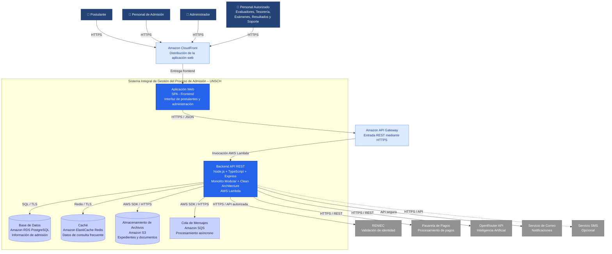

# Nivel 2 · Diagrama de Contenedores

> **Proyecto:** Sistema Integral de Gestión del Proceso de Admisión – UNSCH  
> **Modelo:** C4 · Nivel 2 de 4 · **Versión:** 1.0

---

## 1. Objetivo

Descomponer el **Sistema Integral de Gestión del Proceso de Admisión – UNSCH**, presentado en el nivel 1, para identificar los **contenedores** que lo conforman, las tecnologías utilizadas y los mecanismos de comunicación entre ellos.

Este nivel muestra la estructura tecnológica del sistema, incluyendo la aplicación web, el backend, los almacenes de datos y los servicios externos necesarios para gestionar el proceso de admisión universitaria.

| **Aspecto** | **Descripción** |
|---|---|
| Pregunta que responde | ¿De qué aplicaciones y almacenes de datos se compone el sistema y qué tecnologías utiliza? |
| Audiencia | Arquitectos de software, desarrolladores, docentes y responsables de operaciones. |
| Qué es un contenedor | Una aplicación o almacén de datos que se ejecuta o administra de manera independiente. No necesariamente representa un contenedor Docker. |
| Arquitectura | Monolito Modular por Capas con Clean Architecture. |
| Nivel anterior | `Nivel1-Diagrama-de-Contexto-del-Sistema.md` |
| Siguiente nivel | `Nivel3-Diagrama-de-Componentes.md` |

---

## 2. Diagrama

### Diagrama de contenedores del Sistema Integral de Gestión del Proceso de Admisión – UNSCH

**Descripción:** El sistema utiliza una aplicación web que se comunica mediante HTTPS con un backend REST implementado como Monolito Modular. El backend se ejecuta en AWS Lambda y utiliza PostgreSQL, Redis, Amazon S3 y Amazon SQS para gestionar la información y los procesos de admisión.

**Nota:** Amazon CloudFront y API Gateway se muestran como servicios de entrada y distribución. La aplicación web estática se almacenará en Amazon S3 y será entregada al navegador mediante CloudFront. Los servicios de infraestructura se detallan aquí para contextualizar el despliegue; no representan módulos internos del backend.

---

## 3. Contenedores

| **Contenedor** | **Tecnología** | **Responsabilidad** | **Datos que maneja** |
|---|---|---|---|
| **Aplicación Web** | SPA, tecnología frontend por definir, Amazon S3 y CloudFront | Proporcionar interfaces para postulantes, personal de admisión y administradores. Se ejecuta en el navegador. | Estado temporal de formularios, sesiones y datos de consulta. |
| **Backend API REST** | Node.js + TypeScript + Express, AWS Lambda | Exponer los endpoints REST, ejecutar las reglas de negocio, gestionar los 14 módulos funcionales e integrar servicios externos. | Procesa datos de postulantes, inscripciones, pagos, expedientes, exámenes y resultados. |
| **Base de Datos** | Amazon RDS PostgreSQL | Almacenar de forma persistente la información del proceso de admisión. | Usuarios, convocatorias, postulantes, inscripciones, pagos, expedientes, aulas, exámenes y resultados. |
| **Caché** | Redis mediante Amazon ElastiCache | Almacenar temporalmente información consultada frecuentemente para reducir tiempos de respuesta. | Convocatorias vigentes, programas, modalidades y configuraciones de consulta frecuente. |
| **Almacenamiento de Archivos** | Amazon S3 | Guardar documentos digitales, expedientes y archivos generados por el sistema. | Documentos de inscripción, comprobantes autorizados, fichas y archivos PDF. |
| **Cola de Mensajes** | Amazon SQS | Almacenar mensajes para tareas que pueden procesarse de manera asíncrona. | Solicitudes de notificación y otras tareas pendientes de procesamiento. |

### Servicios de infraestructura complementarios

| **Servicio** | **Tecnología** | **Responsabilidad** |
|---|---|---|
| **Distribución Web** | Amazon CloudFront | Distribuir el frontend mediante HTTPS. |
| **Entrada de API** | Amazon API Gateway | Recibir solicitudes REST y dirigirlas al backend AWS Lambda. |
| **Gestión de conexiones** | Amazon RDS Proxy | Administrar las conexiones del backend hacia PostgreSQL. |
| **Gestión de secretos** | AWS Secrets Manager | Proteger credenciales y claves de servicios externos. |
| **Monitoreo** | Amazon CloudWatch | Registrar métricas, eventos, errores y logs. |
| **DNS** | Amazon Route 53 | Gestionar los nombres de dominio del sistema. |
| **Certificados** | AWS Certificate Manager | Gestionar certificados TLS para las comunicaciones HTTPS. |

---

## 4. Relaciones

| **Origen** | **Destino** | **Descripción** | **Protocolo** |
|---|---|---|---|
| Postulante | Aplicación Web | Realiza inscripciones, consulta pagos, exámenes y resultados. | HTTPS |
| Personal de Admisión | Aplicación Web | Gestiona convocatorias, inscripciones y procesos administrativos. | HTTPS |
| Administrador | Aplicación Web | Administra usuarios, roles y configuración. | HTTPS |
| Personal Autorizado | Aplicación Web | Realiza evaluaciones, conciliaciones y gestión de resultados. | HTTPS |
| Aplicación Web | API Gateway | Envía solicitudes a los servicios del backend. | HTTPS / JSON |
| API Gateway | Backend API REST | Invoca la aplicación desplegada en AWS Lambda. | Integración AWS Lambda |
| Backend API REST | PostgreSQL | Consulta y registra información institucional mediante RDS Proxy. | PostgreSQL / TLS |
| Backend API REST | Redis | Consulta y actualiza información almacenada en caché. | Redis / TLS |
| Backend API REST | Amazon S3 | Guarda y recupera documentos autorizados. | AWS SDK / HTTPS |
| Backend API REST | Amazon SQS | Publica mensajes para procesamiento asíncrono. | AWS SDK / HTTPS |
| Backend API REST | RENIEC | Solicita validación de identidad de postulantes. | HTTPS / API autorizada |
| Backend API REST | Pasarela de Pagos | Solicita operaciones de pago y procesa confirmaciones verificadas. | HTTPS / REST |
| Backend API REST | OpenRouter API | Envía consultas del chatbot y recibe respuestas. | HTTPS / REST |
| Backend API REST | Servicio de Correo | Solicita el envío de confirmaciones y avisos. | API segura |
| Backend API REST | Servicio SMS | Envía notificaciones opcionales. | HTTPS / API |

---

## 5. Decisiones arquitectónicas reflejadas

| **Decisión** | **Alternativa descartada** | **Motivo** |
|---|---|---|
| **Un único backend basado en Monolito Modular** | Microservicios independientes | Reduce la complejidad de desarrollo, integración y mantenimiento para el equipo del proyecto. |
| **Clean Architecture dentro de los módulos** | Código organizado únicamente por controladores y servicios | Permite separar reglas de negocio, casos de uso e infraestructura. |
| **Frontend separado del backend** | Aplicación monolítica con páginas generadas en el servidor | Facilita el desarrollo y despliegue independiente de la interfaz web. |
| **AWS Lambda para ejecutar el backend** | Servidor dedicado administrado permanentemente | Permite un despliegue administrado y escalamiento según la demanda. |
| **API Gateway como entrada REST** | Exponer directamente el backend | Centraliza el acceso a los endpoints y permite aplicar controles de seguridad. |
| **PostgreSQL como base de datos principal** | Base de datos NoSQL como almacenamiento principal | Los procesos de inscripción, pagos y resultados requieren relaciones e integridad transaccional. |
| **Redis como caché** | Consultar PostgreSQL en todas las solicitudes | Reduce consultas repetitivas y mejora el rendimiento. |
| **Amazon S3 para documentos** | Guardar archivos directamente en PostgreSQL | Facilita el almacenamiento y la gestión de archivos digitales. |
| **Amazon SQS para tareas asíncronas** | Procesar todas las tareas durante la solicitud HTTP | Permite desacoplar tareas que no necesitan ejecutarse inmediatamente. |
| **Integraciones externas desde el backend** | Invocar servicios externos directamente desde el navegador | Evita exponer credenciales y centraliza la validación de respuestas. |

---

## 6. Seguridad entre contenedores

| **Comunicación** | **Medida de seguridad** |
|---|---|
| Navegador → Aplicación Web | Tráfico cifrado mediante HTTPS y certificados TLS. |
| Aplicación Web → API Gateway | HTTPS, autenticación y autorización para operaciones protegidas. |
| API Gateway → Backend AWS Lambda | Permisos de invocación controlados mediante políticas de AWS. |
| Backend → PostgreSQL | Conexiones cifradas mediante TLS, credenciales protegidas y acceso restringido desde la red autorizada. |
| Backend → Redis | Conexiones cifradas mediante TLS y controles de acceso. |
| Backend → Amazon S3 | Permisos mínimos mediante IAM, cifrado de objetos y acceso privado a documentos. |
| Backend → Amazon SQS | Permisos IAM, cifrado y control de acceso a colas. |
| Backend → RENIEC | Comunicación segura y uso de credenciales institucionales autorizadas. |
| Backend → Pasarela de Pagos | HTTPS, verificación de confirmaciones e idempotencia de operaciones. |
| Backend → OpenRouter API | HTTPS, protección de claves API y minimización de datos personales enviados. |
| Backend → Servicios de Notificación | Credenciales protegidas y uso de canales seguros. |

### Controles adicionales

- **Autenticación:** identificación segura de usuarios.
- **Autorización:** control de acceso basado en roles (RBAC).
- **Protección de credenciales:** almacenamiento mediante AWS Secrets Manager.
- **Auditoría:** registro de operaciones administrativas y acciones críticas.
- **Monitoreo:** supervisión mediante Amazon CloudWatch.
- **Respaldo:** copias de seguridad y recuperación de PostgreSQL.
- **Privacidad:** protección de los datos personales de los postulantes.
- **Validación:** comprobación de entradas antes de procesar operaciones.
- **Integridad:** restricciones y transacciones para evitar registros inconsistentes.

---

## 7. Distribución de responsabilidades

| **Elemento** | **Responsabilidad principal** |
|---|---|
| Aplicación Web | Presentación e interacción con los usuarios. |
| API Gateway | Entrada y enrutamiento de solicitudes HTTPS. |
| Backend AWS Lambda | Procesamiento de reglas de negocio y coordinación de módulos. |
| PostgreSQL | Persistencia e integridad de datos. |
| Redis | Optimización de consultas mediante caché. |
| Amazon S3 | Almacenamiento de archivos digitales. |
| Amazon SQS | Comunicación asíncrona mediante mensajes. |
| RENIEC | Validación externa de identidad. |
| Pasarela de Pagos | Procesamiento externo de pagos. |
| OpenRouter API | Generación de respuestas de inteligencia artificial. |
| Servicio de Correo | Entrega de notificaciones electrónicas. |

---

## 8. Relación con el nivel 3

El siguiente nivel del modelo C4 describirá los componentes internos del contenedor **Backend API REST**, implementado como un Monolito Modular por Capas.

Se identificarán los siguientes módulos funcionales:

| **Código** | **Módulo** |
|---|---|
| M01 | Gestión de Convocatorias |
| M02 | Usuarios y Validación de Identidad |
| M03 | Inscripción Ordinaria |
| M04 | Inscripción de Exonerados |
| M05 | Gestión de Pagos |
| M06 | Gestión de Expedientes |
| M07 | Programación de Exámenes |
| M08 | Gestión de Sedes y Aulas |
| M09 | Gestión de Resultados |
| M10 | Chatbot con Inteligencia Artificial |
| M11 | Gestión de Notificaciones |
| M12 | Reportes y Estadísticas |
| M13 | Seguridad y Roles |
| M14 | Configuración e Integraciones |

**Siguiente documento:** `Nivel3-Diagrama-de-Componentes.md`

---

## 9. Resumen

| **Aspecto** | **Descripción** |
|---|---|
| Proyecto | Sistema Integral de Gestión del Proceso de Admisión – UNSCH |
| Modelo | C4 |
| Nivel | Nivel 2 – Contenedores |
| Arquitectura | Monolito Modular por Capas |
| Enfoque interno | Clean Architecture |
| Backend | Node.js + TypeScript + Express |
| Despliegue backend | AWS Lambda |
| Entrada API | Amazon API Gateway |
| Comunicación | API REST mediante HTTPS |
| Base de datos | Amazon RDS PostgreSQL |
| Caché | Redis mediante Amazon ElastiCache |
| Almacenamiento | Amazon S3 |
| Mensajería | Amazon SQS |
| Monitoreo | Amazon CloudWatch |
| Integraciones externas | RENIEC, pasarela de pagos, OpenRouter API y notificaciones |
| Siguiente nivel | Nivel 3 – Diagrama de Componentes |

