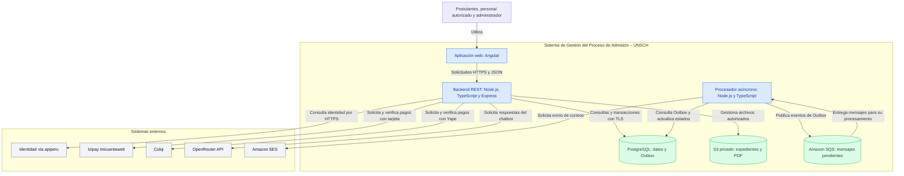

# Nivel 2 · Diagrama de Contenedores

**Proyecto:** Sistema de Gestión del Proceso de Admisión – UNSCH  
**Modelo:** C4 · Nivel 2  
**Entrega:** Sprint 1 · Diseño inicial

## 1. Objetivo

Identificar las aplicaciones, los almacenes de datos y los mecanismos de comunicación que conformarán el sistema.

Esta vista descompone el sistema presentado en el nivel 1 y establece las tecnologías seleccionadas para su desarrollo.

| Aspecto | Descripción |
|---|---|
| Pregunta principal | ¿Qué aplicaciones y almacenes de datos componen el sistema y cómo se comunican? |
| Audiencia | Equipo de desarrollo, docente y responsables técnicos. |
| Contenedor C4 | Aplicación o almacén de datos con una responsabilidad definida. No implica utilizar Docker. |
| Arquitectura del backend | Monolito Modular por Capas con Clean Architecture. |
| Organización funcional | 12 módulos dentro de una misma aplicación backend. |
| Nivel anterior | Contexto del sistema. |
| Siguiente nivel | Componentes internos del backend. |

## 2. Diagrama de contenedores

El diagrama representa las relaciones lógicas entre contenedores. CloudFront, API Gateway y AWS Lambda se describen como servicios de distribución, acceso y ejecución en la sección 4.

El backend REST y el procesador asíncrono compartirán la base de código modular. Sus puntos de entrada tendrán responsabilidades distintas, sin convertir los módulos funcionales en microservicios.

## 3. Contenedores del sistema

| Contenedor | Tecnología | Responsabilidad | Información que maneja |
|---|---|---|---|
| Aplicación web | Angular, ejecutado en el navegador. | Proporcionar el portal del postulante y el panel administrativo. | Formularios, estados de navegación y datos de consulta autorizados. |
| Backend API REST | Node.js, TypeScript y Express sobre AWS Lambda. | Recibir solicitudes, ejecutar casos de uso, aplicar permisos e integrar servicios externos. | Datos de usuarios, convocatorias, inscripciones, pagos, expedientes, exámenes y resultados. |
| Procesador asíncrono | Node.js y TypeScript sobre AWS Lambda. | Despachar eventos de Outbox y procesar tareas recibidas mediante SQS. | Eventos, tareas pendientes, intentos y resultados de procesamiento. |
| Base de datos | Amazon RDS PostgreSQL. | Almacenar información transaccional y eventos Outbox. | Datos del proceso de admisión y registros de control. |
| Almacenamiento documental | Amazon S3 privado. | Conservar expedientes y documentos digitales con acceso autorizado. | Archivos presentados, fichas y documentos PDF. |
| Cola de mensajes | Amazon SQS. | Transportar mensajes para su procesamiento asíncrono. | Identificadores de eventos y datos mínimos necesarios para las tareas. |

Outbox será una tabla dentro de PostgreSQL, no una base de datos ni un contenedor adicional.

## 4. Servicios de distribución y ejecución

| Servicio | Función |
|---|---|
| Amazon S3 para frontend | Alojar los archivos estáticos generados por Angular. |
| Amazon CloudFront | Distribuir el frontend mediante HTTPS y aplicar caché HTTP a contenido público autorizado. |
| Amazon API Gateway | Exponer los endpoints REST y dirigir las solicitudes al backend. |
| AWS Lambda | Ejecutar el backend REST y el procesamiento asíncrono. |
| Disparador periódico del despacho Outbox | Activar la revisión de eventos pendientes; su configuración se detallará en el diseño de despliegue. |

El navegador descargará Angular desde CloudFront, cuyo origen estático será S3.

Las solicitudes a `/api/*` podrán dirigirse mediante CloudFront a API Gateway. Este invocará el backend en Lambda. S3 no procesará ni reenviará solicitudes de negocio.

El almacenamiento estático del frontend y el almacenamiento documental privado tendrán permisos y políticas diferenciados.

## 5. Organización del backend

El backend contendrá los siguientes 12 módulos:

| Código | Módulo |
|---|---|
| M01 | Convocatorias |
| M02 | Usuarios |
| M03 | Inscripciones: Ordinaria y Exonerados |
| M04 | Pagos |
| M05 | Expedientes |
| M06 | Exámenes, Sedes y Aulas |
| M07 | Resultados |
| M08 | Chatbot IA |
| M09 | Notificaciones |
| M10 | Reportes |
| M11 | Seguridad |
| M12 | Configuración |

Estos módulos compartirán una base de datos PostgreSQL con separación lógica de responsabilidades. Cada módulo accederá a sus datos mediante los contratos definidos y colaborará con los demás a través de interfaces públicas o eventos.

La estructura interna por capas se detallará en el nivel 3.

## 6. Integraciones externas

| Sistema externo | Función | Contenedor que lo utiliza |
|---|---|---|
| Consulta de identidad vía apiperu | Verificar datos de identidad vinculados a RENIEC, según las condiciones de acceso aplicables. | Backend API REST. |
| Izipay micuentaweb | Procesar pagos con tarjeta y proporcionar confirmaciones. | Backend API REST. |
| Culqi | Procesar pagos con Yape y proporcionar su resultado. | Backend API REST. |
| OpenRouter API | Generar respuestas del chatbot con información autorizada. | Backend API REST. |
| Amazon SES | Enviar confirmaciones y notificaciones por correo. | Procesador asíncrono. |

Las integraciones utilizarán adaptadores de infraestructura. Las credenciales permanecerán en el backend y no se entregarán al navegador.

## 7. Relaciones entre contenedores

| Origen | Destino | Propósito | Comunicación |
|---|---|---|---|
| Usuarios | Aplicación web | Realizar consultas y operaciones según sus permisos. | Interacción mediante navegador. |
| Aplicación web | Backend API REST | Ejecutar casos de uso y consultar información. | HTTPS y JSON mediante API Gateway. |
| Backend API REST | PostgreSQL | Consultar y guardar datos; registrar eventos Outbox. | Protocolo PostgreSQL con TLS. |
| Backend API REST | S3 privado | Gestionar documentos y autorizar su acceso. | API de AWS mediante HTTPS. |
| Procesador asíncrono | PostgreSQL | Leer eventos pendientes y registrar resultados. | Protocolo PostgreSQL con TLS. |
| Procesador asíncrono | Amazon SQS | Publicar mensajes procedentes de Outbox. | API de AWS mediante HTTPS. |
| Amazon SQS | Procesador asíncrono | Entregar mensajes mediante la integración con Lambda. | Integración administrada de AWS. |
| Backend API REST | Servicios de identidad, pagos e IA | Ejecutar las integraciones autorizadas. | HTTPS mediante las interfaces del proveedor. |
| Procesador asíncrono | Amazon SES | Solicitar el envío de correos. | API de AWS mediante HTTPS. |

Los documentos podrán descargarse mediante URLs prefirmadas de duración limitada, emitidas después de verificar los permisos correspondientes.

Las confirmaciones de pago recibidas por endpoints del backend se validarán antes de modificar el estado de una transacción.

## 8. Procesamiento asíncrono

1. El backend ejecutará una operación de negocio.
2. Guardará el cambio y su evento Outbox dentro de una misma transacción en PostgreSQL.
3. El mecanismo de despacho consultará los eventos pendientes.
4. Los eventos se enviarán a Amazon SQS.
5. El procesador asíncrono ejecutará los consumidores correspondientes.
6. Se registrarán los resultados y se aplicarán reintentos cuando corresponda.

Outbox y SQS cumplirán funciones complementarias: Outbox conservará el evento junto con el cambio de negocio; SQS transportará el mensaje.

La entrega de mensajes podrá repetirse. Los consumidores deberán ser idempotentes para evitar duplicar actualizaciones o efectos de negocio. Los fallos de envío de correo no deberán revertir una inscripción o un pago ya confirmado.

## 9. Decisiones arquitectónicas reflejadas

| Decisión | Justificación |
|---|---|
| Backend monolítico modular | Organizar las funcionalidades en 12 módulos y simplificar su desarrollo y mantenimiento. |
| Clean Architecture | Separar reglas de negocio, casos de uso e infraestructura. |
| Angular como aplicación web | Proporcionar interfaces responsivas para postulantes y personal. |
| AWS Lambda | Ejecutar la aplicación mediante infraestructura administrada. |
| API Gateway | Proporcionar el acceso a los endpoints REST. |
| PostgreSQL | Mantener relaciones, restricciones y transacciones para los procesos críticos. |
| S3 privado | Gestionar documentos sin almacenarlos como archivos binarios en la base de datos principal. |
| CloudFront y caché HTTP | Distribuir el frontend y reducir consultas repetidas de información pública. |
| Outbox y SQS | Conservar eventos transaccionales y procesar tareas de forma asíncrona. |
| Adaptadores externos | Mantener los casos de uso independientes de los proveedores. |

## 10. Seguridad entre contenedores

| Relación | Controles propuestos |
|---|---|
| Navegador y servicios de acceso | HTTPS y validación de las solicitudes. |
| Aplicación web y backend | Autenticación para operaciones protegidas y autorización verificada en el servidor. |
| API Gateway y Lambda | Permisos de invocación restringidos. |
| Backend y PostgreSQL | TLS, credenciales protegidas y acceso de red limitado. |
| Backend y S3 privado | Permisos mínimos, acceso autorizado y URLs prefirmadas limitadas. |
| Procesador y SQS | Permisos específicos para publicar, recibir y eliminar mensajes. |
| Backend y pasarelas | Validación de confirmaciones, comprobación de importes e idempotencia. |
| Backend y OpenRouter | Protección de la API key y minimización de datos enviados. |
| Procesador y SES | Permisos de envío restringidos y protección de los datos del destinatario. |

Las respuestas con datos personales, estados de pago o información administrativa no se almacenarán en cachés públicas.

La concurrencia del procesamiento se limitará según la capacidad de PostgreSQL y de los servicios externos.

