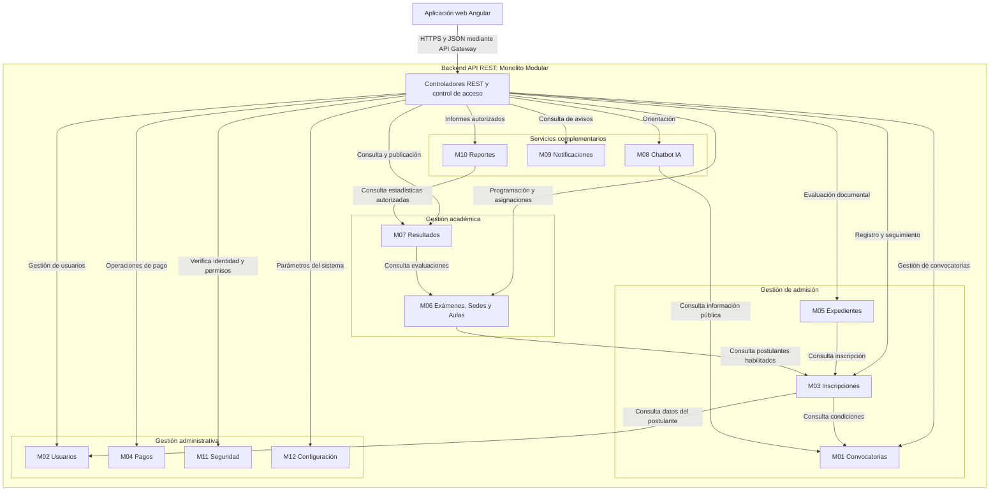
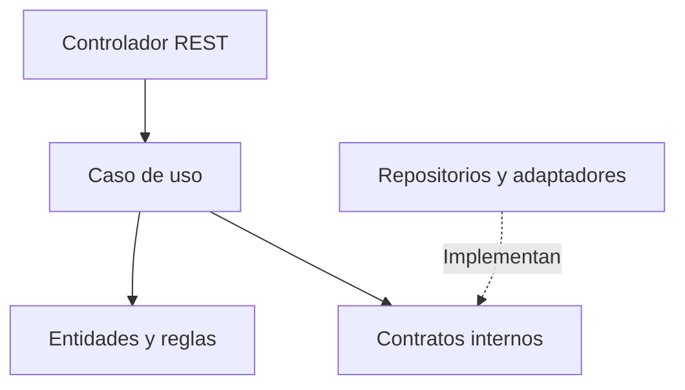

# Nivel 3 · Diagrama de Componentes

**Proyecto:** Sistema de Gestión del Proceso de Admisión – UNSCH  
**Contenedor detallado:** Backend API REST  
**Modelo:** C4 · Nivel 3  
**Entrega:** Sprint 1 · Diseño inicial

## 1. Objetivo

Identificar los componentes funcionales del backend, sus responsabilidades y las relaciones que establecerán entre sí y con los servicios externos.

El backend se organizará como un **Monolito Modular por Capas**, aplicando **Clean Architecture** dentro de sus 12 módulos.

| Aspecto | Descripción |
|---|---|
| Pregunta principal | ¿Qué componentes conforman el backend y cómo colaboran? |
| Audiencia | Equipo de desarrollo, docente y responsables técnicos. |
| Componentes funcionales | Los 12 módulos del sistema, con interfaces públicas definidas. |
| Tecnología | Node.js, TypeScript y Express. |
| Ejecución | AWS Lambda, con acceso mediante Amazon API Gateway. |
| Nivel anterior | Diagrama de contenedores. |
| Siguiente nivel | Diseño de código de los componentes seleccionados. |

## 2. Diagrama de componentes funcionales

Los grupos del diagrama facilitan la lectura y no representan aplicaciones ni unidades de despliegue independientes.

Las conexiones representan relaciones funcionales seleccionadas. Las llamadas entre módulos utilizarán sus interfaces públicas; cada operación estará sujeta a los permisos correspondientes.

Los eventos y las integraciones se detallan en las siguientes secciones para mantener legible el diagrama.

## 3. Componentes funcionales

Las rutas propuestas son relativas a `apps/backend/src/`.

| Código | Componente | Responsabilidad principal | Carpeta |
|---|---|---|---|
| M01 | Convocatorias | Gestionar procesos de admisión, cronogramas y condiciones de apertura y cierre. | `modules/convocatorias/` |
| M02 | Usuarios | Gestionar datos de postulantes, cuentas opcionales y usuarios del personal; coordinar la consulta de identidad. | `modules/usuarios/` |
| M03 | Inscripciones | Gestionar postulaciones Ordinaria y Exonerados, sus requisitos, estados y fichas. | `modules/inscripciones/` |
| M04 | Pagos | Generar órdenes, verificar confirmaciones y facilitar la conciliación de pagos. | `modules/pagos/` |
| M05 | Expedientes | Gestionar documentos, evaluaciones, observaciones y subsanaciones. | `modules/expedientes/` |
| M06 | Exámenes, Sedes y Aulas | Programar evaluaciones, administrar ambientes y distribuir postulantes según capacidades y horarios. | `modules/examenes/` |
| M07 | Resultados | Registrar calificaciones, calcular puntajes y gestionar la validación y publicación de resultados. | `modules/resultados/` |
| M08 | Chatbot IA | Orientar al postulante, consultar información autorizada y derivar incidencias a soporte. | `modules/asistente/` |
| M09 | Notificaciones | Gestionar avisos y preparar el envío de correos electrónicos. | `modules/notificaciones/` |
| M10 | Reportes | Generar estadísticas e informes mediante consultas autorizadas. | `modules/reportes/` |
| M11 | Seguridad | Gestionar autenticación, autorización, permisos y consulta de auditoría. | `modules/seguridad/` |
| M12 | Configuración | Administrar modalidades, programas, parámetros generales e integraciones. | `modules/configuracion/` |

Los módulos productores registrarán los datos de auditoría de sus operaciones críticas. Seguridad proporcionará los controles y el acceso autorizado a su consulta.

## 4. Organización interna por capas

Cada módulo comprenderá componentes de interfaces, aplicación, dominio e infraestructura. El módulo completo no se ubicará únicamente en la capa de dominio.

| Capa | Componentes y responsabilidades |
|---|---|
| Interfaces | Controladores REST, rutas, validación de entrada y transformación de respuestas. |
| Aplicación | Casos de uso, coordinación de procesos y contratos requeridos por esas operaciones. |
| Dominio | Entidades, reglas de negocio y contratos propios del dominio. |
| Infraestructura | Implementaciones de repositorios, almacenamiento, integraciones y mensajería. |
| Composición | Construcción y conexión de las implementaciones con los contratos internos. |

El diagrama representa dependencias de código. Los casos de uso utilizarán abstracciones y recibirán sus implementaciones mediante inyección de dependencias.

## 5. Relaciones entre componentes

| Origen | Destino | Propósito | Mecanismo |
|---|---|---|---|
| Controladores REST | Seguridad | Verificar identidad y permisos para operaciones protegidas. | Interfaz interna y controles HTTP. |
| Controladores REST | Casos de uso del módulo | Ejecutar la funcionalidad solicitada. | Llamada en memoria. |
| Inscripciones | Convocatorias | Consultar vigencia, plazos y condiciones de inscripción. | Interfaz pública. |
| Inscripciones | Usuarios | Consultar datos y validación del postulante. | Interfaz pública. |
| Pagos | Inscripciones | Consultar el contexto necesario para generar una orden de pago. | Interfaz pública. |
| Expedientes | Inscripciones | Consultar la postulación asociada a un expediente. | Interfaz pública. |
| Exámenes, Sedes y Aulas | Inscripciones | Consultar postulantes habilitados para la distribución. | Interfaz pública. |
| Resultados | Exámenes, Sedes y Aulas | Consultar información de las evaluaciones. | Interfaz pública. |
| Chatbot IA | Convocatorias | Obtener información pública del proceso. | Interfaz pública. |
| Chatbot IA | Inscripciones, Pagos y Expedientes | Consultar estados permitidos después de verificar el acceso. | Interfaces específicas de consulta. |
| Reportes | Módulos responsables de los datos | Obtener información autorizada para estadísticas e informes. | Interfaces de consulta. |

Las relaciones de consulta no autorizarán el acceso a clases privadas ni a las tablas de otro módulo. No se utilizarán solicitudes HTTP para llamadas internas dentro del mismo proceso.

## 6. Comunicación mediante eventos

| Evento propuesto | Productor | Consumidores | Finalidad |
|---|---|---|---|
| `InscripcionRegistrada` | Inscripciones | Notificaciones | Comunicar el registro y los pasos pendientes. |
| `PagoConfirmado` | Pagos | Inscripciones y Notificaciones | Actualizar el proceso según sus requisitos y comunicar el pago. |
| `ExpedienteEvaluado` | Expedientes | Inscripciones y Notificaciones | Actualizar condiciones documentales y comunicar el dictamen. |
| `AulaAsignada` | Exámenes, Sedes y Aulas | Notificaciones | Informar la ubicación de evaluación. |
| `ResultadosPublicados` | Resultados | Notificaciones | Informar que los resultados autorizados están disponibles. |

Los eventos se guardarán en Outbox dentro de la misma transacción que el cambio de negocio.

El despacho y procesamiento asíncrono corresponderán al contenedor Procesador Asíncrono definido en el nivel 2, que reutilizará componentes de la misma base de código modular.

Los consumidores deberán admitir mensajes repetidos mediante idempotencia. Una confirmación de pago no habilitará automáticamente al postulante si todavía existen requisitos documentales pendientes.

## 7. Persistencia e integraciones externas

| Componente responsable | Destino | Responsabilidad del adaptador |
|---|---|---|
| Módulos con persistencia | Amazon RDS PostgreSQL | Implementar los contratos de consulta y almacenamiento del módulo. |
| Usuarios | Consulta de identidad vía apiperu | Transformar solicitudes y respuestas del proveedor al contrato interno. |
| Pagos | Izipay micuentaweb | Gestionar pagos con tarjeta y verificar sus confirmaciones. |
| Pagos | Culqi | Gestionar pagos con Yape y comprobar su resultado. |
| Chatbot IA | OpenRouter API | Solicitar respuestas enviando únicamente información autorizada. |
| Expedientes | Amazon S3 privado | Guardar y recuperar documentos con acceso controlado. |
| Inscripciones | Amazon S3 privado | Gestionar fichas y documentos generados. |
| Productores de eventos | Outbox en PostgreSQL | Conservar eventos junto con el cambio de negocio. |
| Despacho asíncrono | Amazon SQS | Publicar mensajes pendientes procedentes de Outbox. |
| Notificaciones, desde el procesador asíncrono | Amazon SES | Enviar los correos preparados por el módulo. |

Las integraciones de red se realizarán desde infraestructura. Las credenciales no se expondrán a Angular ni formarán parte del dominio.

## 8. Organización de carpetas propuesta

Cada módulo utilizará la siguiente estructura:

| Ruta | Contenido |
|---|---|
| `modules/nombre-modulo/presentation/` | Controladores, rutas y validaciones HTTP. |
| `modules/nombre-modulo/application/` | Casos de uso y contratos de aplicación. |
| `modules/nombre-modulo/domain/` | Entidades, reglas y contratos del dominio. |
| `modules/nombre-modulo/infrastructure/` | Repositorios y adaptadores concretos. |
| `modules/nombre-modulo/index.ts` | Exportaciones públicas y composición del módulo. |
| `shared/` | Componentes técnicos comunes justificados. |

Los contratos se ubicarán en la capa interna que los necesite. La carpeta compartida no concentrará reglas de negocio pertenecientes a módulos específicos.

## 9. Reglas del Monolito Modular

1. Los 12 módulos formarán parte de una aplicación backend modular.
2. Cada módulo expondrá contratos públicos con responsabilidades definidas.
3. Ningún módulo accederá directamente a las implementaciones privadas ni a las tablas de otro.
4. Los controladores delegarán el procesamiento en los casos de uso.
5. El dominio permanecerá independiente de PostgreSQL, AWS y proveedores externos.
6. Los repositorios y adaptadores implementarán contratos internos.
7. Se evitarán dependencias circulares entre módulos.
8. Las operaciones críticas utilizarán transacciones, restricciones e idempotencia.
9. Los eventos de negocio se persistirán mediante Outbox cuando deban entregarse de forma confiable.
10. Los permisos se comprobarán en el backend, también para las consultas realizadas por el chatbot.
11. Las operaciones administrativas y los cambios críticos generarán registros de auditoría.
12. El procesamiento asíncrono reutilizará el código modular sin establecer microservicios por módulo.

## 10. Patrones y mecanismos seleccionados

| Patrón o mecanismo | Aplicación | Beneficio |
|---|---|---|
| Repositorio | Persistencia de los módulos que gestionen datos. | Separar los casos de uso de las consultas concretas. |
| Adaptador | Identidad, pagos, chatbot, correo, archivos y mensajería. | Aislar protocolos y SDK externos. |
| Fábrica simple | Selección de implementaciones reales o simuladas. | Centralizar la construcción de proveedores. |
| Inyección de dependencias | Composición de casos de uso y colaboradores. | Facilitar sustituciones y pruebas. |
| Fachada | Contratos públicos de los módulos. | Limitar el conocimiento de componentes internos. |
| Publicación y suscripción | Reacción de módulos a eventos de negocio. | Reducir el acoplamiento entre productores y consumidores. |
| Transactional Outbox | Persistencia conjunta de cambios y eventos. | Evitar confirmar operaciones sin conservar su evento asociado. |

## 11. Alcance del Sprint 1

Esta vista define los 12 componentes funcionales del backend, sus responsabilidades y sus principales relaciones.

Las clases, los métodos y los contratos detallados de los componentes seleccionados se desarrollarán en el nivel 4 y durante los siguientes sprints.

---

## 9. Estado de cumplimiento de las reglas (02/11/2026)

| Regla | Estado |
|---|---|
| 1. Un único backend desplegable | ✅ Un backend con dos puntos de entrada en Lambda: API (`lambda-api.ts`) y tareas (`lambda-worker.ts`) |
| 2. Comunicación solo por la API pública (`index.ts`) | ✅ Ningún módulo importa capas internas de otro |
| 3. Cada módulo usa solo sus tablas | 🟡 Un esquema de PostgreSQL por módulo; `reportes` lee tablas de otros módulos (solo lectura, para los indicadores) y hay algunas lecturas cruzadas, como `inscripciones` sobre resultados |
| 4. Integraciones con interfaces y adaptadores | ✅ |
| 5. Clean Architecture por módulo | 🟡 Capas presentes; la persistencia aún no está detrás de repositorios en la mayoría de módulos |
| 6. Casos de uso dependen de interfaces | 🟡 Sí para los servicios externos; no para la base de datos |
| 7. Controladores sin acceso directo a datos | ✅ |
| 8. Integridad e idempotencia en inscripción y pago | ✅ |
