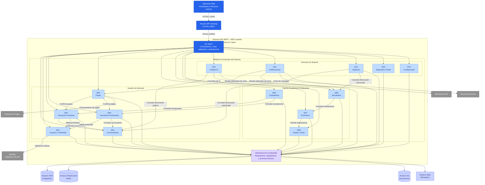

# Nivel 3 · Diagrama de Componentes

> **Proyecto:** Sistema Integral de Gestión del Proceso de Admisión – UNSCH  
> **Contenedor detallado:** Backend API REST – Sistema de Admisión UNSCH  
> **Modelo:** C4 · Nivel 3 de 4 · **Versión:** 1.0

---

## 1. Objetivo

Descomponer el contenedor **Backend API REST del Sistema Integral de Gestión del Proceso de Admisión – UNSCH**, presentado en el nivel 2, para identificar sus **componentes internos**, las responsabilidades de cada módulo funcional y las relaciones que mantienen entre sí, con los almacenes de datos y con los sistemas externos.

El backend está diseñado como un **Monolito Modular por Capas**, organizado internamente mediante **Clean Architecture**, y se desplegará como una única aplicación en AWS Lambda.

| **Aspecto** | **Descripción** |
|---|---|
| Pregunta que responde | ¿Cómo está organizado internamente el backend y qué responsabilidades tiene cada módulo? |
| Audiencia | Arquitectos de software, desarrolladores y equipo técnico. |
| Qué es un componente | Unidad funcional con una responsabilidad definida y una interfaz pública. En este proyecto, cada módulo del monolito representa un componente. |
| Arquitectura | Monolito Modular por Capas. |
| Enfoque interno | Clean Architecture. |
| Contenedor detallado | Backend API REST – AWS Lambda. |
| Nivel anterior | `Nivel2-Diagrama-de-Contenedores.md` |
| Siguiente nivel | `Nivel4-Diagrama-de-Codigo.md` |

---

## 2. Diagrama

### Diagrama de componentes del Backend API REST – UNSCH



**Descripción:** El backend está organizado en 14 módulos funcionales que se ejecutan dentro de una única aplicación AWS Lambda. Los módulos se comunican mediante interfaces públicas y utilizan repositorios y adaptadores para acceder a los servicios de infraestructura y sistemas externos.

**Nota:** Las conexiones del diagrama representan dependencias funcionales y flujos de comunicación propuestos. No significan que los módulos puedan acceder directamente a las tablas o implementaciones internas de otros módulos.

---

## 3. Componentes

| **Componente** | **Responsabilidad** | **Funcionalidades principales** | **Carpeta en el código** |
|---|---|---|---|
| **API REST** | Punto de entrada HTTP del backend. | Rutas `/api/v1`, autenticación, autorización, validación de solicitudes y manejo de errores. | `src/api/` |
| **M01 – Convocatorias** | Administrar los procesos de admisión. | Crear convocatorias, configurar cronogramas, modalidades, programas y vacantes. | `src/modules/convocatorias/` |
| **M02 – Usuarios e Identidad** | Gestionar la información de postulantes y usuarios. | Registro, actualización de datos y validación de identidad mediante RENIEC. | `src/modules/usuarios/` |
| **M03 – Inscripción Ordinaria** | Gestionar las inscripciones de modalidad ordinaria. | Registro de postulaciones, selección de programas y seguimiento del estado de inscripción. | `src/modules/inscripcion-ordinaria/` |
| **M04 – Inscripción Exonerados** | Gestionar las postulaciones de modalidades especiales. | Registro de postulantes exonerados y validación de requisitos específicos. | `src/modules/inscripcion-exonerados/` |
| **M05 – Pagos** | Gestionar los pagos de inscripción. | Generación de órdenes, integración con pasarela, confirmación y conciliación de pagos. | `src/modules/pagos/` |
| **M06 – Expedientes** | Administrar la documentación de postulantes. | Carga, revisión, validación y observación de documentos. | `src/modules/expedientes/` |
| **M07 – Exámenes** | Organizar las evaluaciones de admisión. | Programación de exámenes, fechas y asignación de evaluaciones. | `src/modules/examenes/` |
| **M08 – Sedes y Aulas** | Gestionar ambientes de evaluación. | Registro de sedes, aulas, capacidades y asignación de postulantes. | `src/modules/sedes-aulas/` |
| **M09 – Resultados** | Gestionar las calificaciones y resultados de admisión. | Procesamiento, validación, orden de mérito y publicación de resultados. | `src/modules/resultados/` |
| **M10 – Chatbot IA** | Proporcionar orientación automatizada. | Atención de consultas frecuentes e integración con OpenRouter API. | `src/modules/chatbot-ia/` |
| **M11 – Notificaciones** | Gestionar la comunicación con postulantes. | Envío de confirmaciones, avisos, observaciones y recordatorios. | `src/modules/notificaciones/` |
| **M12 – Reportes** | Generar información estadística y administrativa. | Reportes de inscritos, pagos, modalidades, exámenes y resultados. | `src/modules/reportes/` |
| **M13 – Seguridad y Roles** | Controlar el acceso a funcionalidades. | Autenticación, autorización, roles, permisos y auditoría de acciones. | `src/modules/seguridad/` |
| **M14 – Configuración** | Gestionar parámetros generales del sistema. | Configuración institucional, parámetros operativos e integraciones. | `src/modules/configuracion/` |
| **Infraestructura Compartida** | Proporcionar mecanismos técnicos reutilizables. | Conexiones, manejo de errores, clientes AWS y utilidades transversales. | `src/shared/` |

---

## 4. Relaciones entre componentes

| **Origen** | **Destino** | **Descripción** | **Tipo de comunicación** |
|---|---|---|---|
| Aplicación Web | API REST | Envía solicitudes para ejecutar funcionalidades del sistema. | HTTPS / JSON |
| API REST | Módulos funcionales | Invoca los casos de uso correspondientes. | Llamada en memoria |
| Inscripción Ordinaria | Convocatorias | Consulta convocatorias activas, modalidades y vacantes. | Llamada en memoria mediante API pública |
| Inscripción Ordinaria | Usuarios | Comprueba la información y validación del postulante. | Llamada en memoria mediante API pública |
| Inscripción Exonerados | Convocatorias | Consulta modalidades especiales y requisitos. | Llamada en memoria mediante API pública |
| Inscripción Exonerados | Usuarios | Comprueba los datos del postulante. | Llamada en memoria mediante API pública |
| Pagos | Inscripción Ordinaria | Comunica la confirmación de pagos asociados a inscripciones ordinarias. | API pública o evento interno |
| Pagos | Inscripción Exonerados | Comunica la confirmación de pagos de modalidades especiales. | API pública o evento interno |
| Expedientes | Inscripción Ordinaria | Consulta información de inscripciones ordinarias. | Llamada en memoria |
| Expedientes | Inscripción Exonerados | Consulta información de inscripciones especiales. | Llamada en memoria |
| Exámenes | Sedes y Aulas | Solicita ambientes y asignaciones de postulantes. | Llamada en memoria |
| Resultados | Exámenes | Consulta información de las evaluaciones programadas. | Llamada en memoria |
| Chatbot IA | Convocatorias | Consulta información pública sobre procesos de admisión. | API pública del módulo |
| Notificaciones | Pagos | Recibe solicitudes o eventos de confirmación de pago. | Evento interno o mensajería |
| Notificaciones | Resultados | Recibe solicitudes de comunicación sobre resultados publicados. | Evento interno o mensajería |
| Reportes | Convocatorias | Obtiene información autorizada de procesos de admisión. | API pública del módulo |
| Reportes | Resultados | Obtiene información estadística de evaluaciones y resultados. | API pública del módulo |
| API REST | Seguridad y Roles | Valida autenticación y permisos de acceso. | Middleware y llamada en memoria |

**Regla:** la comunicación entre módulos del monolito se realiza mediante sus interfaces públicas. No se utilizarán solicitudes HTTP entre módulos que se ejecutan dentro de la misma aplicación.

---

## 5. Relaciones con contenedores y sistemas externos

| **Componente** | **Destino** | **Descripción** | **Protocolo** | **Patrón aplicado** |
|---|---|---|---|---|
| Módulos con persistencia | Amazon RDS PostgreSQL | Cada módulo accede a las tablas de las que es responsable mediante su repositorio. | PostgreSQL / TLS | Repositorio |
| Convocatorias | Redis | Almacena temporalmente convocatorias y configuraciones consultadas frecuentemente. | Redis / TLS | Decorador |
| Configuración | Redis | Mantiene en caché parámetros de consulta frecuente. | Redis / TLS | Decorador |
| Usuarios | RENIEC | Solicita la validación de identidad de postulantes. | HTTPS / API autorizada | Adaptador |
| Pagos | Pasarela de Pagos | Gestiona operaciones de pago y verifica confirmaciones. | HTTPS / REST | Adaptador |
| Chatbot IA | OpenRouter API | Solicita respuestas de modelos de inteligencia artificial. | HTTPS / REST | Adaptador |
| Notificaciones | Servicio de Correo | Solicita el envío de mensajes electrónicos. | API segura | Adaptador |
| Notificaciones | Amazon SQS | Publica tareas de notificación para procesamiento asíncrono. | AWS SDK / HTTPS | Mensajería |
| Expedientes | Amazon S3 | Almacena y recupera documentos de postulantes. | AWS SDK / HTTPS | Repositorio de archivos / Adaptador |
| Inscripciones | Amazon S3 | Guarda y recupera fichas y documentos generados. | AWS SDK / HTTPS | Adaptador |
| Backend API REST | Amazon CloudWatch | Registra logs, errores y métricas operativas. | Integración AWS | Observabilidad |

---

## 6. Reglas del Monolito Modular

| **#** | **Regla** | **Motivo** |
|---|---|---|
| 1 | Todos los módulos funcionales se despliegan juntos como una única aplicación backend en AWS Lambda. | Mantener una arquitectura monolítica modular y simplificar el despliegue. |
| 2 | Cada módulo debe comunicarse con otro únicamente mediante su API pública (`index.ts`). | Evitar dependencias directas de implementaciones internas. |
| 3 | Un módulo no debe consultar ni modificar directamente las tablas de otro módulo. | Mantener la independencia lógica y la propiedad de los datos. |
| 4 | Cada integración externa debe tener un módulo responsable y utilizar interfaces y adaptadores. | Centralizar las integraciones y facilitar el cambio de proveedores. |
| 5 | Cada módulo se organizará internamente mediante Clean Architecture. | Separar las reglas de negocio de los detalles tecnológicos. |
| 6 | Los casos de uso dependerán de interfaces y no de implementaciones concretas. | Cumplir el principio de inversión de dependencias. |
| 7 | Los controladores no accederán directamente a PostgreSQL, Redis ni a servicios externos. | Mantener la separación entre presentación e infraestructura. |
| 8 | Las operaciones críticas de inscripción y pago deberán utilizar mecanismos de integridad e idempotencia. | Evitar duplicidades e inconsistencias. |
| 9 | Las operaciones asíncronas se realizarán mediante mecanismos de mensajería cuando sea necesario. | Reducir el acoplamiento temporal entre procesos. |
| 10 | Las operaciones administrativas estarán protegidas mediante autenticación y autorización basada en roles. | Garantizar la seguridad de los procesos de admisión. |

---

## 7. Organización interna de cada módulo

Todos los módulos seguirán una estructura uniforme basada en Clean Architecture.

```text
src/
└── modules/
    └── nombre-modulo/
        ├── dominio/
        │   ├── entidades/
        │   ├── interfaces/
        │   └── reglas/
        ├── aplicacion/
        │   ├── casos-uso/
        │   └── dto/
        ├── infraestructura/
        │   ├── repositorios/
        │   └── adaptadores/
        ├── presentacion/
        │   ├── controladores/
        │   └── rutas/
        ├── nombre-modulo.module.ts
        └── index.ts
```

### Responsabilidades por capa

| **Capa** | **Responsabilidad** |
|---|---|
| Dominio | Definir entidades, reglas de negocio e interfaces. |
| Aplicación | Coordinar los casos de uso y procesos funcionales. |
| Infraestructura | Implementar repositorios, adaptadores y conexiones externas. |
| Presentación | Gestionar solicitudes HTTP, validaciones de entrada y respuestas REST. |
| Composición | Configurar las dependencias e implementaciones concretas. |

---

## 8. Patrones de diseño aplicados

| **Patrón** | **Aplicación en el sistema** | **Beneficio** |
|---|---|---|
| Repositorio | Persistencia de inscripciones, pagos, convocatorias y resultados. | Separar las reglas de negocio de PostgreSQL. |
| Adaptador | Integraciones con RENIEC, pasarela de pagos y OpenRouter API. | Evitar dependencia directa de proveedores externos. |
| Decorador | Implementación de caché con Redis. | Mejorar el rendimiento sin modificar la lógica de negocio. |
| Inyección de Dependencias | Composición de casos de uso, repositorios y adaptadores. | Facilitar las pruebas y el mantenimiento. |
| Fachada | Interfaces públicas entre módulos. | Reducir el acoplamiento entre componentes. |

---

## 9. Relación con el Nivel 4

El siguiente nivel del modelo C4 detallará la estructura interna de código del módulo **Inscripción Ordinaria**, seleccionado como módulo de referencia.

Se representarán sus principales clases e interfaces:

| **Elemento** | **Responsabilidad** |
|---|---|
| `InscripcionController` | Recibir solicitudes HTTP de inscripción. |
| `RegistrarInscripcionUseCase` | Coordinar el registro de una inscripción. |
| `Inscripcion` | Aplicar las reglas de negocio. |
| `EstadoInscripcion` | Definir los estados permitidos. |
| `InscripcionRepository` | Declarar las operaciones de persistencia. |
| `ElegibilidadPort` | Definir la validación de elegibilidad. |
| `PostgresInscripcionRepository` | Implementar la persistencia en PostgreSQL. |
| `ElegibilidadAdapter` | Implementar las consultas de elegibilidad mediante contratos internos. |
| `InscripcionOrdinariaModule` | Configurar las dependencias del módulo. |

**Siguiente documento:** `Nivel4-Diagrama-de-Codigo.md`

---

## 10. Resumen

| **Aspecto** | **Descripción** |
|---|---|
| Proyecto | Sistema Integral de Gestión del Proceso de Admisión – UNSCH |
| Modelo | C4 |
| Nivel | Nivel 3 – Componentes |
| Contenedor detallado | Backend API REST |
| Arquitectura | Monolito Modular por Capas |
| Enfoque interno | Clean Architecture |
| Número de módulos | 14 módulos funcionales |
| Backend | Node.js + TypeScript + Express |
| Despliegue | AWS Lambda |
| Comunicación externa | API REST mediante HTTPS |
| Comunicación entre módulos | Llamadas en memoria mediante interfaces públicas |
| Persistencia | Amazon RDS PostgreSQL |
| Caché | Amazon ElastiCache Redis |
| Almacenamiento | Amazon S3 |
| Mensajería | Amazon SQS |
| Integraciones | RENIEC, pasarela de pagos, OpenRouter API y correo |
| Siguiente nivel | Nivel 4 – Diagrama de Código |

## 11. Conclusión

El diagrama de componentes del **Sistema Integral de Gestión del Proceso de Admisión – UNSCH** permite comprender cómo se organiza internamente el backend y cómo se distribuyen las responsabilidades entre sus 14 módulos funcionales.

La arquitectura de **Monolito Modular por Capas** permite mantener todos los módulos dentro de una única aplicación desplegada en AWS Lambda, mientras que **Clean Architecture** establece una separación entre presentación, aplicación, dominio e infraestructura.

La comunicación mediante interfaces públicas, junto con los patrones Repositorio, Adaptador e Inyección de Dependencias, permite reducir el acoplamiento y facilitar el mantenimiento del sistema.

Este diseño constituye la base para el **Nivel 4 del modelo C4**, donde se describirán las clases, interfaces y dependencias internas del módulo Inscripción Ordinaria.