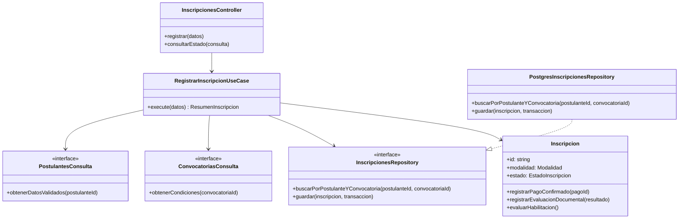
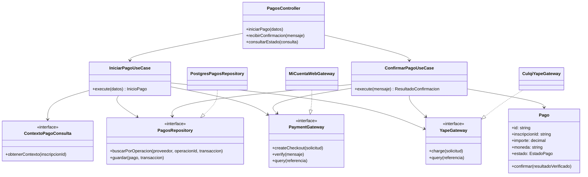
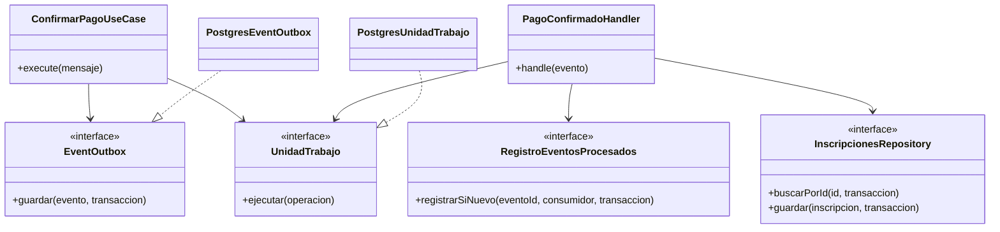
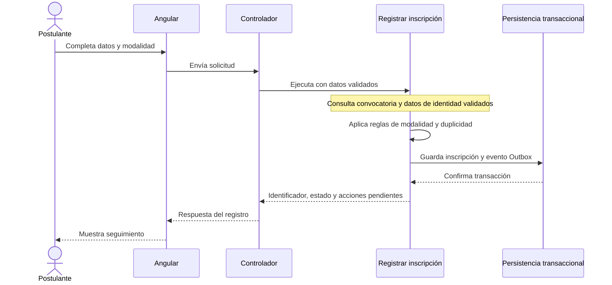
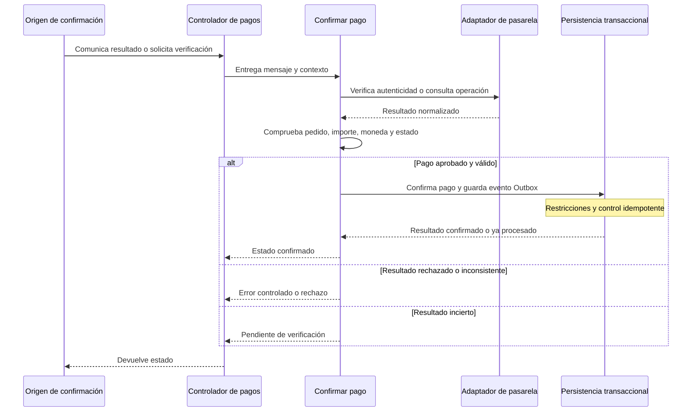
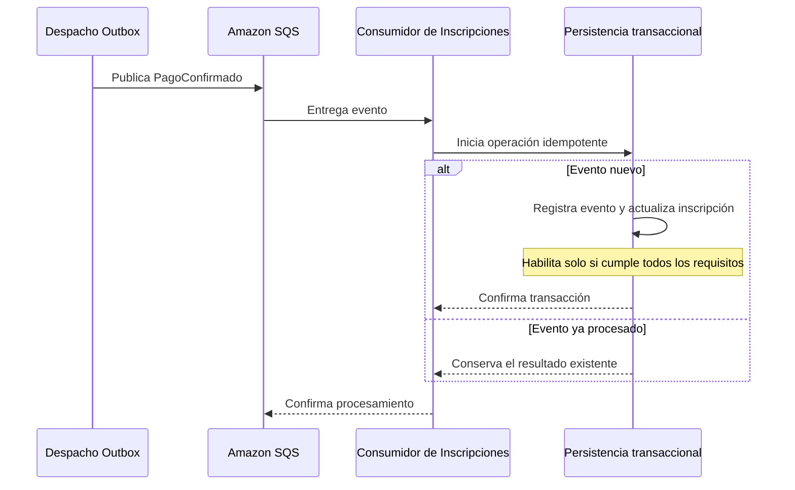

# Nivel 4 · Diagrama de Código

**Proyecto:** Sistema de Gestión del Proceso de Admisión – UNSCH  
**Módulos detallados:** M03 Inscripciones y M04 Pagos  
**Modelo:** C4 · Nivel 4  
**Notación:** UML  
**Entrega:** Sprint 1 · Diseño inicial

## 1. Objetivo

Definir las clases, interfaces y relaciones propuestas para registrar una inscripción y confirmar su pago.

El diseño comprenderá las modalidades Ordinaria y Exonerados dentro de M03 Inscripciones. M04 Pagos gestionará las operaciones con tarjeta mediante Izipay micuentaweb y con Yape mediante Culqi.

Los nombres de clases y métodos representan una propuesta de diseño que se detallará durante la implementación.

## 2. Distribución por capas

| Capa | Elementos propuestos | Responsabilidad |
|---|---|---|
| Interfaces | Controladores de Inscripciones y Pagos. | Recibir solicitudes, validar su formato y devolver respuestas HTTP. |
| Aplicación | Casos de uso de registro, inicio de pago y confirmación. | Coordinar validaciones, operaciones transaccionales e integraciones. |
| Dominio | Entidades Inscripción y Pago, reglas por modalidad y contratos. | Mantener las reglas y transiciones válidas del negocio. |
| Infraestructura | Repositorios PostgreSQL, adaptadores de pasarela y Outbox. | Implementar persistencia, comunicación externa y registro de eventos. |
| Composición | Configuración de módulos e inyección de dependencias. | Conectar los casos de uso con sus implementaciones concretas. |

## 3. Diagrama de clases de Inscripciones

El caso de uso consultará las condiciones de la convocatoria y los datos validados del postulante mediante contratos públicos.

La entidad Inscripción aplicará las reglas correspondientes a la modalidad. Su habilitación requerirá cumplir las condiciones de pago y validación documental que correspondan.

## 4. Diagrama de clases de Pagos

Los contratos de tarjeta y Yape serán específicos para sus capacidades. No se exigirá que ambas pasarelas implementen operaciones que su proveedor no admita.

El importe y la moneda se obtendrán de información validada por el backend. Los datos recibidos desde Angular no determinarán por sí solos el valor que se deba cobrar.

## 5. Transacciones y eventos

La implementación de Unidad de Trabajo proporcionará un contexto transaccional compartido por los repositorios y Outbox.

La confirmación del pago y el registro de `PagoConfirmado` se guardarán en una misma transacción.

Posteriormente, el consumidor de Inscripciones actualizará su información en otra transacción. El registro del evento procesado y la modificación de la inscripción deberán ser atómicos para evitar aplicar el mismo evento más de una vez.

## 6. Responsabilidades principales

| Elemento | Responsabilidad |
|---|---|
| `RegistrarInscripcionUseCase` | Verificar condiciones, prevenir duplicidades y coordinar el registro. |
| `Inscripcion` | Aplicar reglas por modalidad y controlar la habilitación. |
| `IniciarPagoUseCase` | Consultar el contexto autorizado y solicitar la operación al proveedor. |
| `ConfirmarPagoUseCase` | Verificar el resultado externo, comprobar los datos y registrar la confirmación idempotente. |
| `Pago` | Proteger las transiciones y condiciones de la transacción. |
| `InscripcionesRepository` | Definir las operaciones de persistencia de inscripciones. |
| `PagosRepository` | Definir las operaciones de persistencia de pagos. |
| `UnidadTrabajo` | Ejecutar operaciones que requieran una transacción común. |
| `EventOutbox` | Registrar eventos dentro de la transacción de negocio. |
| `PagoConfirmadoHandler` | Aplicar el pago confirmado a la inscripción y revisar sus requisitos. |
| Adaptadores de pasarela | Traducir solicitudes, verificar respuestas y consultar al proveedor. |

## 7. Secuencia de registro de inscripción

El identificador inicial permitirá consultar el proceso. La emisión de la ficha definitiva y la habilitación dependerán de las reglas de inscripción, pago y evaluación documental.

Las restricciones de PostgreSQL complementarán la comprobación de duplicidad para proteger las operaciones concurrentes.

## 8. Secuencia de confirmación de pago

El origen podrá ser una notificación del proveedor, una solicitud enviada desde el navegador o una consulta de conciliación.

La respuesta del navegador no se considerará una confirmación suficiente sin verificación en el backend. Los mecanismos concretos de autenticidad se implementarán según el contrato de cada pasarela.

## 9. Procesamiento del evento de pago

Notificaciones procesará los eventos que le correspondan mediante su propio consumidor. Un fallo de correo no revertirá un pago confirmado.

## 10. Reglas de integridad y seguridad

1. La identidad deberá validarse antes de habilitar el pago.
2. Las inscripciones respetarán las restricciones de unicidad del proceso.
3. Los importes y las monedas se determinarán y comprobarán en el backend.
4. Las confirmaciones deberán corresponder a una operación conocida.
5. Las solicitudes repetidas no generarán nuevas confirmaciones del mismo pago.
6. El pago y su evento se guardarán dentro de una misma transacción.
7. Los consumidores admitirán entregas repetidas de mensajes.
8. Los resultados inciertos permanecerán pendientes hasta verificar su estado.
9. La habilitación exigirá cumplir los requisitos de la modalidad.
10. Las credenciales y los datos sensibles de integración permanecerán en infraestructura.

## 11. Patrones y principios relacionados

| Patrón o principio | Aplicación propuesta |
|---|---|
| Repositorio | Persistencia mediante contratos de Inscripciones y Pagos. |
| Adaptador | Integraciones con Izipay micuentaweb y Culqi. |
| Inyección de dependencias | Conexión de casos de uso con repositorios y proveedores. |
| Fábrica simple | Construcción de adaptadores según la configuración. |
| Publicación y suscripción | Reacción de Inscripciones y Notificaciones a eventos. |
| Transactional Outbox | Registro conjunto de operaciones y eventos. |
| Responsabilidad Única | Separación de HTTP, coordinación, reglas y persistencia. |
| Segregación de Interfaces | Contratos específicos para consultas, repositorios y métodos de pago. |
| Inversión de Dependencias | Casos de uso independientes de PostgreSQL y proveedores concretos. |

## 12. Alcance del Sprint 1

Este documento define el diseño inicial de código para M03 Inscripciones y M04 Pagos.

Los nombres definitivos, tipos de datos, estados, contratos de error y detalles de las pasarelas se precisarán durante la implementación y se validarán mediante pruebas de dominio, contrato e integración.