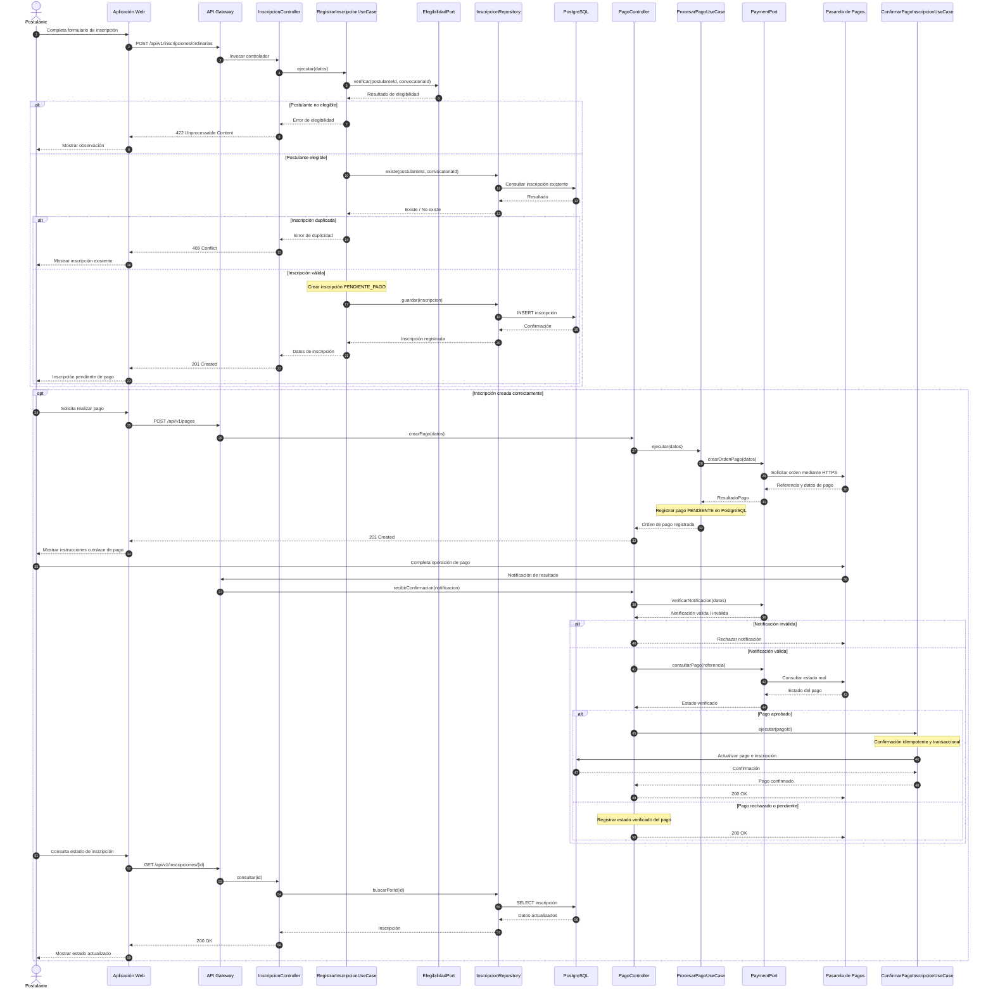

# Nivel 4 · Diagrama de Código

> **Proyecto:** Sistema Integral de Gestión del Proceso de Admisión – UNSCH  
> **Módulos detallados:** Inscripción Ordinaria y Pagos  
> **Modelo:** C4 · Nivel 4 de 4 · **Notación:** UML · **Versión:** 1.0

---

## 1. Objetivo

Mostrar cómo está organizado el código de los componentes del **Sistema Integral de Gestión del Proceso de Admisión – UNSCH**, identificando sus clases, interfaces, responsabilidades y relaciones.

Se detalla el flujo **Registrar inscripción ordinaria y confirmar pago**, que involucra los módulos **Inscripción Ordinaria (M03)** y **Pagos (M05)**, así como la validación del postulante y la integración con la pasarela de pagos.

Este nivel permite comprender cómo se implementarán las reglas de negocio mediante **Clean Architecture**, manteniendo la independencia entre el dominio y las tecnologías externas.

| **Aspecto** | **Descripción** |
|---|---|
| Pregunta que responde | ¿Qué clases existen dentro de los módulos y cómo se relacionan para registrar una inscripción y confirmar su pago? |
| Audiencia | Desarrolladores y arquitectos de software. |
| Notación | UML: diagrama de clases y diagrama de secuencia. |
| Arquitectura | Monolito Modular por Capas. |
| Enfoque interno | Clean Architecture. |
| Backend | Node.js + TypeScript + Express. |
| Despliegue | AWS Lambda. |
| Módulos detallados | M03 – Inscripción Ordinaria y M05 – Pagos. |
| Por qué estos módulos | Concentran reglas importantes del proceso de admisión y requieren persistencia, validación e integración con servicios externos. |
| Nivel anterior | `Nivel3-Diagrama-de-Componentes.md` |

---

## 2. Diagrama de Clases

### Diagrama de clases de los módulos Inscripción Ordinaria y Pagos

```mermaid
classDiagram
    direction TB

    namespace Presentacion {
        class InscripcionController {
            -registrarInscripcionUseCase
            +registrar(req, res)
            +consultar(req, res)
        }

        class PagoController {
            -procesarPagoUseCase
            +crearPago(req, res)
            +recibirConfirmacion(req, res)
        }
    }

    namespace Aplicacion {
        class RegistrarInscripcionUseCase {
            -inscripcionRepository
            -elegibilidadPort
            +ejecutar(command) Inscripcion
        }

        class ProcesarPagoUseCase {
            -paymentPort
            -pagoRepository
            +ejecutar(command) ResultadoPago
        }

        class ConfirmarPagoInscripcionUseCase {
            -inscripcionRepository
            -pagoRepository
            +ejecutar(pagoId) void
        }
    }

    namespace Dominio {
        class Inscripcion {
            -id: string
            -postulanteId: string
            -convocatoriaId: string
            -programaId: string
            -estado: EstadoInscripcion
            +crear(datos) Inscripcion
            +confirmarPago() void
            +obtenerEstado() EstadoInscripcion
        }

        class EstadoInscripcion {
            <<enumeration>>
            PENDIENTE_PAGO
            PAGO_CONFIRMADO
            EN_REVISION
            APROBADA
            OBSERVADA
            ANULADA
        }

        class Pago {
            -id: string
            -inscripcionId: string
            -monto: number
            -estado: EstadoPago
            -referenciaExterna: string
            +registrarConfirmacion() void
            +registrarRechazo() void
            +obtenerEstado() EstadoPago
        }

        class EstadoPago {
            <<enumeration>>
            PENDIENTE
            APROBADO
            RECHAZADO
            ANULADO
        }

        class InscripcionRepository {
            <<interface>>
            +guardar(inscripcion) Promise
            +buscarPorId(id) Promise
            +existe(postulanteId, convocatoriaId) Promise
        }

        class ElegibilidadPort {
            <<interface>>
            +verificar(postulanteId, convocatoriaId) Promise
        }

        class PagoRepository {
            <<interface>>
            +guardar(pago) Promise
            +buscarPorId(id) Promise
            +buscarPorReferencia(referencia) Promise
        }

        class PaymentPort {
            <<interface>>
            +crearOrdenPago(datos) Promise
            +consultarPago(referencia) Promise
            +verificarNotificacion(datos) Promise
        }

        class ResultadoPago {
            +pagoId: string
            +estado: string
            +referencia: string
            +mensaje: string
        }
    }

    namespace Infraestructura {
        class PostgresInscripcionRepository {
            -db
            +guardar(inscripcion) Promise
            +buscarPorId(id) Promise
            +existe(postulanteId, convocatoriaId) Promise
        }

        class PostgresPagoRepository {
            -db
            +guardar(pago) Promise
            +buscarPorId(id) Promise
            +buscarPorReferencia(referencia) Promise
        }

        class PaymentGatewayAdapter {
            -httpClient
            -apiKey
            +crearOrdenPago(datos) Promise
            +consultarPago(referencia) Promise
            +verificarNotificacion(datos) Promise
        }

        class ElegibilidadAdapter {
            -usuariosFacade
            -convocatoriasFacade
            +verificar(postulanteId, convocatoriaId) Promise
        }
    }

    InscripcionController --> RegistrarInscripcionUseCase
    PagoController --> ProcesarPagoUseCase
    PagoController --> ConfirmarPagoInscripcionUseCase

    RegistrarInscripcionUseCase --> InscripcionRepository
    RegistrarInscripcionUseCase --> ElegibilidadPort
    RegistrarInscripcionUseCase ..> Inscripcion : crea

    ProcesarPagoUseCase --> PaymentPort
    ProcesarPagoUseCase --> PagoRepository
    ProcesarPagoUseCase ..> Pago : crea

    ConfirmarPagoInscripcionUseCase --> InscripcionRepository
    ConfirmarPagoInscripcionUseCase --> PagoRepository

    Inscripcion --> EstadoInscripcion
    Pago --> EstadoPago
    Pago --> ResultadoPago : produce

    PostgresInscripcionRepository ..|> InscripcionRepository
    PostgresPagoRepository ..|> PagoRepository
    PaymentGatewayAdapter ..|> PaymentPort
    ElegibilidadAdapter ..|> ElegibilidadPort
```

**Descripción:** El diagrama representa las clases principales de los módulos Inscripción Ordinaria y Pagos, organizadas mediante Clean Architecture.

Los controladores reciben las solicitudes HTTP, los casos de uso coordinan los procesos, las entidades aplican las reglas de negocio y los repositorios y adaptadores permiten la comunicación con PostgreSQL y la pasarela de pagos.

---

## 2.1. Capas de Clean Architecture

| **Capa** | **Contiene** | **Regla** |
|---|---|---|
| **Presentación** | Controladores y rutas REST. | Traducir solicitudes HTTP en llamadas a los casos de uso y devolver respuestas al cliente. |
| **Aplicación** | Casos de uso y comandos. | Coordinar los procesos sin depender directamente de PostgreSQL ni de servicios externos. |
| **Dominio** | Entidades, enumeraciones, reglas de negocio e interfaces. | Contener las reglas fundamentales del sistema sin depender de las demás capas. |
| **Infraestructura** | Repositorios y adaptadores. | Implementar las interfaces mediante tecnologías concretas. |

**Regla de dependencia:** las dependencias del código deben apuntar hacia las capas internas. Los repositorios y adaptadores implementan interfaces del dominio; las entidades no conocen PostgreSQL, AWS Lambda ni la pasarela de pagos.

---

## 2.2. Clases del módulo Inscripción Ordinaria

| **Clase** | **Tipo** | **Capa** | **Responsabilidad** |
|---|---|---|---|
| `InscripcionController` | Controlador | Presentación | Recibe solicitudes de registro y consulta de inscripciones mediante la API REST. |
| `RegistrarInscripcionUseCase` | Caso de uso | Aplicación | Verifica la elegibilidad, comprueba duplicidades y registra una inscripción. |
| `Inscripcion` | Entidad | Dominio | Representa la inscripción del postulante y controla sus reglas y estados. |
| `EstadoInscripcion` | Enumeración | Dominio | Define los estados permitidos de una inscripción. |
| `InscripcionRepository` | Interfaz | Dominio | Establece el contrato para guardar y consultar inscripciones. |
| `ElegibilidadPort` | Interfaz | Dominio | Define el contrato para verificar si un postulante puede inscribirse. |
| `PostgresInscripcionRepository` | Repositorio | Infraestructura | Implementa la persistencia de inscripciones en PostgreSQL. |
| `ElegibilidadAdapter` | Adaptador | Infraestructura | Consulta los módulos Usuarios y Convocatorias para comprobar la elegibilidad. |

### Responsabilidades principales

**InscripcionController**

- Recibir solicitudes HTTP.
- Validar los datos de entrada.
- Invocar los casos de uso.
- Devolver respuestas JSON.

**RegistrarInscripcionUseCase**

- Verificar la elegibilidad del postulante.
- Comprobar que no exista una inscripción duplicada.
- Crear la inscripción.
- Guardar la inscripción con estado `PENDIENTE_PAGO`.

**Inscripcion**

- Representar la información de la postulación.
- Mantener los estados permitidos.
- Aplicar las reglas de transición de estado.
- Confirmar el pago cuando exista una validación autorizada.

**PostgresInscripcionRepository**

- Guardar inscripciones.
- Consultar inscripciones por identificador.
- Verificar duplicidades.
- Ejecutar operaciones SQL mediante PostgreSQL.

---

## 2.3. Clases del módulo Pagos

| **Clase** | **Tipo** | **Capa** | **Responsabilidad** |
|---|---|---|---|
| `PagoController` | Controlador | Presentación | Recibe solicitudes para generar pagos y notificaciones de la pasarela. |
| `ProcesarPagoUseCase` | Caso de uso | Aplicación | Coordina la generación de una orden de pago. |
| `ConfirmarPagoInscripcionUseCase` | Caso de uso de integración | Aplicación | Coordina la confirmación del pago y la actualización autorizada de la inscripción. |
| `Pago` | Entidad | Dominio | Representa un pago asociado a una inscripción. |
| `EstadoPago` | Enumeración | Dominio | Define los estados del pago. |
| `PaymentPort` | Interfaz | Dominio | Establece las operaciones requeridas de la pasarela de pagos. |
| `PagoRepository` | Interfaz | Dominio | Define las operaciones de persistencia de pagos. |
| `ResultadoPago` | DTO | Dominio / Contrato | Representa el resultado de una operación de pago. |
| `PaymentGatewayAdapter` | Adaptador | Infraestructura | Implementa la integración con la pasarela de pagos mediante HTTPS. |
| `PostgresPagoRepository` | Repositorio | Infraestructura | Almacena y consulta información de pagos en PostgreSQL. |

### Responsabilidades principales

**ProcesarPagoUseCase**

- Recibir una solicitud de pago.
- Verificar los datos necesarios.
- Solicitar la creación de una orden mediante `PaymentPort`.
- Registrar la referencia del pago.
- Devolver la información necesaria para continuar con el proveedor.

**Pago**

- Representar una operación de pago.
- Mantener el monto y la referencia.
- Controlar los estados del pago.
- Evitar transiciones inválidas.

**PaymentGatewayAdapter**

- Construir solicitudes compatibles con la pasarela.
- Enviar operaciones mediante HTTPS.
- Consultar el estado de un pago.
- Verificar la autenticidad de las notificaciones del proveedor.
- Transformar las respuestas externas en resultados del dominio.

**PostgresPagoRepository**

- Guardar operaciones de pago.
- Consultar pagos por identificador.
- Consultar referencias externas.
- Facilitar el control de duplicidades.

---

## 2.4. Notación UML utilizada

| **Símbolo** | **Significado** | **Ejemplo** |
|---|---|---|
| Línea continua con flecha | Asociación o referencia entre clases. | `InscripcionController → RegistrarInscripcionUseCase` |
| Línea discontinua con flecha | Dependencia o utilización temporal. | `RegistrarInscripcionUseCase → Inscripcion` |
| Línea discontinua con triángulo hueco | Realización de una interfaz. | `PostgresInscripcionRepository ▷ InscripcionRepository` |
| Rombo relleno | Composición entre objetos. | Una entidad puede contener objetos de valor propios. |
| `<<interface>>` | Interfaz o contrato. | `PaymentPort` |
| `<<enumeration>>` | Enumeración. | `EstadoInscripcion` |
| `-` | Atributo o método privado. | `-estado` |
| `+` | Atributo o método público. | `+confirmarPago()` |

---

## 3. Diagrama de Secuencia: Registrar Inscripción y Confirmar Pago

El flujo comienza cuando el postulante registra una inscripción ordinaria. El sistema valida su elegibilidad y guarda la inscripción en estado pendiente de pago.

Posteriormente, el postulante solicita una orden de pago. La confirmación definitiva se realiza únicamente después de verificar la operación con la pasarela de pagos.

### Diagrama de secuencia

**Nota:** El retorno del postulante desde la pasarela no constituye por sí solo una confirmación de pago. El backend debe verificar la notificación y el estado de la operación antes de actualizar la inscripción.

---

## 3.1. Descripción del flujo

| **Paso** | **Origen → Destino** | **Acción** |
|---|---|---|
| 1 | Postulante → Aplicación Web | Completa el formulario de inscripción ordinaria. |
| 2 | Aplicación Web → API Gateway | Envía `POST /api/v1/inscripciones/ordinarias`. |
| 3 | API Gateway → InscripcionController | Dirige la solicitud al controlador. |
| 4 | InscripcionController → RegistrarInscripcionUseCase | Ejecuta el caso de uso de inscripción. |
| 5 | RegistrarInscripcionUseCase → ElegibilidadPort | Verifica que el postulante cumpla las condiciones de inscripción. |
| 6 | RegistrarInscripcionUseCase → InscripcionRepository | Comprueba que no exista una inscripción duplicada. |
| 7 | RegistrarInscripcionUseCase → Inscripcion | Crea una inscripción con estado `PENDIENTE_PAGO`. |
| 8 | InscripcionRepository → PostgreSQL | Guarda la inscripción. |
| 9 | InscripcionController → Aplicación Web | Responde `201 Created` con los datos de inscripción. |
| 10 | Aplicación Web → PagoController | Solicita la generación de una orden de pago. |
| 11 | PagoController → ProcesarPagoUseCase | Ejecuta el caso de uso del módulo Pagos. |
| 12 | ProcesarPagoUseCase → PaymentPort | Solicita una orden de pago. |
| 13 | PaymentGatewayAdapter → Pasarela de Pagos | Envía la solicitud mediante HTTPS. |
| 14 | Pasarela de Pagos → PaymentGatewayAdapter | Devuelve la referencia y los datos de pago. |
| 15 | ProcesarPagoUseCase → PagoRepository | Registra el pago en estado `PENDIENTE`. |
| 16 | Aplicación Web → Postulante | Presenta las instrucciones o el enlace de pago. |
| 17 | Pasarela de Pagos → PagoController | Envía una notificación sobre el resultado del pago. |
| 18 | PagoController → PaymentPort | Verifica la autenticidad de la notificación y consulta el estado del pago. |
| 19 | PagoController → ConfirmarPagoInscripcionUseCase | Solicita la confirmación cuando el pago está aprobado. |
| 20 | ConfirmarPagoInscripcionUseCase → PostgreSQL | Actualiza el pago y la inscripción de manera transaccional e idempotente. |
| 21 | Postulante → Aplicación Web | Consulta el estado actualizado de su inscripción. |

---

## 3.2. Flujos alternativos

| **Situación** | **Comportamiento del sistema** | **Resultado** |
|---|---|---|
| Postulante no elegible | El sistema rechaza el registro y muestra la razón. | `422 Unprocessable Content` |
| Inscripción duplicada | El sistema impide registrar otra inscripción equivalente. | `409 Conflict` |
| Error de conexión con PostgreSQL | El sistema registra el error y evita informar una inscripción no confirmada. | `503 Service Unavailable` o error controlado |
| Pasarela no disponible | El sistema conserva la inscripción pendiente y permite reintentar la generación del pago. | Inscripción `PENDIENTE_PAGO` |
| Pago rechazado | Se registra el rechazo sin confirmar la inscripción. | Pago `RECHAZADO` |
| Pago pendiente | Se conserva el estado pendiente hasta recibir confirmación válida. | Pago `PENDIENTE` |
| Notificación de pago duplicada | Se detecta que la operación ya fue procesada y no se aplica nuevamente. | Respuesta idempotente |
| Pago aprobado | Se actualizan el pago y la inscripción de forma consistente. | Pago `APROBADO` e inscripción `PAGO_CONFIRMADO` |
| Notificación no válida | El sistema rechaza la notificación sin modificar el estado de la inscripción. | Sin cambios en los datos |

---

## 4. Patrones y Principios que se Observan en este Nivel

| **Elemento del diagrama** | **Patrón o principio** |
|---|---|
| `PaymentGatewayAdapter` | Patrón Adaptador: permite integrar la pasarela de pagos sin afectar las reglas de negocio. |
| `ElegibilidadAdapter` | Patrón Adaptador: conecta la inscripción con los contratos públicos de Usuarios y Convocatorias. |
| `InscripcionRepository` y `PostgresInscripcionRepository` | Patrón Repositorio: separa la persistencia de las reglas de negocio. |
| `PagoRepository` y `PostgresPagoRepository` | Patrón Repositorio: encapsula el acceso a los datos de pagos. |
| Los casos de uso reciben interfaces y no clases concretas. | Principio de Inversión de Dependencias (DIP). |
| Cada clase tiene una responsabilidad definida. | Principio de Responsabilidad Única (SRP). |
| Los adaptadores pueden reemplazarse respetando sus contratos. | Principios Abierto/Cerrado (OCP) y Sustitución de Liskov (LSP). |
| Las interfaces contienen operaciones específicas. | Principio de Segregación de Interfaces (ISP). |
| Inscripción Ordinaria utiliza los servicios públicos de Pagos. | Regla del Monolito Modular: comunicación mediante interfaces públicas. |
| Los controladores no contienen consultas SQL. | Separación de responsabilidades de Clean Architecture. |

---

## 5. Reglas de Implementación

| **#** | **Regla** | **Motivo** |
|---|---|---|
| 1 | Las entidades de dominio no deben depender de Express, PostgreSQL ni AWS. | Proteger las reglas de negocio de los cambios tecnológicos. |
| 2 | Los controladores deben delegar los procesos a los casos de uso. | Evitar lógica de negocio dentro de la capa de presentación. |
| 3 | Los casos de uso deben depender de interfaces. | Facilitar pruebas y sustitución de implementaciones. |
| 4 | Los repositorios deben encapsular el acceso a PostgreSQL. | Evitar consultas SQL distribuidas entre capas. |
| 5 | La pasarela de pagos debe integrarse mediante `PaymentPort`. | Permitir reemplazar el proveedor sin modificar la aplicación. |
| 6 | Las inscripciones deben registrarse inicialmente como `PENDIENTE_PAGO`. | Separar el registro de la postulación de la confirmación financiera. |
| 7 | La confirmación de pagos debe ser idempotente. | Evitar duplicidades por notificaciones repetidas. |
| 8 | La actualización conjunta del pago y la inscripción debe garantizar consistencia transaccional. | Evitar estados contradictorios. |
| 9 | Cada módulo debe acceder únicamente a sus datos mediante los contratos definidos. | Mantener el encapsulamiento modular. |
| 10 | Las credenciales de servicios externos deben almacenarse de forma segura. | Proteger la integración con la pasarela de pagos. |

**Consideración de diseño:** Para mantener la propiedad de los datos entre módulos, la coordinación transaccional de confirmación de pago deberá implementarse mediante contratos internos definidos, evitando que un módulo ejecute directamente consultas sobre las tablas privadas de otro.

---

## 6. Relación con la Arquitectura General

| **Aspecto** | **Implementación** |
|---|---|
| Estilo arquitectónico | Monolito Modular por Capas |
| Enfoque | Clean Architecture |
| Backend | Node.js + TypeScript + Express |
| Despliegue | AWS Lambda |
| Entrada REST | Amazon API Gateway |
| Comunicación externa | HTTPS |
| Base de datos | Amazon RDS PostgreSQL |
| Gestión de conexiones | Amazon RDS Proxy |
| Integración de pagos | Adaptador de pasarela mediante `PaymentPort` |
| Comunicación entre módulos | Interfaces públicas y llamadas en memoria |
| Seguridad | Autenticación, autorización y validación de operaciones |
| Consistencia | Transacciones e idempotencia |
| Patrones principales | Adaptador, Repositorio e Inyección de Dependencias |
| Principios | SOLID |

---

## 7. Resumen

| **Aspecto** | **Descripción** |
|---|---|
| Proyecto | Sistema Integral de Gestión del Proceso de Admisión – UNSCH |
| Modelo | C4 |
| Nivel | Nivel 4 – Diagrama de Código |
| Notación | UML |
| Módulos detallados | M03 – Inscripción Ordinaria y M05 – Pagos |
| Flujo principal | Registrar inscripción ordinaria y confirmar pago |
| Capas | Presentación, Aplicación, Dominio e Infraestructura |
| Entidades principales | `Inscripcion` y `Pago` |
| Casos de uso principales | `RegistrarInscripcionUseCase`, `ProcesarPagoUseCase` y `ConfirmarPagoInscripcionUseCase` |
| Interfaces principales | `InscripcionRepository`, `PagoRepository`, `ElegibilidadPort` y `PaymentPort` |
| Persistencia | PostgreSQL |
| Integración externa | Pasarela de Pagos |
| Patrones | Adaptador, Repositorio e Inyección de Dependencias |
| Principios | SOLID y Clean Architecture |

---

## 8. Conclusión

El diagrama de código del **Sistema Integral de Gestión del Proceso de Admisión – UNSCH** permite comprender la estructura interna de los módulos **Inscripción Ordinaria** y **Pagos**, identificando las clases, interfaces y relaciones necesarias para registrar postulaciones y confirmar operaciones financieras.

La utilización de **Clean Architecture** garantiza la separación entre las reglas de negocio y los detalles tecnológicos, mientras que los patrones **Repositorio, Adaptador e Inyección de Dependencias** permiten reducir el acoplamiento entre componentes.

El flujo de inscripción y pago establece mecanismos de validación, persistencia, confirmación segura e idempotencia, necesarios para mantener la integridad de la información del proceso de admisión.

Este documento completa el **Nivel 4 del modelo C4**, proporcionando una referencia para la implementación del backend mediante **Node.js, TypeScript, Express, PostgreSQL y AWS Lambda**.